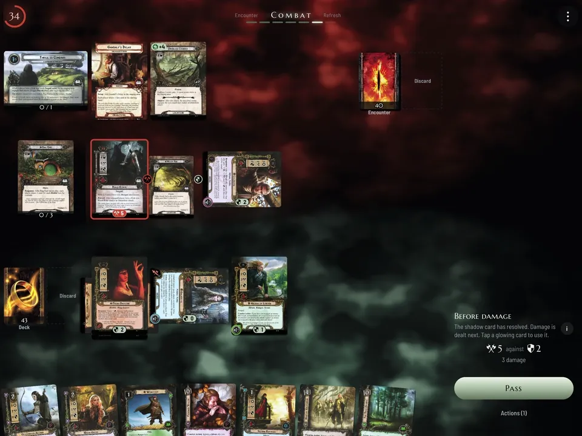
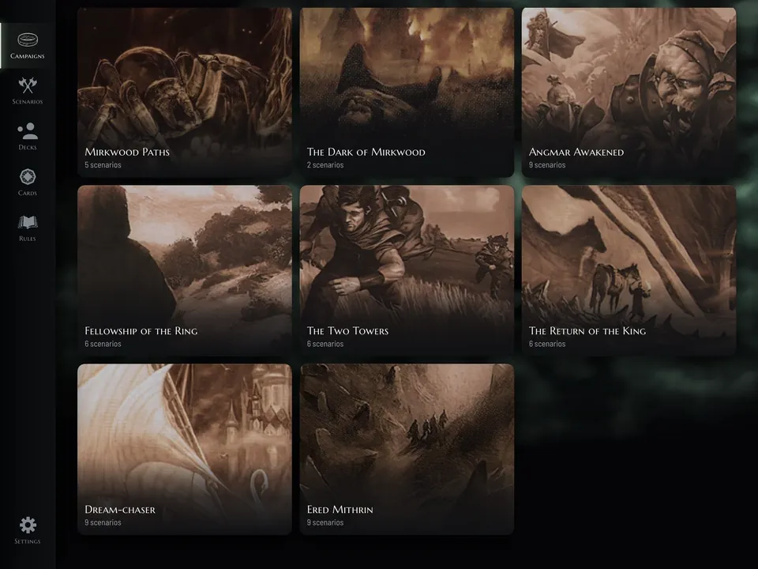
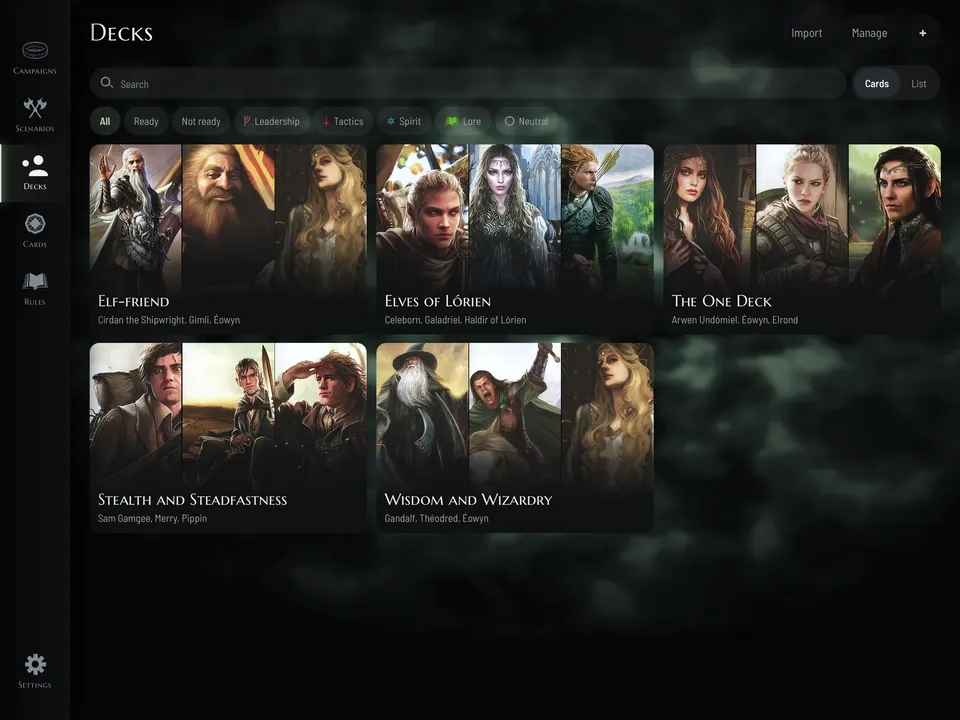
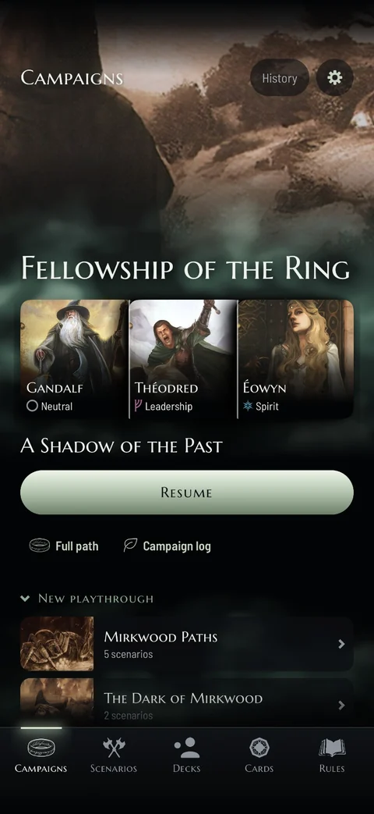
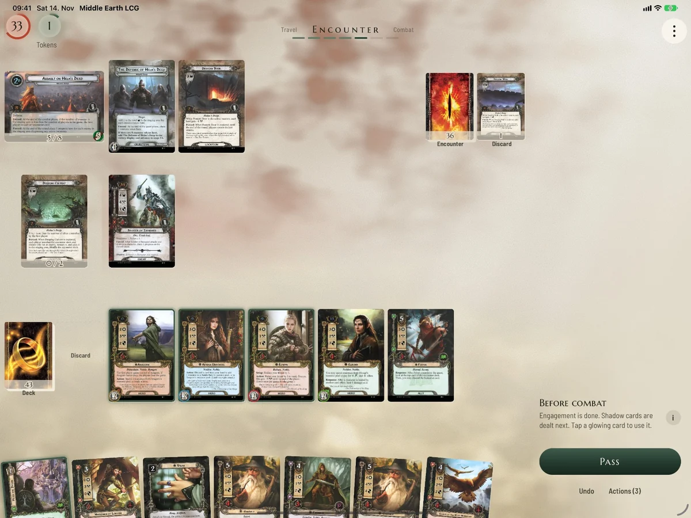

<div align="center">
  
  <h1>Middle-Earth Player</h1>
  <p><strong>The Lord of the Rings: The Card Game, solo, on your phone.</strong><br>Offline, private, free and open source.</p>
  <p>
    <a href="LICENSE"></a>
    <a href="https://www.bestpractices.dev/projects/16744"></a>
    <a href="https://github.com/j-jmnz/middle-earth-player/releases/latest"></a>
    <a href="https://github.com/j-jmnz/middle-earth-player/actions/workflows/test.yml"></a>
    <a href="ACCESSIBILITY.md#supported-features"></a>
    <a href="ACCESSIBILITY.md#target"></a>
  </p>
  <p>
    <a href="#install"><strong>Install</strong></a> ·
    <a href="#features"><strong>Features</strong></a> ·
    <a href="#private-by-design"><strong>Privacy</strong></a> ·
    <a href="#get-involved"><strong>Get involved</strong></a> ·
    <a href="#support"><strong>Support</strong></a>
  </p>
</div>

Middle-Earth Player lets you play The Lord of the Rings: The Card Game solo on an iPhone, iPad or Android phone. The app handles the rules, the encounter deck and the bookkeeping, so you can concentrate on your decisions.

> [!IMPORTANT]
> This is a fan-made, community-supported project. It is not an official app or client for The Lord of the Rings: The Card Game. It is not associated with, endorsed by, sponsored by or approved by Fantasy Flight Games (FFG), Asmodee or Middle-earth Enterprises in any way. All game content belongs to its owners.

<p align="center">
  
</p>

## Features

- **Play the official campaigns from start to finish.** Every scenario is set up, dealt and resolved for you, and the campaign log carries your boons, burdens and fallen heroes from one scenario to the next. Any scenario can also be played on its own.

  

- **Let the app run the rules.** The engine applies every rule and card effect and works out every number. You choose from the legal moves it offers, and Undo takes a move back.
- **Choose your challenge.** Play on Easy or Normal, and try Nightmare mode on the scenarios that have it.
- **Play true solo or two-handed.** Run one seat, or two seats on the same device.
- **Build your decks.** The deck builder has the full player-card pool and the official pre-built decks, and it imports any public deck from a RingsDB link.

  

- **Look things up without leaving the game.** The rules reference and the printed booklets are built in, along with a glossary you can open from the table.
- **See the cards.** Card art ships with the app, so nothing needs downloading.
- **Make it yours.** Choose a dark or light theme, the size of the interface, the animation speed and haptics, and look back over your run history.

### Themes

Ringwraiths is the dark theme, with Minas Morgul's pale green moonlight over a near-black table. Rivendell is the light theme, with warm parchment in morning sunlight. Pick one in Settings, or let the app follow your device.

<table>
  <tr>
    <th>Ringwraiths (dark)</th>
    <th>Rivendell (light)</th>
  </tr>
  <tr>
    <td align="center"></td>
    <td align="center"></td>
  </tr>
  <tr>
    <td align="center"></td>
    <td align="center"></td>
  </tr>
</table>

### Campaigns

All eight official campaigns from the revised, repackaged products are playable. They're listed here in the order the app shows them.

| Campaign | Product | Scenarios |
| --- | --- | --- |
| Mirkwood Paths | Revised Core Set and The Dark of Mirkwood | 5 |
| The Dark of Mirkwood | The Dark of Mirkwood | 2 |
| Angmar Awakened | Angmar Awakened Campaign Expansion | 9 |
| The Fellowship of the Ring | The Fellowship of the Ring Saga Expansion (MEC109) | 6 |
| The Two Towers | The Two Towers Saga Expansion (MEC112) | 6 |
| The Return of the King | The Return of the King Saga Expansion | 6 |
| Dream-chaser | Dream-chaser Campaign Expansion | 9 |
| Ered Mithrin | Ered Mithrin Campaign Expansion | 9 |

There is no online multiplayer, and there won't be: the app is built for one device.

## Private by design

There are no accounts, and the app does no tracking, shows no ads, and sends no analytics or crash reports. Cards, rules, booklets and card art all ship inside the app, so you can play anywhere. The only time it goes online is when you import a deck from RingsDB. Your saves live in the app's private storage and disappear when you delete the app. On Android the app asks for two permissions, `INTERNET` and `VIBRATE`; on iOS it asks for none.

You don't have to take this on trust. [PRIVACY.md](PRIVACY.md) is the full policy, and [SECURITY.md](SECURITY.md) names the code behind each of these promises, describes how the build and release pipeline is locked down, and explains how to report a vulnerability.

## Accessibility

You can play a full game with VoiceOver or TalkBack: with a screen reader on, the table turns into a list of zones and cards. Settings let you use that list table without a reader, and adjust text size, contrast, motion, how long banners and confirmations wait, and whether titles use a plain typeface. The app aims for WCAG 2.2 AA and the Game Accessibility Guidelines, but it hasn't been audited and makes no claim of conformance. [ACCESSIBILITY.md](ACCESSIBILITY.md) describes what is supported and the gaps that remain.

## Install

The app isn't on the Play Store or the App Store. On Android you install the APK from the [Releases page](https://github.com/j-jmnz/middle-earth-player/releases). On an iPhone or iPad you install the IPA through SideStore or AltStore, which sign it with your own Apple ID. It's free, and once it's installed it never needs a network connection.

### Requirements

- An Android phone running Android 7.0 or later, on a 64-bit processor.
- Or an iPhone or iPad running iOS or iPadOS 15.1 or later, a free Apple ID, and SideStore or AltStore Classic. You need a computer once, for the setup. AltStore also needs AltServer running on that computer to refresh the app each week.
- Wi-Fi, and free space of at least twice the download size.

### Android

1. On your phone, open the [latest release](https://github.com/j-jmnz/middle-earth-player/releases/latest), and under Assets tap `middle-earth-player-v<version>.apk`. You can ignore the `.sha256` file.
2. Open the download from your browser or your Files app.
3. If the phone asks, allow that app to install unknown apps (Settings, Allow from this source), then go back.
4. Tap Install. If Play Protect warns you, tap More details, then Install anyway.
5. Open Middle-Earth Player.

To update, install the newer `.apk` the same way and your saves carry over. Don't uninstall the old version first, because that deletes your saves.

#### Automatic updates with Obtainium

[Obtainium](https://obtainium.imranr.dev) is a free app that checks the Releases page for you and installs each new version as it comes out.

1. Install Obtainium from its [GitHub releases](https://github.com/ImranR98/Obtainium/releases/latest) or from F-Droid.
2. In Obtainium, tap Add App, paste `https://github.com/j-jmnz/middle-earth-player`, and tap Add.
3. Tap Install. If Middle-Earth Player is already on the phone, Obtainium picks it up and offers the next release as an update.

Obtainium checks in the background and tells you when an update is ready. On Android 12 or later it can install updates without asking each time, but only for apps it installed itself. Your saves carry over just as they do with a manual update.

### iPhone and iPad

1. Set up [SideStore](https://sidestore.io), which refreshes the app on the phone itself, or [AltStore Classic](https://altstore.io), which refreshes it through AltServer on a computer on the same Wi-Fi. AltStore PAL won't work, because it only installs apps from its own marketplace.
2. On iOS 16 and later, turn on Developer Mode (Settings, Privacy & Security) and restart.
3. In SideStore or AltStore, open Sources, tap +, and add `https://github.com/j-jmnz/middle-earth-player/releases/latest/download/source.json`.
4. Open the Middle-Earth Player source and tap Free or Get.

You can also download the `.ipa` from the [latest release](https://github.com/j-jmnz/middle-earth-player/releases/latest) in Safari and add it under My Apps, +.

An app signed with a free Apple ID stays valid for 7 days. SideStore and AltStore refresh it in the background, or you can tap Refresh All in My Apps. A free Apple ID allows 3 sideloaded apps at once, and SideStore or AltStore counts as one of them. Updates show up in the source and keep your saves, but deleting the app deletes them.

If a release's notes include a TestFlight link, you can use that instead: install [TestFlight](https://apps.apple.com/app/testflight/id899247664), open the link, tap Accept, then Install. TestFlight builds never need refreshing, but they expire 90 days after they are published.

### Check a download (optional)

Each release's notes give the APK's SHA-256 and the fingerprint of its signing certificate. You can check the file with `sha256sum` on Linux, `shasum -a 256` on macOS or `certutil -hashfile <file> SHA256` on Windows.

### If something goes wrong

- Android says "App not installed": the phone is 32-bit or older than Android 7.0, it is short of space, or a copy you built yourself is already installed. In the last case, uninstall that copy first, knowing its saves go with it.
- The download stops or won't open: download it again over Wi-Fi.
- On iOS, the app stops opening after a few days: its signature has expired. Refresh it in SideStore or AltStore, with AltServer running on the same Wi-Fi if you use AltStore.
- You've hit the app limit: remove a sideloaded app you no longer use.
- The TestFlight beta is full: use SideStore or AltStore instead.
- For anything else, [open an issue](https://github.com/j-jmnz/middle-earth-player/issues/new/choose) and include your device, its OS version and the app version shown in Settings.

## Roadmap

The goal is every official campaign and scenario, followed by the fan-made content from [A Long-extended Party](https://alongextendedparty.com) (ALeP).

With the official campaigns done, the cycles come next. A cycle is a group of scenarios that belongs to no campaign, so its scenarios are played standalone only. Each cycle waits under Coming later in the app until at least one of its scenarios is playable (`data/overrides.json`, campaigns). They come in release order, going by the US release of the product that starts each one:

<details>
<summary>The cycles, in order</summary>

- The Shadows of Mirkwood cycle: The Hunt for Gollum, Conflict at the Carrock, A Journey to Rhosgobel, The Hills of Emyn Muil, The Dead Marshes, Return to Mirkwood.
- The Standalone scenarios cycle: The Massing at Osgiliath, The Battle of Lake-town, The Stone of Erech, The Old Forest, Fog on the Barrow-downs, The Ruins of Belegost, Murder at the Prancing Pony, The Siege of Annúminas, Attack on Dol Guldur, The Wizard's Quest, The Woodland Realm, The Mines of Moria, Escape from Khazad-dûm, The Hunt for the Dreadnaught.
- The Dwarrowdelf cycle: Into the Pit, The Seventh Level, Flight from Moria, The Redhorn Gate, Road to Rivendell, The Watcher in the Water, The Long Dark, Foundations of Stone, Shadow and Flame.
- The Hobbit cycle (the two Hobbit saga boxes): "We Must Away, Ere Break of Day", Over the Misty Mountains Grim, Dungeons Deep and Caverns Dim, Flies and Spiders, The Lonely Mountain, The Battle of Five Armies.
- The Against the Shadow cycle: Peril in Pelargir, Into Ithilien, The Siege of Cair Andros, The Steward's Fear, The Drúadan Forest, Encounter at Amon Dîn, Assault on Osgiliath, The Blood of Gondor, The Morgul Vale.
- The Ring-maker cycle: The Fords of Isen, To Catch an Orc, Into Fangorn, The Dunland Trap, The Three Trials, Trouble in Tharbad, The Nîn-in-Eilph, Celebrimbor's Secret, The Antlered Crown.
- The Haradrim cycle: Escape from Umbar, Desert Crossing, The Long Arm of Mordor, The Mûmakil, Race Across Harad, Beneath the Sands, The Black Serpent, The Dungeons of Cirith Gurat, The Crossings of Poros.
- The Vengeance of Mordor cycle: The River Running, Danger in Dorwinion, The Temple of Doom, Wrath and Ruin, The City of Ulfast, Challenge of the Wainriders, Under the Ash Mountains, The Land of Sorrow, The Fortress of Nurn.

</details>

ALeP's content comes after all of these. [docs/phases/STATUS.md](docs/phases/STATUS.md) tracks the work in progress.

## Get involved

Middle-Earth Player is open source under the MIT License, and you don't need to write code to help.

- **Report a rules or card bug.** If a card or a ruling plays wrongly, the [Rules or card bug form](https://github.com/j-jmnz/middle-earth-player/issues/new?template=rules-bug.yml) asks for the card or rule and the printed source it comes from. These reports are the most useful thing a player can send.
- **Report an accessibility barrier.** The [accessibility form](https://github.com/j-jmnz/middle-earth-player/issues/new?template=accessibility.yml) asks for your device, assistive technology and what got in the way. Barriers are treated as bugs.
- **Report a bug or suggest a feature** through the [other issue forms](https://github.com/j-jmnz/middle-earth-player/issues/new/choose).
- **Contribute code or docs.** [CONTRIBUTING.md](CONTRIBUTING.md) explains how to get started and how a change lands, and everyone follows the [Code of Conduct](CODE_OF_CONDUCT.md).

Report security problems privately, as [SECURITY.md](SECURITY.md) describes, rather than in a public issue.

### AI-assisted development

Claude (Anthropic) writes most of the code, tests and docs in Claude Code. The maintainer directs that work: they set the product and its rules and decide what lands on `main`. Commits written this way name Claude as the author or in a `Co-Authored-By` line. The instructions the agents follow are in `CLAUDE.md`, `.claude/rules/` and `.claude/agents/`; you don't need them to contribute.

Nothing lands until CI passes the tests, lint, the type check and the data check. Rules come from the printed cards and booklets, and the engine code cites the id of each rule it implements.

### Project structure

- `data/` holds the card, scenario and rules data. It is committed and built offline from snapshots in `data/raw/`, and `data/sources.json` pins every source.
- `data/printed/` records the lines printed on each card, read from its scan. This is the card text the app uses.
- Each printed line is implemented by an effect record, generated in `src/effects/generated/` or hand-written in `src/effects/authored/`. A scenario becomes playable once every line it deals has a record.
- `src/rules/` is the rules engine: a pure reducer, split by mechanic family.
- When sources disagree, [.claude/rules/authority.md](./.claude/rules/authority.md) says which one wins.

The stack is Expo SDK 58, Expo Router, Skia, Reanimated, NativeWind, SQLite with Drizzle, Zustand and Zod. [docs/architecture.md](docs/architecture.md) goes into detail.

### Local setup

You need Node 22.18 or later and pnpm 10.34.1 (`corepack enable` installs the pinned version). `poppler` is optional: it renders the campaign, boon and burden cards from FFG's PDFs, and without it those cards fall back to their scans.

```bash
git clone https://github.com/j-jmnz/middle-earth-player.git
cd middle-earth-player
pnpm install
pnpm test        # no network or prebuilt database needed
pnpm web         # opens the app in a browser; narrow the window to phone width
```

Before you push, run `pnpm lint` and `pnpm typecheck` as well. [docs/development.md](docs/development.md) covers phone builds, the Maestro flows and every `pnpm` command.

### Documentation

- [docs/brief.md](docs/brief.md) records the product decisions and the rules as implemented.
- [docs/architecture.md](docs/architecture.md) covers the code layout, state, the engine and the tests.
- [docs/development.md](docs/development.md) covers running the app, the test flows and the commands.
- [docs/design-system.md](docs/design-system.md) and [docs/design-system-table.md](docs/design-system-table.md) describe the screens and the game table.
- [docs/releasing.md](docs/releasing.md) walks through the release pipeline.
- [docs/INDEX.md](docs/INDEX.md) is a generated index of every doc, section by section.

## Support

If you enjoy the app, you can support its development through [GitHub Sponsors](https://github.com/sponsors/j-jmnz) or [Ko-fi](https://ko-fi.com/jjmnz). Donations pay for development time and build costs, never for game content. Nothing is paywalled and supporters get no rewards: every build is the same, free for everyone. The app itself never asks for money.

## Attribution

The Lord of the Rings: The Card Game and all of its content are © Fantasy Flight Games. The Lord of the Rings and its characters and places are trademarks of Middle-earth Enterprises. Every source is pinned by URL and sha256 in `data/sources.json`.

| Resource | Source |
| --- | --- |
| Rules, rulebooks, FAQ, Easy Mode, campaign log, community decklists | [Fantasy Flight Games](https://www.fantasyflightgames.com/en/the-lord-of-the-rings-the-card-game/) PDFs |
| Campaign, boon and burden card pictures | FFG's print-and-play PDFs |
| Player cards and packs | [RingsDB](https://ringsdb.com) |
| Card data (encounter and quest cards, scenarios), card scans | [Hall of Beorn](https://hallofbeorn.com) |
| Card database, scenario lists, pre-built decks, game steps | [DragnCards LotR LCG plugin](https://github.com/seastan/dragncards-lotrlcg-plugin) by seastan |
| Card pictures | JvZijp's enhanced proxies ([Google Drive](https://drive.google.com/drive/folders/1jEy_yvRaPXGylPfilxhweQjffo9AZQsQ)), then u/LepcisMagna's 600 DPI scans on [lotr.cardgame.tools](https://lotr.cardgame.tools), then the card data sites above |
| Nightmare deck pictures and card lists | A community [Google Drive folder](https://drive.google.com/drive/folders/10pz9RF2e1QrJXqsmmLWPkO1Hu1auQuxB) |
| Game icons | RingsDB's icon font and DragnCards' token and card-back images; Dream-chaser symbols from the font in FFG's MEC111 rulebook |
| Fonts | [Barlow Semi Condensed](https://fonts.google.com/specimen/Barlow+Semi+Condensed) and [Marcellus SC](https://fonts.google.com/specimen/Marcellus+SC), SIL Open Font License (`assets/fonts/`) |

## License

The code and documentation are under the [MIT License](LICENSE). Game content, `data/raw/` and the fonts stay under their owners' terms; [THIRD_PARTY_NOTICES.md](THIRD_PARTY_NOTICES.md) has the details.
