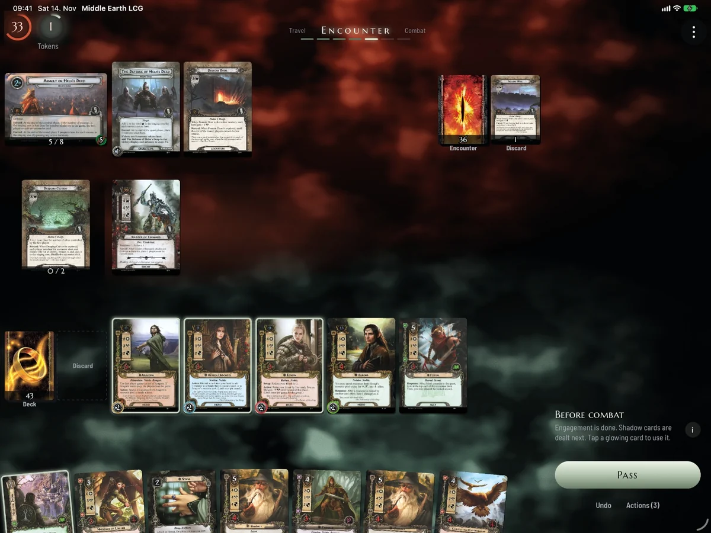

<h1 align="center">
  <picture>
    <source media="(prefers-color-scheme: dark)" srcset=".github/readme/banner-ringwraiths.webp">
    
  </picture>
</h1>

  <picture>
    <source media="(prefers-color-scheme: dark)" srcset=".github/readme/tagline-dark.png">
    
  </picture>

  
  
  

  <a href="https://github.com/j-jmnz/middle-earth-player/releases/latest/download/middle-earth-player-win-x64.exe">Windows .exe</a> ·
  <a href="https://github.com/j-jmnz/middle-earth-player/releases/latest/download/middle-earth-player-mac-universal.dmg">macOS .dmg</a> ·
  <a href="https://github.com/j-jmnz/middle-earth-player/releases/latest/download/middle-earth-player-linux-x64.AppImage">Linux .AppImage</a>
  (experimental) · <a href="guide/install.md">Install guide</a>

  
  
  

<strong>Play The Lord of the Rings: The Card Game solo on Android, iPhone, iPad, Windows, macOS or Linux. The app runs the rules, the encounter deck, the quests and the card effects.</strong>

> [!IMPORTANT]
> This is a fan-made project. It is not an official app, and it is not associated with, endorsed by, sponsored by or approved by Fantasy Flight Games (FFG), Asmodee or Middle-earth Enterprises. All game content belongs to its owners.

  

## What it does

<table>
  <tr>
    <td width="33%" valign="top"> <strong>Full campaigns</strong> Every scenario is set up and dealt for you. The campaign log carries boons, burdens and fallen heroes forward. Any scenario also plays on its own.</td>
    <td width="33%" valign="top"> <strong>The app runs the rules</strong> It applies every card effect and works out every number. You pick a legal move. Undo takes it back.</td>
    <td width="33%" valign="top"> <strong>Easy, Normal or Nightmare</strong> Nightmare where a scenario has it. Play one hand, or two on the same device.</td>
  </tr>
  <tr>
    <td valign="top"> <strong>Deck builder</strong> Every player card, the official pre-built decks, and import from a RingsDB link.</td>
    <td valign="top"> <strong>Rules at hand</strong> The rules reference, the printed booklets and a glossary, open from the table. Every card picture comes with the app.</td>
    <td valign="top"> <strong>Screen readers</strong> With a screen reader on, the table becomes a list of zones and cards. Mouse and keyboard work on a computer.</td>
  </tr>
</table>

<table>
  <tr>
    <td width="50%"></td>
    <td width="50%"></td>
  </tr>
  <tr>
    <td align="center">A campaign's path</td>
    <td align="center">The deck builder</td>
  </tr>
</table>

### Two themes

Ringwraiths is the dark theme: pale green moonlight over a black table. Rivendell is the light one: warm parchment. Pick one in Settings, or follow your device. You can also pick the interface size, the animation speed and haptics, and see your past games.

<table>
  <tr>
    <td width="66%" align="center"></td>
    <td width="34%" align="center"></td>
  </tr>
</table>

<strong>See the Rivendell theme (light)</strong>

 
<table>
  <tr>
    <td width="66%" align="center"></td>
    <td width="34%" align="center"></td>
  </tr>
</table>

## What you can play

<table>
  <tr>
    <th width="33%">Sagas</th>
    <th width="33%">Campaigns</th>
    <th width="33%">Cycles</th>
  </tr>
  <tr>
    <td valign="top">The Hobbit The Fellowship of the Ring The Two Towers The Return of the King</td>
    <td valign="top">Mirkwood Paths The Dark of Mirkwood Angmar Awakened Dream-chaser Ered Mithrin</td>
    <td valign="top">Shadows of Mirkwood Dwarrowdelf Against the Shadow Standalone scenarios</td>
  </tr>
</table>

The Hobbit and the cycles have no campaign, so you play their scenarios one at a time from the Scenarios tab. The [roadmap](guide/roadmap.md) lists what comes next. There is no online multiplayer, and there won't be: the app is built for one device.

## Private by design

<table>
  <tr>
    <td width="33%" valign="top"><strong>No accounts, no tracking</strong> No ads, no analytics, no crash reports.</td>
    <td width="33%" valign="top"><strong>Everything is inside</strong> Cards, rules, booklets and art. The app goes online only to import a RingsDB deck and to check once a day for a new version (Settings turns that off).</td>
    <td width="33%" valign="top"><strong>Your saves stay with you</strong> On your device, never on a server. On Android the app asks for two permissions, <code>INTERNET</code> and <code>VIBRATE</code>; on iOS and desktop, none.</td>
  </tr>
</table>

[PRIVACY.md](PRIVACY.md) is the full policy. [SECURITY.md](SECURITY.md) shows the code behind each promise, how releases are built, and how to report a vulnerability.

## Guides

| Guide | What it holds |
| --- | --- |
| [Install](guide/install.md) | Every platform, step by step, and what to do if something goes wrong |
| [Check a download](guide/install.md#check-a-download-optional) | The SHA-256 of every file and the Android signing certificate |
| [FAQ](guide/questions.md) | Hidden gestures, settings that are off by default, and where to find things |
| [Accessibility](ACCESSIBILITY.md) | Screen readers, text size, contrast and motion: what works and what doesn't yet |
| [Roadmap](guide/roadmap.md) | The next cycles and the fan-made scenarios, in order |
| [Attribution](guide/attribution.md) | Where every card, rule and picture comes from |

## Get involved

The app is open source under the MIT License. You don't need to code to help.

- **Rules or card bug:** use the [Rules or card bug form](https://github.com/j-jmnz/middle-earth-player/issues/new?template=rules-bug.yml). Name the card or rule and where it's printed. These reports help most.
- **Accessibility barrier:** use the [accessibility form](https://github.com/j-jmnz/middle-earth-player/issues/new?template=accessibility.yml). Barriers are treated as bugs.
- **Other bugs and ideas:** use the [other issue forms](https://github.com/j-jmnz/middle-earth-player/issues/new/choose).
- **Talk with other players:** join the [Discord server](https://discord.gg/9tY2jVy32).
- **Code or docs:** start with [CONTRIBUTING.md](CONTRIBUTING.md). Everyone follows the [Code of Conduct](CODE_OF_CONDUCT.md).

Report security problems privately, as [SECURITY.md](SECURITY.md) says, not in a public issue.

## Support

If you enjoy the app, you can support it through [GitHub Sponsors](https://github.com/sponsors/j-jmnz) or [Ko-fi](https://ko-fi.com/jjmnz). Donations pay for development time and build costs, never for game content. Supporters get no rewards and nothing is paywalled: every build is free and the same for everyone. The app never asks for money.

## License

The code and docs are under the [MIT License](LICENSE). The Lord of the Rings: The Card Game and all its content are © Fantasy Flight Games; The Lord of the Rings and its characters and places are trademarks of Middle-earth Enterprises. Game content, `data/raw/` and the fonts stay under their owners' terms; see [THIRD_PARTY_NOTICES.md](THIRD_PARTY_NOTICES.md) and the [attribution](guide/attribution.md).

  
  
  
  

