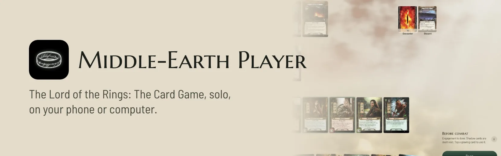
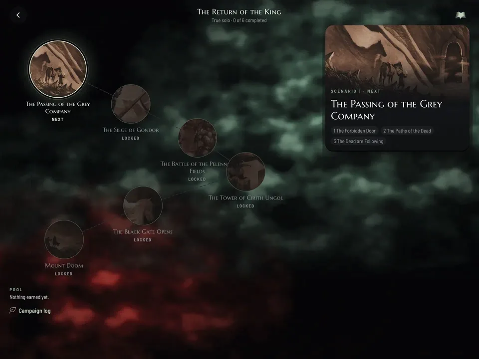
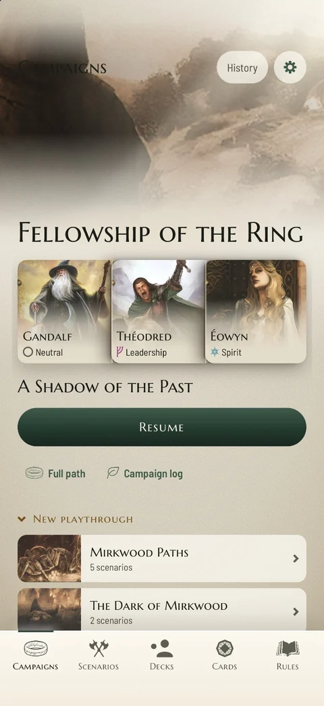

<h1 align="center">
  <picture>
    <source media="(prefers-color-scheme: dark)" srcset=".github/readme/banner-ringwraiths.webp">
    
  </picture>
</h1>

  
<strong>Offline, private, free and open source.</strong>

  

    
    
    
    
    
  

  

    <a href="#install"><strong>Install</strong></a> ·
    <a href="#features"><strong>Features</strong></a> ·
    <a href="#private-by-design"><strong>Privacy</strong></a> ·
    <a href="#faq"><strong>FAQ</strong></a> ·
    <a href="#get-involved"><strong>Get involved</strong></a> ·
    <a href="#support"><strong>Support</strong></a>
  

  

    
  

  

    
    
    
    
    
    
  

> [!IMPORTANT]
> This is a fan-made project. It is not an official app, and it is not associated with, endorsed by, sponsored by or approved by Fantasy Flight Games (FFG), Asmodee or Middle-earth Enterprises. All game content belongs to its owners.

Play The Lord of the Rings: The Card Game solo on Android, iPhone, iPad, Windows, macOS or Linux. The app runs the rules, the encounter deck, the quests and the card effects.

  

<table>
  <tr>
    <td width="50%"></td>
    <td width="50%"></td>
  </tr>
  <tr>
    <td align="center">A campaign's path</td>
    <td align="center">The deck builder</td>
  </tr>
</table>

## Features

<table>
  <tr>
    <td width="50%" valign="top"><strong>Full campaigns</strong> Every scenario is set up and dealt for you. The campaign log carries boons, burdens and fallen heroes forward. Any scenario also plays on its own.</td>
    <td width="50%" valign="top"><strong>The app runs the rules</strong> It applies every card effect and works out every number. You pick a legal move. Undo takes it back.</td>
  </tr>
  <tr>
    <td valign="top"><strong>Easy, Normal or Nightmare</strong> Nightmare where a scenario has it. Play one hand, or two on the same device.</td>
    <td valign="top"><strong>Deck builder</strong> Every player card, the official pre-built decks, and import from a RingsDB link.</td>
  </tr>
  <tr>
    <td valign="top"><strong>Rules at hand</strong> The rules reference, the printed booklets and a glossary, open from the table.</td>
    <td valign="top"><strong>Card art included</strong> Every picture comes with the app. Nothing to download.</td>
  </tr>
  <tr>
    <td valign="top"><strong>Mouse and keyboard</strong> Hover lifts a card and right click previews it. Escape closes a panel. Z is Undo.</td>
    <td valign="top"><strong>Screen readers</strong> With a screen reader on, the table becomes a list of zones and cards.</td>
  </tr>
</table>

You can also pick the theme, the interface size, the animation speed and haptics, and see your past games.

### Themes

Ringwraiths is the dark theme: pale green moonlight over a black table. Rivendell is the light one: warm parchment. Pick one in Settings, or follow your device.

<table>
  <tr>
    <th>Ringwraiths (dark)</th>
    <th>Rivendell (light)</th>
  </tr>
  <tr>
    <td align="center"></td>
    <td align="center"></td>
  </tr>
</table>

## What you can play

All eight official campaigns from the revised products, in the order the app lists them. A cycle has no campaign, so you play its scenarios one at a time from the Scenarios tab.

| Campaign or cycle | Product | Scenarios |
| --- | --- | --- |
| Mirkwood Paths | Revised Core Set and The Dark of Mirkwood | 5 |
| The Dark of Mirkwood | The Dark of Mirkwood | 2 |
| Angmar Awakened | Angmar Awakened Campaign Expansion | 9 |
| The Fellowship of the Ring | The Fellowship of the Ring Saga Expansion (MEC109) | 6 |
| The Two Towers | The Two Towers Saga Expansion (MEC112) | 6 |
| The Return of the King | The Return of the King Saga Expansion | 6 |
| Dream-chaser | Dream-chaser Campaign Expansion | 9 |
| Ered Mithrin | Ered Mithrin Campaign Expansion | 9 |
| Shadows of Mirkwood (cycle) | The Hunt for Gollum to Return to Mirkwood (six Adventure Packs) | 6 |
| Standalone scenarios (cycle) | The scenarios printed on their own, The Massing at Osgiliath to The Hunt for the Dreadnaught | 14 |

There is no online multiplayer, and there won't be. The app is built for one device.

## Private by design

No accounts, no tracking, no ads, no analytics, no crash reports. Cards, rules, booklets and art are all inside the app. It goes online only to import a RingsDB deck and, once a day, to ask GitHub whether a new version is out (Settings turns that off).

Your saves stay on your device. A phone deletes them with the app; a computer keeps them in the app's profile folder until you delete it. On Android the app asks for two permissions, `INTERNET` and `VIBRATE`. On iOS and desktop it asks for none.

[PRIVACY.md](PRIVACY.md) is the full policy. [SECURITY.md](SECURITY.md) shows the code behind each promise, how releases are built, and how to report a vulnerability.

## Accessibility

You can play a whole game with a screen reader: VoiceOver, TalkBack, NVDA, Narrator or Orca. The table becomes a list of zones and cards. You can also turn on the list without a reader, and change text size, contrast, motion, how long messages stay, and the title typeface.

The app aims for WCAG 2.2 AA and the Game Accessibility Guidelines. It hasn't been audited, so it claims no conformance. [ACCESSIBILITY.md](ACCESSIBILITY.md) lists what works and what doesn't yet.

## Install

The app isn't in any app store. Get it from the [Releases page](https://github.com/j-jmnz/middle-earth-player/releases). It's free and works offline once installed.

| Platform | You need | Download |
| --- | --- | --- |
| Android | Android 7.0 or later, 64-bit | `.apk` |
| iPhone, iPad | iOS 15.1 or later, a free Apple ID, and SideStore or AltStore Classic. A computer once, for setup. | `source.json` or `.ipa` |
| Windows (experimental) | 64-bit | `.exe` installer or portable `.zip` |
| macOS (experimental) | Apple silicon or Intel | `.dmg` |
| Linux (experimental) | 64-bit x86 | `.AppImage` or `.deb` |

Use Wi-Fi, and have twice the download size free. The desktop downloads are large because every card picture and booklet is inside.

<strong>Android</strong>

1. On your phone, open the [latest release](https://github.com/j-jmnz/middle-earth-player/releases/latest). Under Assets, tap `middle-earth-player-v<version>.apk`. Skip the `.sha256` file.
2. Open the download.
3. If asked, allow your browser or Files app to install apps, then go back.
4. Tap Install. If Play Protect warns you, tap More details, then Install anyway.

To update, install the new `.apk` the same way. Your saves stay. Don't uninstall first: that deletes your saves.

<strong>Automatic Android updates with Obtainium</strong>

[Obtainium](https://obtainium.imranr.dev) is a free app that installs each new release for you.

1. Install Obtainium from its [GitHub releases](https://github.com/ImranR98/Obtainium/releases/latest) or F-Droid.
2. On your phone, tap [Add to Obtainium](https://apps.obtainium.imranr.dev/redirect?r=obtainium://app/%7B%22id%22%3A%22com.middleearth.player%22%2C%22url%22%3A%22https%3A%2F%2Fgithub.com%2Fj-jmnz%2Fmiddle-earth-player%22%2C%22author%22%3A%22j-jmnz%22%2C%22name%22%3A%22Middle-Earth%20Player%22%7D). If that doesn't open Obtainium, open it yourself, tap Add App, paste `https://github.com/j-jmnz/middle-earth-player` and tap Add.
3. Tap Install. If the app is already installed, Obtainium picks it up.

Obtainium checks in the background. On Android 12 or later it can update without asking, for apps it installed itself. Your saves stay.

<strong>iPhone and iPad</strong>

1. Set up [SideStore](https://sidestore.io), which refreshes the app on the phone, or [AltStore Classic](https://altstore.io), which refreshes it from AltServer on a computer on the same Wi-Fi. AltStore PAL won't work.
2. On iOS 16 or later, turn on Developer Mode (Settings, Privacy & Security) and restart.
3. In SideStore or AltStore, open Sources, tap +, and add `https://github.com/j-jmnz/middle-earth-player/releases/latest/download/source.json`.
4. Open the Middle-Earth Player source and tap Free or Get.

Or download the `.ipa` from the [latest release](https://github.com/j-jmnz/middle-earth-player/releases/latest) in Safari and add it under My Apps, +.

A free Apple ID signs the app for 7 days. SideStore and AltStore refresh it in the background, or tap Refresh All in My Apps. A free Apple ID allows 3 sideloaded apps, SideStore or AltStore included. Updates appear in the source and keep your saves. Deleting the app deletes them.

If a release's notes have a TestFlight link, you can use that instead: install [TestFlight](https://apps.apple.com/app/testflight/id899247664), open the link, tap Accept, then Install. TestFlight builds never need refreshing but expire after 90 days.

<strong>Windows, macOS and Linux</strong> (experimental)

> [!WARNING]
> The desktop apps are experimental. They are newer and less tested than the phone apps, so expect rough edges. If something breaks, [open an issue](https://github.com/j-jmnz/middle-earth-player/issues/new/choose) with your OS and the app version from Settings.

The desktop apps aren't signed by Microsoft or Apple, so the first launch shows a warning. Download your file from Assets on the [latest release](https://github.com/j-jmnz/middle-earth-player/releases/latest):

- **Windows:** run `middle-earth-player-v<version>-win-x64.exe`. When SmartScreen says "Windows protected your PC", choose More info, then Run anyway. Or unzip the portable `-win-x64.zip` anywhere and run `Middle-Earth Player.exe`.
- **macOS:** open `middle-earth-player-v<version>-mac-universal.dmg` and drag the app to Applications. The first time, right-click it and choose Open twice. On macOS 15 or later, try to open it once, then choose Open Anyway in System Settings, Privacy & Security.
- **Linux:** run `chmod +x` on `middle-earth-player-v<version>-linux-x64.AppImage`, then run it. Or install the `.deb`, for example `sudo apt install ./middle-earth-player-v<version>-linux-x64.deb`.

Saves stay on that computer ([PRIVACY.md](PRIVACY.md) says where). To update, install the new release over the old one. To move or copy your campaigns, use Settings, Back up saves, then Restore from a backup on the other computer. The app never updates itself.

<strong>Check a download (optional)</strong>

Each release lists the SHA-256 of every file, with a `.sha256` file beside each download, and the APK's signing certificate fingerprint. Check a file with `sha256sum` on Linux, `shasum -a 256` on macOS or `certutil -hashfile <file> SHA256` on Windows.

<strong>If something goes wrong</strong>

- **Android says "App not installed":** the phone is 32-bit or older than Android 7.0, it's short of space, or a copy you built yourself is installed. Uninstall that copy first; its saves go with it.
- **The download stops or won't open:** download it again over Wi-Fi.
- **Mac says the app "can't be opened" or "is damaged":** right-click it and choose Open. If that fails, run `xattr -dr com.apple.quarantine /Applications/Middle-Earth\ Player.app` in Terminal once.
- **The Linux AppImage won't start:** install FUSE 2 (`libfuse2`), or run it with `--appimage-extract-and-run`.
- **The iOS app stops opening after a few days:** its signature expired. Refresh it in SideStore or AltStore (with AltServer running, for AltStore).
- **You've hit the 3-app limit:** remove a sideloaded app you don't use.
- **The TestFlight beta is full:** use SideStore or AltStore.
- **Anything else:** [open an issue](https://github.com/j-jmnz/middle-earth-player/issues/new/choose) with your device, its OS version and the app version from Settings.

## FAQ

Things that are easy to miss: hidden gestures, settings that are off by default, and where to find things.

### At the table

How do I see a card's damage, attachments and effects?

Long-press the card (right-click on a computer). The large view lists the tokens on it, the effects on it, and why a hand card can't be played now. If it has attachments or shadow cards, or it's a quest stage with earlier stages, swipe sideways on the card to step through them.

How do I see my whole hand at once?

Press and hold on your hand for a moment, then slide. The hand rises and fans out, and the card under your finger lifts. On a computer, rest the mouse over the hand, and use the wheel to step through the cards.

Why do some buttons need two taps?

A button that acts with nothing picked first (Pass, End planning, Leave undefended, Keep and similar) asks for a second tap, and the line above it says what the second tap does. Settings, Confirm time sets how long it waits; No limit waits until you tap again.

How far back can Undo go?

Back to the last time something hidden was shown: a card drawn, revealed or dealt as a shadow. Each tap takes back one more choice. Z (or Ctrl+Z, Cmd+Z) is Undo on a computer.

Where does the staging threat come from?

In the Quest phase, tap the quest meter (the two bars above the dock). It lists every card adding threat, highest first, and any other effects.

Which enemies will engage me?

The small ticks on your threat dial mark each staging enemy's engagement cost. Tap your dial to open the threat panel, which says what the engagement checks would do with each enemy right now.

In two-handed play, how do I see the other player's cards?

Tap the other seat's threat dial. You can look at that seat's hand, play area, enemies, deck and discard pile. It's only a view: the acting seat doesn't change. Tap Back to Player 1, or your own dial, to return.

What does the small struck ring on a card mean?

The card has a line the app doesn't apply yet. Its large view lists those lines under Not applied. In the Cards tab, the Applied only chip hides such cards.

Can the game stop asking me to pass?

Tap the phase rail at the top of the table. Turn Stops on, then pick the steps you want to stop at. Every other action window is passed for you, unless a card you can use there is new. Planning, the quest commit and Responses always ask. Pass to stop (the gold button) passes until the next stop, or until planning.

Can a free Response play itself?

Yes. A Response with no cost and nothing to choose offers Always use. To be asked again, tap it under Settings, Responses used every time.

Where can I read a banner I missed?

Open Log from the table menu (the three dots). It keeps every step of the round with its cause. If the banner closes too soon for you, set Settings, Banner closes to When tapped. Swipe a banner sideways or up to dismiss it.

Where is the scenario's setup card?

Table menu, Setup card. On Nightmare the Nightmare setup card sits beside it. The same menu holds Rules, Booklet, Table settings and Resign.

A card says it can be played from my discard pile. Where is it?

When you can play it, the discard pile glows. Tap the pile and the card is first in the list.

How do I skip the combat replay?

Tap it. To turn it off, switch off Settings, Combat spotlight. Reduce motion set to Always turns it off too.

### Settings worth knowing

Where are the settings during a game?

Table menu, Table settings. All settings at the end of that panel opens the full page and returns you to the table.

What does each step of the round mean?

The First-game guide (on by default) adds a hint under the step title the first two times each step comes up. Explain timing words (off by default) adds a chip to a card's large view for each timing word on it, such as Response, Forced or Travel. Tap the chip for its rule.

What if the table stutters or the device runs hot?

Under Performance, set Card pictures to Low and switch off Moving fog. Neither changes the game. Reduce motion set to Always also lowers the load.

Can the animations go faster, or slower?

Animation speed: Quick shortens animations and skips the phase title. Slow makes them one and a half times as long.

Why does the screen stay on during a game?

Keep screen awake is on by default. Switch it off in Settings, At the table.

How do I make the text easier to read?

UI scale changes text, buttons and cards, the table included. Title face set to Plain draws titles and numbers in the plain text face, which is easier to read. Strong outlines thickens the outlines on effect marks and token counts.

Can I play with the table as text, without a screen reader?

Yes. Set Table as a list to Always. On a computer it's also the way to play with the keyboard alone.

Does Restore defaults touch my games?

No. It resets the settings only; your games and decks stay.

### Decks and cards

What can I import from RingsDB?

Tap Import on the Decks tab and paste a decklist link or its number. You can also import your own RingsDB deck while you have it shared.

How do I reorder my decks?

Long-press a deck and drag it. Or tap Manage and use Move up and Move down. Manage also has Duplicate, Delete and Reset for the pre-built decks.

How does the card search work?

It matches names, traits, types, spheres and card text, ignores accents, and forgives a one-letter slip in longer names. Filter narrows by pack, trait and cost.

Can I browse a pack, encounter cards included?

Yes: Packs, at the top of the Cards tab.

Is there a side deck?

Yes. While adding cards to a deck, switch between Deck and Side deck above the search.

### Campaigns, saves and updates

Can I change from True solo to Two-handed mid-campaign?

No. The seat count is set when a playthrough starts.

Can I carry cards from one campaign into the next?

Yes. When a finished playthrough holds cards for a new campaign, its setup offers the carry-over. Carry nothing over is chosen by default.

Where are my finished, archived or deleted games?

History, on the Campaigns and Scenarios tabs, holds every playthrough and game with its runs: the result, rounds, threat, score and time played. Tap Manage, or long-press a card, to archive, restore or delete it. A delete asks twice and can't be undone; your decks stay.

What if an update changed the rules my game was dealt on?

Pick Continue to play on from where you were. The app replays your moves on the new rules as far as they still match, and says how many it takes back. Restart deals the scenario again with the same decks. Leaving the sheet changes nothing, and it shows again next time.

How do I spend XP in Dream-chaser?

From the campaign path, between scenarios, tap Spend XP. Nothing is spent until you tap Mark, and Undo takes back a pick before that.

How do I back up my saves?

On a computer, Settings, Back up saves writes one file. Restore from a backup replaces every campaign, game, deck and setting with the file's. A phone uses its own system backup.

How do I stop the update check?

Switch off Settings, Check for new versions. The app then never goes online except to import a RingsDB deck.

Which keys work on a computer?

Escape closes the top panel or the large view. Z, Ctrl+Z or Cmd+Z is Undo. Right click opens a card's large view. In a booklet, the arrow keys, Page Up and Page Down, Space, Home and End turn pages, + and − zoom, and Escape closes it.

## Roadmap

Every official campaign and scenario, then the fan-made ones: first the content from [A Long-extended Party](https://alongextendedparty.com) (ALeP), then the other community projects listed below.

The official campaigns are done, so the cycles are next. Shadows of Mirkwood and Dwarrowdelf are playable: fifteen scenarios, each on Easy, Normal and Nightmare. The Standalone scenarios cycle has all its fourteen scenarios, The Massing at Osgiliath, The Battle of Lake-town, The Stone of Erech, The Old Forest, Fog on the Barrow-downs, The Ruins of Belegost, Murder at the Prancing Pony, The Siege of Annúminas, Attack on Dol Guldur, The Wizard's Quest, The Woodland Realm, The Mines of Moria, Escape from Khazad-dûm and The Hunt for the Dreadnaught, on Easy and Normal (none has a Nightmare deck). The scenarios and cycles not built yet show under Coming later in the app. They come in release order:

Incoming cycles, in order of implementation

- The Hobbit cycle (the two Hobbit saga boxes): "We Must Away, Ere Break of Day", Over the Misty Mountains Grim, Dungeons Deep and Caverns Dim, Flies and Spiders, The Lonely Mountain, The Battle of Five Armies.
- The Against the Shadow cycle: Peril in Pelargir, Into Ithilien, The Siege of Cair Andros, The Steward's Fear, The Drúadan Forest, Encounter at Amon Dîn, Assault on Osgiliath, The Blood of Gondor, The Morgul Vale.
- The Ring-maker cycle: The Fords of Isen, To Catch an Orc, Into Fangorn, The Dunland Trap, The Three Trials, Trouble in Tharbad, The Nîn-in-Eilph, Celebrimbor's Secret, The Antlered Crown.
- The Haradrim cycle: Escape from Umbar, Desert Crossing, The Long Arm of Mordor, The Mûmakil, Race Across Harad, Beneath the Sands, The Black Serpent, The Dungeons of Cirith Gurat, The Crossings of Poros.
- The Vengeance of Mordor cycle: The River Running, Danger in Dorwinion, The Temple of Doom, Wrath and Ruin, The City of Ulfast, Challenge of the Wainriders, Under the Ash Mountains, The Land of Sorrow, The Fortress of Nurn.

The fan-made scenarios follow the official ones. None is playable yet, and their cards are not in the app until then.

Fan-made scenarios, in order of implementation

- ALeP's Oaths of the Rohirrim cycle: Ambush at Erelas, The Battle for the Beacon and The Horse Lord's Ire (the Children of Eorl box), then The Aldburg Plot, Fire on the Eastemnet, The Gap of Rohan, The Glittering Caves, Mustering of the Rohirrim, Blood in the Isen.
- ALeP's standalone scenarios: The Scouring of the Shire, The Nine are Abroad, The Siege of Erebor, The Hobbit, The Mirror of Galadriel.
- ALeP's Fell Summer cycle: Pies for the Party, Sundown on the Shire and Secrets of the Old Forest (The Shire's Reckoning box), then Strange News in Bree, Fangs in the Dark, The Brandywine Pursuit, and the three packs ALeP has yet to release.
- [First Age](https://talesfromthecards.wordpress.com/first-age/), by Ian of Tales from the Cards: The Isle of Werewolves, The Seat of Morgoth and Hunting of the Wolf, then its Doom Mastered cycle: Trial Upon the Marches, Among the Outlaws, The Betrayal of Mîm, The Fall of Nargothrond.
- [Legacy of Fëanor](https://www.facebook.com/LegacyofFeanor): Skirmish in the Shire, Down the Baranduin and Dwarf Lord Battle, then its Fate of the Stone cycle as it is released.
- Scenarios shared on BoardGameGeek and community sites, once a source the app can read holds their cards: MJ Newman's five ([Ruins of Nan Wathren](https://boardgamegeek.com/thread/689740), [The Bandits of Chetwood North](https://boardgamegeek.com/thread/703809), [The Culling at the Barrow Downs](https://boardgamegeek.com/thread/710317), [Raid on the River Carnen](https://boardgamegeek.com/thread/805266), [The Fall of Dale](https://boardgamegeek.com/thread/818448)), [Ninjadorg's Mirkwood trilogy](https://boardgamegeek.com/filepage/66659/ninjadorgs-lotr-lcg-scenarios), [A Light in the East](https://sites.google.com/view/where-the-stars-are-strange/the-lord-of-the-rings-lcg/a-light-in-the-east-deluxe-expansion), [Defiance of the East](https://superior-realities.com/2022/10/21/defiance-of-the-east-a-fan-made-expansion-for-lord-of-the-rings-lcg/), [The Battle of the Last Alliance](https://boardgamegeek.com/filepage/200071/lotr-lcg-last-alliance-custom-scenario) and [Dragon Hunting](https://boardgamegeek.com/thread/1906141/stand-alone-dragon-hunting-map-mechanic).

[docs/phases/STATUS.md](docs/phases/STATUS.md) tracks the work in progress.

## Get involved

The app is open source under the MIT License. You don't need to code to help.

- **Rules or card bug:** use the [Rules or card bug form](https://github.com/j-jmnz/middle-earth-player/issues/new?template=rules-bug.yml). Name the card or rule and where it's printed. These reports help most.
- **Accessibility barrier:** use the [accessibility form](https://github.com/j-jmnz/middle-earth-player/issues/new?template=accessibility.yml). Barriers are treated as bugs.
- **Other bugs and ideas:** use the [other issue forms](https://github.com/j-jmnz/middle-earth-player/issues/new/choose).
- **Code or docs:** start with [CONTRIBUTING.md](CONTRIBUTING.md). Everyone follows the [Code of Conduct](CODE_OF_CONDUCT.md).

Report security problems privately, as [SECURITY.md](SECURITY.md) says, not in a public issue.

## Support

If you enjoy the app, you can support it through [GitHub Sponsors](https://github.com/sponsors/j-jmnz) or [Ko-fi](https://ko-fi.com/jjmnz). Donations pay for development time and build costs, never for game content. Supporters get no rewards and nothing is paywalled: every build is free and the same for everyone. The app never asks for money.

## Attribution

The Lord of the Rings: The Card Game and all its content are © Fantasy Flight Games. The Lord of the Rings and its characters and places are trademarks of Middle-earth Enterprises. `data/sources.json` pins every source by URL and sha256.

| Resource | Source |
| --- | --- |
| Rules, rulebooks, FAQ, Easy Mode, campaign log, community decklists | [Fantasy Flight Games](https://www.fantasyflightgames.com/en/the-lord-of-the-rings-the-card-game/) PDFs |
| Campaign, boon and burden card pictures | FFG's print-and-play PDFs |
| Player cards and packs | [RingsDB](https://ringsdb.com) |
| Card data (encounter and quest cards, scenarios), card scans | [Hall of Beorn](https://hallofbeorn.com) |
| Card database, scenario lists, pre-built decks, game steps | [DragnCards LotR LCG plugin](https://github.com/seastan/dragncards-lotrlcg-plugin) by seastan |
| Card pictures | JvZijp's enhanced proxies ([Google Drive](https://drive.google.com/drive/folders/1jEy_yvRaPXGylPfilxhweQjffo9AZQsQ)), then u/LepcisMagna's 600 DPI scans on [lotr.cardgame.tools](https://lotr.cardgame.tools), then the card data sites above |
| Nightmare deck pictures and card lists | A community [Google Drive folder](https://drive.google.com/drive/folders/10pz9RF2e1QrJXqsmmLWPkO1Hu1auQuxB) |
| Game icons | RingsDB's icon font and DragnCards' token and card-back images; Dream-chaser symbols from the font in FFG's MEC111 rulebook |
| Fonts | [Barlow Semi Condensed](https://fonts.google.com/specimen/Barlow+Semi+Condensed) and [Marcellus SC](https://fonts.google.com/specimen/Marcellus+SC), SIL Open Font License (`assets/fonts/`) |

## License

The code and docs are under the [MIT License](LICENSE). Game content, `data/raw/` and the fonts stay under their owners' terms; see [THIRD_PARTY_NOTICES.md](THIRD_PARTY_NOTICES.md).
