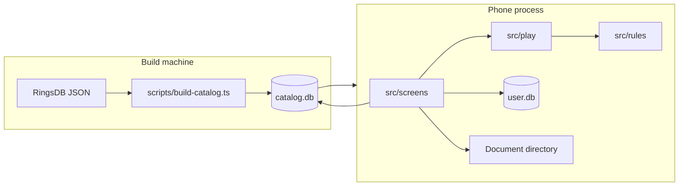
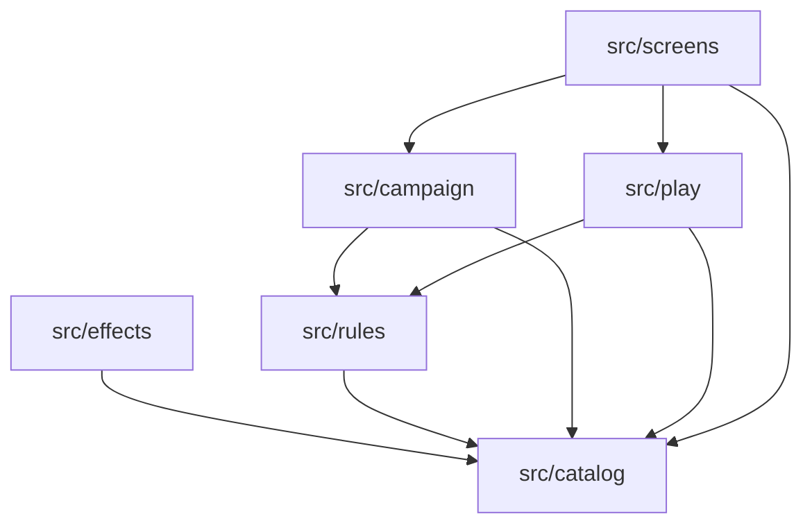
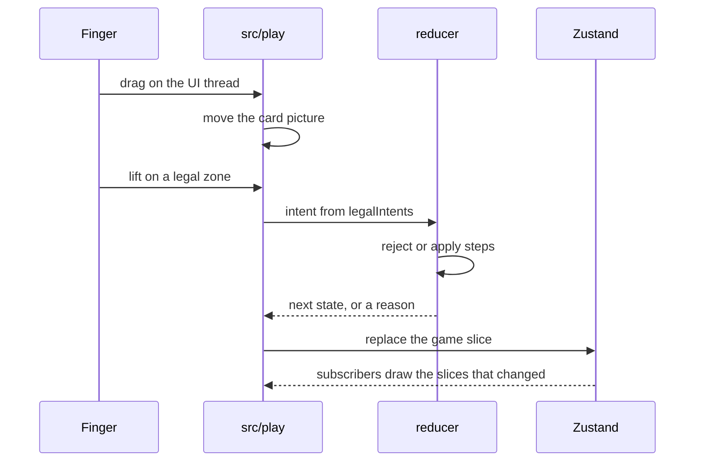

# Architecture

Structural design for the solo Lord of the Rings LCG app. Product rules, the round, and the build order stay in [brief.md](brief.md). This file says how the process is split, who is allowed to write state, and which library owns which job. It does not restate a rule the brief owns.

The app is one Expo binary. The reducer runs in that process. There is no accounts system, no room, and no server on the play loop.

## Stack

Pin Expo SDK 57 at 57.0.17 or later. The new architecture stays on. One package, no monorepo. SDK 58 is out of these phases.

| Job | Library | Lives in |
| --- | --- | --- |
| Shell, routing, device builds | Expo SDK 57, Expo Router, EAS Build | `src/screens` |
| Chrome layout | NativeWind 4.2.7, Tailwind 3 | screens other than the table |
| Table | `@shopify/react-native-skia`, the SDK 57 `expo install` version | `src/play` |
| Gestures and motion | `react-native-gesture-handler`, `react-native-reanimated`, `react-native-worklets` | `src/play` |
| Lists | `@shopify/flash-list`, the SDK 57 `expo install` version | pool, deck editor, any list past one screen |
| Catalog schema | one schema from `drizzle-orm/sqlite-core` | `src/catalog` |
| Catalog build | `better-sqlite3` opens that schema | `scripts/build-catalog.ts` only |
| Device database | `expo-sqlite` opens the same catalog tables, read-only | screens, opened at the root |
| User schema | `expo-sqlite`, migrations in `drizzle/` | screens |
| Catalog boundary | Zod | `src/catalog` |
| Files and list images | `expo-file-system`, `expo-image` | image cache, lists, inspect, booklets |
| Screen state | Zustand | subscribers of reducer output |
| Engine tests | Vitest | `src/rules`, `src/campaign` |
| End-to-end | Maestro, flows in `.maestro/` | a built app, locally and in an EAS Workflow |

Install Reanimated, `react-native-worklets`, Gesture Handler, Skia, FlashList, `expo-sqlite`, `expo-image`, and `expo-file-system` with `npx expo install`. Worklets is the Reanimated 4 peer. NativeWind 5 is out. Stay on the Skia and FlashList versions that command selects. Expo Go ships those binaries. The table decodes cached files. It does not call Skia's `makeImageFromView`. If FlashList 2.0.2 is still the bundle pin, the pool does not use sticky headers.

The catalog is one `drizzle-orm/sqlite-core` schema. The script opens it with `better-sqlite3`. The phone opens those tables with `expo-sqlite`, read-only. `user.db` is a separate schema. Its migrations stay in `drizzle/`.

Reanimated is the only animation library. Do not add TanStack Query, Redux, a Phoenix client, a server framework, MUI, Emotion, or styled-components.

Android ships an APK or AAB. iOS ships an IPA. A physical iPhone needs Apple signing. The binary contains the Expo shell, native modules, and `catalog.db`. Image files and booklet PDFs stay in the document directory. The binary does not contain them.

## Processes



Two Node entry points exist, and they do not call each other at runtime.

- `scripts/build-catalog.ts` runs on a machine with network. It writes `assets/catalog.db` and the `CATALOG_VERSION` constant. Vitest and EAS Build consume that file. The phone never runs this script.
- The Expo app runs on the device. It reads the bundled catalog, reads and writes `user.db`, and calls the reducer in process. After the images for a session are cached, airplane mode is a supported state.

A second human who must not see hidden cards, or several clients sharing one live table, would need a host. This product has neither. A future copy of `user.db` rows onto another device would still not run the round.

## Modules



| Path | Owns | May import |
| --- | --- | --- |
| `src/catalog` | Zod schemas for cards, packs, `Effect`, `Instruction`, `Condition`, `Cost`, and `ScenarioDefinition`; the universal deck-legal check; the catalog Drizzle schema | nothing in `src/` |
| `src/effects` | Authored effect records, grouped by set | `src/catalog` |
| `src/rules` | Round, zones, keywords, window stack, modifier list, effect interpreter, reducer | `src/catalog` |
| `src/campaign` | Campaign registry, save and log types, saga validators, scenario scripts, resolution | `src/catalog`, `src/rules` |
| `src/play` | Skia table, phase rail, sheets, gesture-to-intent mapping | `src/rules`, `src/catalog` |
| `src/screens` | Expo Router routes, SQLite, image cache, deck editor, booklet reader | `src/play`, `src/campaign`, `src/catalog` |

`src/rules` and `src/campaign` do not import `react-native`, `expo-*`, `src/play`, or `src/screens`. `src/play` imports `src/rules` and `src/catalog` only. Production code in `src/rules`, `src/campaign`, `src/play`, and `src/screens` does not import `src/effects`. The build script and tests may. A flat-config import rule fails the build on those edges. `eslint-plugin-import` v2 is the wrong tool for that config. Vitest imports the same reducer the screen calls and passes the effect list in.

Widget flags and resolution options are on reducer state. `src/screens` keeps the campaign import.

The core round and the deck builder do not mention Fellowship by name. A scenario is a `ScenarioDefinition` the campaign registry supplies. The next box is a folder plus `register()` plus a catalog rebuild.

`src/play` sends player intents. It does not assign threat, damage, resources, progress, or log fields.

## State

Three kinds of state, three owners.

| State | Owner | Persistence |
| --- | --- | --- |
| Game and the open scenario | `src/rules` reducer | `user.db` `saves.activeScenario`, written when an intent commits |
| Campaign log, pool, path | `src/campaign`, applied by the same commit | `user.db` `saves` |
| Decks, image index, booklets, applied catalog version | screen writers | `user.db` |
| Card rows, effect rows, scenario definitions baked at build time | catalog build | `catalog.db`, replaced only by a version bump |
| Finger position, card lift, in-progress sheet motion | Reanimated shared values on the UI thread | nowhere |
| Which slice a screen draws | Zustand | memory, rehydrated from SQLite on launch |

Zustand stores the latest reducer result so a subscriber can select one slice. The reducer is the only writer of game numbers. A screen replaces the Zustand game slice with the value the reducer returned. Reducer updates keep the same object references for zones that did not change. A threat change updates the threat overlay and does not replace the hand slice. Do not use Drizzle `useLiveQuery` for scenario state.

Undo keeps the intent log and the engine steps that followed each intent, plus a snapshot at each phase boundary. Restoring a decision replays from that snapshot. The restored state and the seed cursor match. The log is not a diff of the whole tree.

`legalIntents(state)` runs when the window changes, not per pixel. It does not build the cross product of every card and every target up front. The table computes targets for the card the player selected. A gesture samples positions on the UI thread and asks the reducer only when the finger lifts or a button commits.

The interpreter and the reducer are pure. Shuffles advance the seed cursor stored on the scenario. No clock, no network, no `Math.random`. Vitest passes a fixed seed. An e2e build passes one too, through a launch argument that production builds ignore. A kill and relaunch continues the same sequence.

Willpower and damage read a modifier list on the scenario. The list may be empty. A `constant` effect appends a record. Combat math does not fork to apply one.

## Play loop



Which intents are legal, and which amounts the engine computes, are in the brief. Drop targets are zone ids from `legalIntents`.

The window stack is part of game state. A nested frame pops before the parent continues. The phase rail names the step. An animation does not gate the rule. Keyword scope is in the brief.

## Effects

The effect record shape, and which sentences may stay inactive, are in the brief. Zod schemas for `Effect`, `Instruction`, `Condition`, `Cost`, and `ScenarioDefinition` live in `src/catalog` from the catalog phase on, including while the `effects` and `scenarios` tables are still empty. `src/effects` holds the authored records and imports only `src/catalog`.

The interpreter takes the effect list as an argument. It does not import `src/effects`. Vitest passes the TypeScript records. The phone loads rows from `catalog.db` and passes those. The build script is the only production writer of that table. A round-trip test asserts the database ids equal the TypeScript ids.

## Scenario definition

The reducer accepts a definition. It does not branch on a scenario's product name.

```ts
type ScenarioDefinition = {
  id: string;
  encounterSets: { code: string; count: number }[];
  stages: { code: string }[];
  widgets: {
    hide: boolean;
    lifeTracker: boolean;
    burdenDeck: boolean;
    secondActiveLocation: boolean;
    perSeatStaging: boolean;
  };
  setup: Instruction[];
  resolution: ResolutionOption[];
  bookletPage?: number;
};
```

`bookletPage` is an optional index on the scenario. It is not prose. Leave it unset until a page number is taken from the booklet. Do not copy headings or narrative into this type. The second active-location slot is the shared scenario slot the widget flag opens. It is not a field on the seat.

Fixtures in `fixtures/` are codes and counts. They contain no card text. The build joins the codes to RingsDB rows. Which widget a scenario turns on is in the brief.

The save, the log, the pool, the loadout, and win and loss are specified in the brief. `src/campaign` applies that specification. The reducer does not switch on Fellowship scenario ids.

## Persistence

Two files, two handles, both reachable from screens.

| File | Contents | Replacement |
| --- | --- | --- |
| `catalog.db` | `packs`, `cards`, `effects`, `scenarios`, `campaigns`, `meta` | New asset when `CATALOG_VERSION` increases. Not migrated in place. |
| `user.db` | `decks`, `saves`, `image_files`, `booklets`, `meta` | SQL migrations in `drizzle/`, run on open. Never replaced by a catalog update. |

`catalog.db` is a Metro asset. `forceOverwrite` is true only when the bundled version is greater than `user.db` `meta.appliedCatalogVersion`. First launch has no applied version, so the copy runs. `cards.deck_legal` is set at build time. `cards.campaign_id` is set only for rows a campaign owns. Errata text is what the app stores and shows when RingsDB sets `has_errata`.

`useSQLiteContext` returns the nearest `SQLiteProvider`. Nesting the two providers and reading through that single hook leaves `catalog.db` unreachable, and the suspense helper keeps one module-level database and closes the previous file. Open each file with its own handle and pass both down.

`image_files` stores code, path, width, height, byte size, media type, and sha256. The bytes live under the document directory. A catalog update deletes a file only when that code's hash changed.

`saves.activeScenario` carries a schema version. When the engine version differs, drop the in-progress scenario and keep the log, the decks, and the image index. Do not migrate a half-played game during this box.

`booklets` stores one row per book: id, path, original filename, byte size, sha256, page count, and last page. One file per book lives in the document directory under `booklets/`. Those bytes stay eligible for backup. A catalog update does not delete the row or the file. `expo-document-picker` copies into the cache. Copy that file into `booklets/` before inserting the row. The ids for this box are `fellowship-of-the-ring` and `learn-to-play`. A later campaign adds its own id. The engine does not read the PDF.

## Images

RingsDB `imagesrc` is the asset. The build sniffs magic bytes because the URL often ends in `.png` while the body is a JPEG. About 430×600 is the native size of a normal card. The inspect screen may decode the cached file at that size.

Download with `File.createDownloadTask` from `expo-file-system`. On SDK 57, `FileSystem.createDownloadResumable` throws. Persist `DownloadPauseState` so a kill mid-file can resume. Cap concurrency and retry a 503. Keep the bytes in the document directory so iOS cannot purge them under the airplane-mode exit. A cache-directory file would not survive that exit. `expo-file-system` does not expose backup exclusion, so one local function sets `isExcludedFromBackup` on the image directory and does nothing else. About 420 MB of player-card art, plus quest and encounter art, must not enter an iCloud backup. Booklet files are not part of that directory.

`expo-image` decodes list rows and the inspect screen, at the size on screen for a row. The table is one Skia canvas. Skia decodes the same cached file at the card's on-screen size and releases images that leave the table. Nothing decodes the whole cache. Prefetch covers the hand, staging, and the next screen. Startup does not wait on a download, and text is enough while a file is missing.

On the fetch recorded in the brief, 1,039 official rows had an `imagesrc`. About 420 MB of that is the player-card subset. Quest and encounter images are further files in the same cache, downloaded when a scenario needs them.

## Screens

Expo Router. The app opens on the campaign list.

| Route | Reads | Writes |
| --- | --- | --- |
| Campaign list | `saves`, `campaigns` | a new save: id, campaign id, seat count. It does not query `cards`. |
| Campaign path | save, pool | nothing until a scenario ends |
| Log | save | notes |
| Briefing | save, deck, catalog, scenario definition | the loadout, then the opening `ScenarioState` from the reducer |
| Table | game slice, image cache, effect rows from `catalog.db` | intents. Pass those rows into the reducer. |
| Resolution | the script's options | the chosen resolution intent |
| Card | one cached file, catalog text | nothing |
| Card pool | card rows loaded when the screen opens, then filtered in memory; `image_files` | nothing |
| Deck | catalog, `decks` | `decks` |
| Booklet | one `booklets` row and the file under `booklets/` | last page |

The campaign list, the path, the briefing, the log, and the table each open the booklet route and close back to that same screen. The reader is an in-app native view, full screen, with the close control in thumb reach. It is not a Skia surface and not a WebView. `react-native-pdf` stays out unless `@config-plugins/react-native-pdf` has an SDK 57 release when the campaign shell starts. That phase adds `expo-dev-client` and verifies one Expo PDF module against SDK 57. If that module does not build, a local view is allowed: PDFKit on iOS, `PdfRenderer` on Android. It renders a local file and reports the page. It does not annotate, search the prose into the app, or become a second document system. A missing file does not block a scenario. Opening from a scenario starts on `bookletPage` when that index is set, and otherwise on the saved last page.

NativeWind 4.2.7 styles the chrome. The table does not use it for cards. Tap targets are at least 44 points. The phase rail, the choice buttons, and the booklet close control sit in thumb reach. Reduced motion snaps the same transitions. A new gesture cancels the animation in progress.

The phase rail, threat, life, and the choice sheets are React Native text and buttons with stable testIDs. Card pictures stay on the Skia canvas. A tap on a table card opens the inspect route. The picture stays on the canvas. The inspect screen is the React Native view. Those ids are how Maestro finds a control. A card drawn only on the canvas is not a view Maestro can address.

The first screen paints from SQLite. It does not scan the image directory, query `cards`, or count the catalog before drawing.

## Catalog build

`scripts/build-catalog.ts` fetches RingsDB packs and per-pack card files, drops names that start with `ALeP - `, validates with Zod, and writes `catalog.db`. Identifiers are RingsDB codes. The script is the only production writer of the `effects` table. It copies `src/effects` into that table and writes scenario rows from the checked fixtures plus the joined card rows. Payloads are cached in a gitignored directory. A re-run with that cache present does not refetch. CI fetches on a miss.

Payloads, `assets/catalog.db`, card images, and booklet PDFs are gitignored. The release job builds the database and ships it inside the binary. The coverage job builds `catalog.db` when the cached file is missing or older than the payloads, before Vitest, because the test has to see printed abilities that are not in git.

The One Ring has a named source if a live payload still has no row. The build fails when a fixture code is missing. It does not invent stats.

## Tests

Three layers. They do not stand in for each other.

| Layer | Proves | Does not prove |
| --- | --- | --- |
| Vitest | The reducer, the campaign log, effect coverage | That a screen dispatched the intent, or that a save survived a relaunch |
| Maestro | The built app: navigation, a refused briefing, a deck save, a resolution choice writing the log | Combat math, or that a drag stayed on the UI thread |
| A physical phone | Pool fling, table drag, airplane mode after a kill, a catalog bump leaving `user.db` in place | The suite above |

Vitest runs in Node on `src/rules` and `src/campaign`. No React renderer. A scenario is not playable until a test loads its quest deck, encounter deck, burden deck when it has one, and the seeded starter decks, and every printed ability on those cards has an effect id. A player card outside that set does not fail the test.

Maestro flows live in `.maestro/`. Each flow taps and asserts by testID and visible text. Card ability text stays out of those assertions. Assert a RingsDB code. The phase rail and the sheets are those nodes. A booklet flow asserts the empty state and the close control by testID. A smoke file, if a flow needs one, is a one-page PDF written for the test, not a page of MEC109. A flow that needs a deal uses the e2e seed. A flow that needs a finished scenario opens a save fixture parked on that choice, then asserts the log and the next path node. It does not play fifty rounds of unscripted draws. Local `maestro test` against a debug build is the developer loop. `.eas/workflows/e2e.yml` runs the same flows as an EAS `maestro` job on pull request. That job is alpha. A local failure still fails the phase. The simulator does not stand in for the fling or the drag.

## Performance

The new architecture stays on. A drag does not cross into JavaScript to reposition a card. The reducer runs at the end of the gesture. `legalIntents` runs when the window changes. It does not build the cross product of every card and every target up front. Lists virtualize. The pool loads card rows when that screen opens, then filters in memory. Painting every row is not. A hitch under a finger fails the phase that introduced it. Smoothness is not a later pass.
