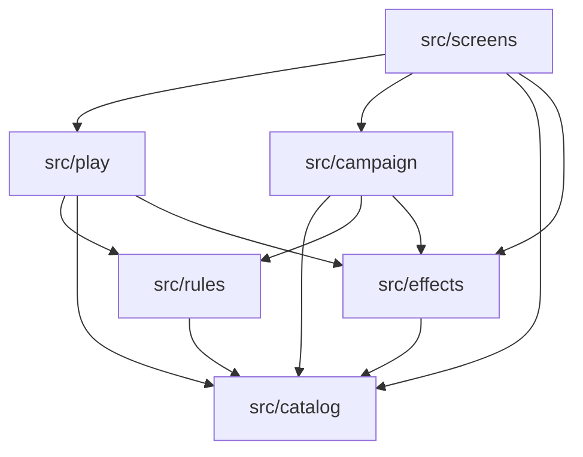
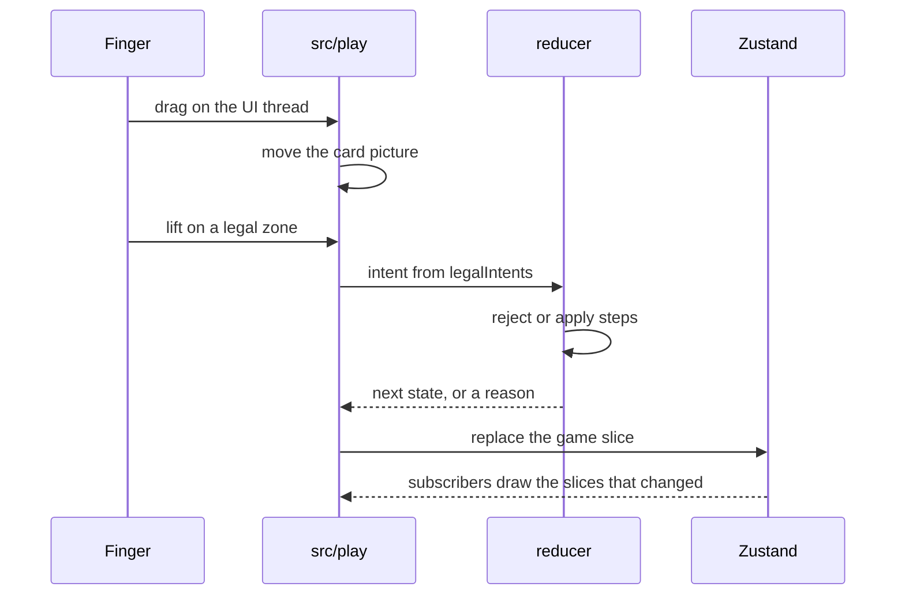

# Architecture

Structural design for the solo Lord of the Rings LCG app. Product rules and the round stay in [brief.md](brief.md). This file says how the process is split, who is allowed to write state, and which library owns which job. It does not restate a rule the brief owns.

The app is one Expo binary. The reducer runs in that process. There is no accounts system, no room, and no server on the play loop.

## Stack

Pin Expo SDK 58. The new architecture stays on. One package, no monorepo. pnpm is the package manager. SDK 59 is out of these phases.

| Job | Library | Lives in |
| --- | --- | --- |
| Shell, routing, device builds | Expo SDK 58, Expo Router, EAS Build | `src/screens` |
| Chrome layout | NativeWind 4.2.7, Tailwind 3 | screens other than the table |
| Table | `@shopify/react-native-skia`, the SDK 58 `pnpm expo install` version | `src/play` |
| Gestures and motion | `react-native-gesture-handler`, `react-native-reanimated`, `react-native-worklets` | `src/play` |
| Lists | `@shopify/flash-list`, the SDK 58 `pnpm expo install` version | pool, deck editor, any list past one screen |
| Catalog schema | one schema from `drizzle-orm/sqlite-core` | `src/catalog` |
| Catalog build | `better-sqlite3` opens that schema | `scripts/build-catalog.ts` only |
| Device database | `expo-sqlite` opens the same catalog tables, read-only | screens, opened at the root |
| User schema | `expo-sqlite`, migrations in `drizzle/` | screens |
| Catalog boundary | Zod | `src/catalog` |
| Files and list images | `expo-file-system`, `expo-image` | bundled pictures, lists, inspect, booklets |
| Screen state | Zustand | subscribers of reducer output |
| Haptics | `expo-haptics` (user request, 2026-10-25) | the table's dock: arm, send, undo, refusal; a card landing; a combat spotlight's strike |
| Keep awake | `expo-keep-awake` (user request, 2026-10-28), the one new dependency of the settings work | the table, while Keep screen awake is on (`src/play/use-keep-awake.ts`) |
| Backup exclusion | local Expo module `modules/image-backup-exclusion` | the image directory (`src/screens/images/queue.native.ts`) |
| Local PDF reader | `modules/booklet-pdf`, a local Expo module: PDFKit on iOS, `PdfRenderer` on Android | `src/screens/booklets` |
| Booklet import | `expo-document-picker`; bundled books through `expo-asset` | `src/screens/booklets` |
| Dev build | `expo-dev-client` (the local module is not in Expo Go) | device builds |
| Engine tests | Vitest | `src/rules`, `src/campaign` |
| End-to-end | Maestro, flows in `.maestro/` | a built app, locally and in an EAS Workflow |

Install Reanimated, `react-native-worklets`, Gesture Handler, Skia, FlashList, `expo-sqlite`, `expo-image`, `expo-file-system` and `expo-haptics` with `pnpm expo install`. Worklets is the Reanimated 4 peer. NativeWind 5 is out. `package.json` pins Skia (2.14.0), FlashList (2.3.2), NativeWind (4.2.7), Reanimated (4.7.1), worklets (0.13.0) and Zustand (5.0.15) exactly; keep the versions `pnpm expo install` selected. The table decodes cached files. It does not call Skia's `makeImageFromView`. Only the deck import list uses FlashList sticky headers.

The catalog is one `drizzle-orm/sqlite-core` schema. The script opens it with `better-sqlite3`. The phone opens those tables with `expo-sqlite`, read-only. `user.db` is a separate schema. Its migrations stay in `drizzle/`.

Reanimated is the only animation library. Do not add TanStack Query, Redux, a Phoenix client, a server framework, MUI, Emotion, or styled-components.

Android ships an APK or AAB. iOS ships an IPA. A physical iPhone needs Apple signing. The binary contains the Expo shell, native modules, `catalog.db`, the booklet PDFs that `pnpm booklets:pack` packs into `.cache/booklets/` (not committed; `metro.config.js` bundles its map in place of the stub `src/screens/booklets/bundled-map.ts`) and every card's picture, which `scripts/pack-scans.ts` writes into `assets/scans` scaled to at most 1200 px on the long side (with the map `src/screens/images/scan-map.ts`, empty in git): each card's pinned `pictures` file, else its scan. `pnpm ios` and `pnpm android` pack too. `eas-build-post-install` runs the catalog build and both packers. Image files stay in the document directory. A bundled booklet is copied into the document directory on first open, and the reader reads only that copy.

## Processes


Three groups of Node entry points exist, and none of them runs on the phone.

- `pnpm data:sync` is the only command that uses the network. It refreshes `data/raw/` (the game icon sources under `data/raw/icons` included), `.cache/pdf/`, `.cache/scans/` and `.cache/pictures/` (every card's picture the app bundles, `scripts/data/sources/pictures.ts`) and records every pin in `data/sources.json`. Card text comes from the printed-text ledger `data/printed/`, read from the scans; rule text from the curated spans in `data/rules/index.json`. `pnpm data:build` turns the raw snapshots into `data/cards`, `data/scenarios`, `data/campaigns`, `data/decks` (the pre-built player decks, read by the import screen), `data/rules`, `src/effects/generated`, and the game icons and printed card backs (`assets/icons`, `src/play/icons`), offline and deterministically. `pnpm data:check` rebuilds into a temporary directory and fails on any difference.
- `scripts/build-catalog.ts` (`pnpm catalog:build`) reads `data/` offline. It writes `assets/catalog.db` and the `CATALOG_VERSION` constant. `scripts/pack-booklets.ts` and `scripts/pack-scans.ts` bundle the booklets and card scans. EAS Build runs all three after install.
- Developer tools read `data/` and the engine: `pnpm data:query`, `pnpm effects:draft`, `pnpm effects:open`, `scripts/e2e-fixtures.ts`, `scripts/card-smoke.ts`, `scripts/combat-policy.ts` (the policy the combat tests play whole starter games with, which attacks; the auto-player never does), and the auto-player and scene scripts the golden games use.
- The Expo app runs on the device. It reads the bundled catalog, reads and writes `user.db`, and calls the reducer in process. It needs no network: the catalog, the booklets and every card's picture are in the binary.

A second human who must not see hidden cards, or several clients sharing one live table, would need a host. This product has neither. A future copy of `user.db` rows onto another device would still not run the round.

## Modules



| Path | Owns | May import |
| --- | --- | --- |
| `src/catalog` | Zod schemas for cards, packs, `Effect`, `Instruction`, `Condition`, `Cost`, and `ScenarioDefinition`; the mechanic families' vocabulary (`families/`); scenario and campaign data types; the universal deck-legal check; the catalog Drizzle schema; `CATALOG_VERSION` | nothing in `src/` (tests and scripts may reach `src/effects`) |
| `src/effects` | `generated/` (written by `data:build` from sentence templates) and `authored/` (per scenario, `pool/<pack>.ts` and `families/<family>.ts`); `EFFECTS` is both, an authored id replacing a generated one; `open-lines.ts` | `src/catalog` |
| `src/rules` | The engine: state, round machine, window and frame stack, keywords, modifier list, effect interpreter, the mechanic families' engine (`families/`), reducer, undo, replay | `src/catalog` |
| `src/campaign` | Save and log types, briefing and checklist, `buildStart`, resolution, scoring, replay of a save, standalone games, playable list | `src/catalog`, `src/rules`, `src/effects` |
| `src/play` | Skia table, phase rail, sheets, choice logic, readouts, gesture-to-intent mapping, undo history | `src/rules`, `src/catalog`, `src/effects` |
| `modules/image-backup-exclusion` | Sets the platform's backup-exclusion flag on the image directory; `index.ts` is the JS side | `expo-modules-core` only |
| `modules/booklet-pdf` | Native view and `pageCount` for one local PDF (Swift on iOS, Kotlin on Android; Android zooms in `ZoomList`, PDFKit zooms itself); `index.ts` is the JS side and reports `bookletPdfAvailable()` | `expo-modules-core` only |
| `src/screens` | Expo Router routes, SQLite, image cache, deck editor, booklet reader | `src/play`, `src/campaign`, `src/catalog`, `src/effects` |

The Expo Router root is `src/screens/routes`. Every file in that directory is a page. SQLite, the database provider, and tests stay in `src/screens`, outside that root.

`eslint.config.js` enforces these edges (`pnpm lint`, CI). `import-x/no-restricted-paths` zones allow only the imports in the table, and `src/play` may not import `src/campaign` or `src/screens`; `src/screens` may not import `src/rules`, so it reads engine results through `src/play` and `src/campaign`. `src/rules` and `src/campaign` also may not import `react-native`, `expo` or `expo-*`, statically, dynamically or with `require`. Scripts and test files get the same zones except that they may import `src/effects` into `src/rules` and `src/catalog`; `src/rules/boundaries.test.ts` additionally scans `src/rules` for `src/effects`, `fetch`, `Math.random` and `better-sqlite3`. `src/rules` receives the effect list as an argument (`ReduceContext`). Vitest imports the same reducer the screen calls and passes the effect list in.

The core round and the deck builder do not mention Fellowship by name. A scenario is `data/scenarios/<id>.json` and a `ScenarioDefinition` derived from it; `buildStart` turns a campaign and a scenario into the engine's start. A further scenario is more `data:sync` and `data:build` output, its campaign card's Setup and Resolution as records, and the records `pnpm effects:draft` drafts for its open lines. `src/campaign/playable.ts` lists the scenarios whose printed lines all have records (the first four Fellowship scenarios); `pnpm effects:open` lists the lines still open.

`src/play` sends player intents. It does not assign threat, damage, resources, progress, or log fields.

## State

Three kinds of state, three owners.

| State | Owner | Persistence |
| --- | --- | --- |
| Game and the open scenario | `src/rules` reducer | `user.db` `saves.activeScenario`, written when an intent commits |
| Campaign log, pool, path | `src/campaign`, applied by the same commit | `user.db` `saves` |
| A standalone game and its result | `src/rules` reducer, ended by `src/campaign/standalone.ts` | `user.db` `standalone_games`, each intent written when it commits |
| Decks, image index, booklets, applied catalog version | screen writers | `user.db` |
| The app's settings (theme, UI scale, haptics, Reduce motion, keep awake, animation speed, spotlight, stops, Responses always used, strong outlines, the first-game guide; user request, 2026-10-28) | `src/play/table-settings.ts`, a vanilla Zustand store the table and the screens read; `src/play/ui-scale.ts` (the three factors, the 44 pt `touch` floor, `UiScaleContext`) and `src/play/theme.ts` (`resolveTheme`, `ThemeContext`); `src/screens/settings-store.ts` hydrates the store and writes each change. `routes/_layout.tsx` resolves the theme and the scale once, sets NativeWind's rem (14 × the factor) and the theme's color variables, and provides both contexts, so a list row pays one context read and no store selector | `user.db` `settings`, key `table` |
| Card rows, effect rows, scenario definitions baked at build time | catalog build | `catalog.db`, replaced only by a version bump |
| Finger position, card lift, in-progress sheet motion | Reanimated shared values on the UI thread | nowhere |
| Which slice a screen draws | Zustand | memory, rehydrated from SQLite on launch |
| The seat the table is peeking at in two-handed play (`viewedSeat`, phase 26) | the table store (`src/play/store.ts`), set by a tap on the other seat's dial (`src/play/peek.ts`); `shownSeat(game, viewed)` is what the canvas, the web list and the pile list draw, `actingSeat(game)` is what picks, pays and sends | memory only: never engine state, never in the save; null when the table opens and after every new state |

Zustand stores the latest reducer result so a subscriber can select one slice. The reducer is the only writer of game numbers. A screen replaces the Zustand game slice with the value the reducer returned. Reducer updates keep the same object references for zones that did not change. A threat change updates the threat overlay and does not replace the hand slice. Do not use Drizzle `useLiveQuery` for scenario state.

The save keeps only the seed and the intent log (Persistence). The table's Undo is `src/play/undo-history.ts`: the store keeps the state before each intent that showed nothing hidden (`showedHidden` in `src/rules/undo.ts` decides; a finished scenario keeps none), with the round's log as it then was, and goes back to the last one. The session then drops that intent from the save (`unrecord`), so a relaunch replays the same game. The restored state and the seed cursor match. Separately, the engine keeps `state.undo`, a snapshot at each phase boundary plus the intents and steps since (`noteHistory`, and `replay` in `src/rules/undo.ts`). The snapshot is held by reference, not copied: a state is never changed once the reducer returns it, so `snapshotOf` keeps the state itself (with an empty card map and an empty `undo`) and `cards` points at the same card map.

`legalIntents(state)` runs when the window changes, not per pixel. It does not build the cross product of every card and every target up front. The table computes targets for the card the player selected. A gesture samples positions on the UI thread and asks the reducer only when the finger lifts or a button commits.

The interpreter and the reducer are pure. Shuffles advance the seed cursor stored on the scenario. No clock, no network, no `Math.random`. Vitest passes a fixed seed. An e2e build passes one too, through a launch argument that production builds ignore. A kill and relaunch continues the same sequence.

Willpower and damage read a modifier list on the scenario. The list may be empty. A `constant` effect appends a record. Combat math does not fork to apply one.

## Play loop



Which intents are legal, and which amounts the engine computes, are in the brief. Drop targets are zone ids from `legalIntents`.

The window stack is part of game state. A nested frame pops before the parent continues. The action windows between framework steps, and between the steps of an attack, are opened by `src/rules/step-window.ts`; the attack in progress waits on them and goes on once they close. The phase rail names the step. An animation does not gate the rule. Keyword scope is in the brief.

## Engine

`src/rules` is one pure reducer. Its public edge is `src/rules/reduce.ts`: `reduce(state, intent, ctx)` returns the next state and the `EngineStep`s that produced it, or a reason; `legalIntents` and `legalTargets` (`legal.ts`) say what the window allows; `startScenario` (`setup.ts`) turns a `StartScenario` into the opening state; `replay` re-runs intents. `ctx` is a `ReduceContext`: the effect list and the printed cards (`PrintedCard`, `printed.ts`), both passed in.

One call to `reduce` runs `rejectionReason` (legality), `applyIntent` (`machine.ts`), `settle`, `syncConstants`, and `noteHistory` (`undo.ts`). `ScenarioState` (`state.ts`) holds the zones (`ZoneName`: deck, hand, discard, heroes, play, engaged, staging, the active locations, the quest and encounter piles, `burdenDeck`, `victory`, `setAside`, `removed`, `shadow`, `attached`, and the zones campaign play adds: `under`, `campaign`, `captive`), the round (`phase`, and `mode`, the framework step the machine is in), the open question for a player (`window`), the `stack` of frames, the modifier list, delayed effects, limit uses, the seed and its cursor, and the queue of events not yet announced.

- **Frames and windows.** A frame (`frame-types.ts`, `windows.ts`, `frames.ts`, `effect-frames.ts`) is work that can wait for a player: a reveal, an effect with a choice, a Response offer, a Forced effect. `settle` (`machine.ts`) advances the top frame until it pops or opens a `Window` (mulligan, pass, defense, choose, response, look, resolution, and so on), announces queued events once no window is open (`queue.ts`, `events.ts`), and runs the framework steps in order. `step-window.ts` opens the action windows between steps.
- **Effects.** `runEffects` and `runEffect` (`interpret.ts`) run a card's records of one timing, each instruction through `runInstruction`. That function asks, in order: `runFamilyVerb` (`families/index.ts`), `runPlayerVerb` (`player-verbs.ts`), the core verbs in its own `switch`, and `runExtraVerb` (`verbs.ts`). A verb that needs a choice or a child frame is handled by the effect frame before it gets there.
- **Triggers.** Code that changes the game announces a `GameEvent` (a `trigger` name, a seat, a card). `fireForced` (`triggers.ts`) collects the records whose `trigger` the event matches (`hears` in `listen.ts`, with `triggerHears` for the two-way triggers), Triggered before Forced, oldest card first, and pushes a frame for each; Responses are offered by `responses.ts`. `crossBoundary` fires the end-of-phase and end-of-round records and the delayed effects (`delayed.ts`). Code that has no effect list queues the event and `settle` announces it.
- **Constants.** `syncConstants` (`constants.ts`) turns each `ModifyStat` of a `constant` record into entries of the modifier list, rebuilt as cards enter and leave play; `modifiedStat` is the only reader. A stat flag (`FLAGS`) is such an entry with a boolean meaning, read with `flagged` or `heldStat`.
- **Causes.** Every step that changes a number carries a `Cause` (`cause.ts`): a rule span id, or an effect record with its printed line. A test plays the goldens and refuses any step without one.
- **Hidden information and randomness.** Shuffles use `seed.ts` and advance `seedCursor`. `showedHidden` (`undo.ts`) is true when an intent revealed something the player had not seen or moved the cursor; the table's Undo cannot take such an intent back.
- **Version.** `ENGINE_VERSION` (`version.ts`, 6) is bumped when a change can move a replayed game. A save from another version drops its open scenario.

### Mechanic families

The engine and the record vocabulary grow by mechanic family, so work on one family does not edit another's files. A family `<F>` has three parts, composed by an `index.ts` beside each:

| Part | File | Holds |
| --- | --- | --- |
| Vocabulary | `src/catalog/families/<F>.ts` | `VERBS` (strict Zod objects), `TRIGGERS` (event names), `FLAGS` (stat flags `ModifyStat` can set). `index.ts` joins them as `FAMILY_VERBS`, `FAMILY_TRIGGERS` and `FAMILY_FLAGS`; `effect-schema-verbs.ts`, `effect-schema.ts` and `effect-schema-stats.ts` spread them into the verb union, the trigger enum and the stat enum. |
| Engine | `src/rules/families/<F>.ts` and its `<F>-*.ts` files | `run(state, instruction, focus, ctx, steps)`, which returns the next state for a verb the family owns and `null` for any other. `families/index.ts` lists the `run`s in `RUNNERS`; the first non-null result wins. Families also hold the small hooks the shared engine files call (for example `play-hooks.ts`, `attachments-hold.ts`, `defense-listen.ts`). |
| Records | `src/effects/authored/families/<F>.ts` | `RECORDS` and `REPLACES` (ids of generated records the family's records replace). `authored/families/index.ts` composes them into `FAMILY_AUTHORED_EFFECTS`. |

The families are `attack`, `defense`, `encounter`, `quest`, `play`, `costs`, `deck`, `attachments`, `sidequests`, `misc`, `burden`, `south`, `campaign`, `objectives`, `prisoner`, `dungeon`, `caves` and `dreamchaser` (`src/catalog/families/index.ts`). `dreamchaser` (the Dream-chaser campaign's XP: the Resolution verb `GainXp`, run by `src/rules/resolution.ts`, with its counts in `src/rules/families/dreamchaser.ts`) has its records in `src/effects/authored/pool/DCCE.ts` for the Hard/Expert Mode card, and in each scenario's file for its campaign card. `campaign` (the Mirkwood Paths campaign cards' Setup and Resolution verbs: an objective ally put into play, cards set aside and attached later, cards added to the Campaign Pool on their hero, a prisoner named, cards carried to the next campaign, tokens placed on the campaign card and recorded) has its records in `src/effects/authored/passage-through-mirkwood.ts`, `journey-along-the-anduin.ts`, `the-oath.ts`, `pool/RevCore.ts` and `pool/TDoM.ts`. The Oath adds the limit `oncePerCampaign` (`src/rules/usage.ts`, `families/campaign-used.ts`: the use is a fact in the Campaign Log's `usedOnce`), the encounter family's `SearchCollection` and table flag `encounterUncancelable`, and a Response window at the end of the round (`src/rules/triggers.ts`). The first quest card's own Setup and When Revealed at the start of the game run in `src/rules/families/quest-setup.ts`. `burden` (the burden deck, the Ring-bearer's life, Flight to the Ford) and `south` (a second active location, the Ring-bearer captive under the Watcher, damage assigned among characters, The Ring Goes South) have no records file of their own: their records are in `src/effects/authored/flight-to-the-ford.ts` and `the-ring-goes-south.ts`, and `authored/families/index.ts` lists ten families. `objectives` (a Guarded objective with an encounter card attached, claimed by a player and attached to a hero), `prisoner` (a hero held facedown in the captive zone the south family also uses, Mendor captured with it, the rescue) and `dungeon` (Orc Guards made of deck cards, Iron Shackles on a deck, the group limit of allies, a staging threat raise) have no records file of their own: their records are in `src/effects/authored/escape-from-dol-guldur.ts`. `caves` (The Caves of Nibin-Dûm: progress limits on the quest card, engagement cost 0, a location the first player may attack from the staging area, the excess of combat damage taken off the quest, a card removed from the game) has its records in `src/effects/authored/the-caves-of-nibin-dum.ts` and `pool/TDoM.ts`; the stage number is an amount, and a stage that arrives with 0 quest points is not met on arrival (`src/rules/quest.ts`). How to write records for a family is `docs/plans/effect-authoring.md`.

## Effects

The effect record shape, and which sentences may stay inactive, are in the brief. Zod schemas for `Effect`, `Instruction`, `Condition`, `Cost`, and `ScenarioDefinition` live in `src/catalog`. `src/effects/generated/` is written by `data:build`: `scripts/data/effects/templates.ts` holds ordered sentence patterns, and a template writes a record only when its pattern matches a whole line of card text. `src/effects/authored/` holds the records for the lines no template reads, and an authored record replaces a generated one with the same id (`mergeEffects` in `src/effects/index.ts`); `AUTHORED_REPLACES` names those overlaps, and `scripts/effect-coverage.test.ts` fails when the list and the overlaps differ. Authored records live in `authored/fellowship-of-the-ring.ts`, `flight-to-the-ford.ts` and `the-ring-goes-south.ts` (the scenarios' own cards), `authored/<scenario-id>.ts` for each Mirkwood Paths and The Dark of Mirkwood scenario (where `effects:draft` sends a box card that no pool file takes), `authored/pool/<pack>.ts` (the player pool, by pack; `pool/RevCore.ts` and `pool/TDoM.ts` also take those boxes' boons and burdens) and `authored/families/<family>.ts`. `pnpm effects:draft <scenario | starter deck id>` writes `.agent/drafts/<code>.md` for the lines that still lack a record.

The interpreter takes the effect list as an argument. It does not import `src/effects`. The screens, `src/campaign` and `src/play` import `EFFECTS` and pass it in. There is no effects table in `catalog.db`. New verbs are added by hand to the vocabulary and the engine: a family's `VERBS` and `run` (Engine, Mechanic families), or, for the older core verbs, `effect-schema-verbs.ts` (stat modifiers, picks, conditions and amounts in `effect-schema-stats.ts`, `effect-schema-pick.ts`, `effect-schema-conditions.ts` and `effect-schema-amount.ts`, all exported through `effect-schema.ts`) and `src/rules/interpret.ts` or `verbs.ts`. That is engine work, not data. Printed lines no record owns are listed by `pnpm effects:open` (`src/effects/open-lines.ts`).

## Scenario definition

The reducer accepts a definition. It does not branch on a scenario's product name.

```ts
type ScenarioDefinition = {
  id: string;
  encounterSets: { code: string; count: number }[];
  stages: { code: string }[];
  widgets: {
    hide: boolean;
    lifeTracker: boolean;
    burdenDeck: boolean;
    secondActiveLocation: boolean;
    perSeatStaging: boolean;
  };
  setup: Instruction[];
  resolution: Instruction[]; // the campaign card's Resolution records, in line order
  burdenDeck?: string[]; // the burden deck's cards, in booklet order
  life?: number; // the Ring-bearer's starting life
  campaignCard?: string; // the campaign card whose Setup and Resolution belong to the scenario
  bookletPage?: number; // in the schema; `scenarioDefinition` does not set it
};
```

`widgets.lifeTracker` is `life != null` and `widgets.burdenDeck` is a non-empty burden deck; the other flags come from the scenario file. `bookletPages` is an optional map in the campaign file (`data/campaigns`), scenario id to the MEC109 page its setup is printed on; screens read it through `src/screens/campaign-data.ts`. It is an index, not prose. `pnpm data:build` fills it from the page of the scenario's `mec109.setup-<id>` span in `data/rules/index.json`, which was read from the booklet PDF; a scenario with no such span has no entry. Do not copy headings or narrative into this type. The second active-location slot is the shared scenario slot the widget flag opens. It is not a field on the seat.

**The campaign registry.** `src/screens/campaign-data.ts` holds every built campaign and scenario by id (`campaignOf`, `scenarioOf`, `scenarioName`, `bookletParams`) and the boxes the Scenarios tab lists (`BOXES`, `boxOf`, `campaignOfScenario`). Metro needs static JSON imports, so the map is written by hand; `campaign-data.test.ts` checks it against `data/campaigns` and `data/scenarios`. A screen never names a campaign id: it asks the registry, and a campaign's `saga`, `xp` and `bookletId` come from its file. The XP, the sheet's scalable and upgradable cards and the Spend XP rules are pure in `src/campaign/xp.ts` and `xp-view.ts`; the Spend XP screen only draws them. `src/campaign` stays pure and takes the campaign through the `World` it is handed.

`data/scenarios/<id>.json` is generated: stages, booklet sets, and for every card its pile (encounter, quest, staging, active location, set aside, attached) with Normal and Easy counts. `data:build` fails to write a scenario unless Hall of Beorn's per-scenario counts and the quest card's Setup text agree with the DragnCards load list; a mismatch is resolved with a row in `data/overrides.json`. `scenarioDefinition(data, campaign, effects)` (`src/catalog/scenario-data.ts`) derives the `ScenarioDefinition`, including `setup` from the piles in the quest card's order (set aside, staging, active location, attach) and `resolution` from the campaign card's records. Which widget a scenario turns on is in the brief.

The save, the log, the pool, the loadout, and win and loss are specified in the brief. `src/campaign` applies that specification. The reducer does not switch on Fellowship scenario ids.

## Persistence

Two files, two handles, both reachable from screens.

| File | Contents | Replacement |
| --- | --- | --- |
| `catalog.db` | `packs`, `cards`, `campaigns` (id, name, scenario count, playable; from `data/campaigns/index.json`), `meta` | New asset when `CATALOG_VERSION` differs from the applied one. Not migrated in place. |
| `user.db` | `decks`, `saves`, `standalone_games`, `image_files`, `booklets`, `settings`, `meta` | SQL migrations in `drizzle/`, run on open. Never replaced by a catalog update. |

`catalog.db` is a Metro asset. `CATALOG_VERSION` is a hash of the catalog rows, so any change moves it. `forceOverwrite` is true when the bundled version differs from `user.db` `meta.appliedCatalogVersion`. First launch has no applied version, so the copy runs. `cards.deck_legal` is set at build time. `cards.campaign_id` is set only for rows a campaign owns. Errata text is what the app stores and shows when RingsDB sets `has_errata`.

`useSQLiteContext` returns the nearest `SQLiteProvider`. Nesting the two providers and reading through that single hook leaves `catalog.db` unreachable, and the suspense helper keeps one module-level database and closes the previous file. Open each file with its own handle and pass both down.

`image_files` stores code, path, width, height, byte size, media type, and sha256. The bytes live under the document directory. A catalog update deletes a file only when that code's hash changed.

`saves.activeScenario` is `{ engineVersion, dataHash, seed, intents }`, not the table. Loading rebuilds the start from the log and the decks and replays the intents through the reducer. When the engine version or the data hash differs, or the reducer refuses an intent, drop the in-progress scenario and keep the log, the decks, and the image index. Do not migrate a half-played game during this box. `saves.loadout` keeps what the briefing dealt (the heroes and cards of each deck, the Ring-bearer, the difficulty, the answers to the campaign card's choices), so a relaunch rebuilds the same start even if a deck is edited afterwards. `saves.archivedAt` marks a playthrough the player put away: the row is kept whole, and Restore clears the mark. Only the campaign list hides an archived save; it still opens by id (a deep link, the e2e fixture route, which also clears the mark). Each accepted intent and each Undo is written at once and writes only the open scenario (`writeActive`, `writeStandaloneActive`: `activeScenario` and, for a save, `updatedAt`); the log and the loadout are not serialized again. A change to the log or the loadout (a deal, the Resolution, a lost game, the checklist, notes) writes the whole row (`writeSave`, `writeStandalone`). The lists read a row without the open scenario's intents: a save row says only whether one is open, a standalone row carries its engine version and data hash (what tells a stale one). The save lists no longer parse the open scenario, so a save whose open scenario is malformed lists as open until the table opens it and drops it with the usual message. `saves.updatedAt` is set by every write of the save, not by Archive or Restore, and orders the list's open saves, the one written last first. A standalone game (`standalone_games`) is stored the same way, with its own loadout (no campaign choices or penalty) and its result instead of a log; `src/campaign/standalone.ts` builds its start with `buildStart(..., mode: "standalone")`, which leaves the campaign card's Setup and Resolution out. Delete removes the row, which is the whole playthrough; decks are separate rows and stay. A write inserts a missing row, so no save screen stays open under the list: path, briefing, table, log and resolution are pushed above it. The catalog's `cards` rows also carry `encounter_set` and the campaign-card facts the engine reads (`campaign_kind`, `burden_set`, `back_type`), so the phone builds the engine's cards from `catalog.db` and never reads `data/cards`.

`decks.updatedAt` (0005) is set by each Save of a deck and orders the deck list, the one saved last first; the starters are inserted and reset with it null. A deck is written whole by `src/screens/deck-store.ts`, ready to play or not. The deck being edited is a draft in memory (`src/screens/deck-draft.ts`) shared by the editor and the pool; it knows the saved deck it came from, so Back can ask before unsaved changes are lost.

`booklets` stores one row per book: id, path, original filename, byte size, sha256, page count, and last page. One file per book lives in the document directory under `booklets/`. Those bytes stay eligible for backup. A catalog update does not delete the row or the file. `expo-document-picker` copies into the cache. Copy that file into `booklets/` before inserting the row. A bundled book (`.cache/booklets/bundled-map.ts`, written by `scripts/pack-booklets.ts`) is resolved through `expo-asset` and stored the same way. The ids for this box are `fellowship-of-the-ring` and `learn-to-play`. A later campaign adds its own id. The engine does not read the PDF.

## Images

Every card's picture is bundled (brief, Card images): `scanAssets` in `src/screens/images/scan-map.ts` maps a code to its asset and size (and `<code>.B` to side B of a quest stage or campaign card, which the table and the preview show for a card turned to its B side, `src/play/picture-key.ts`; and `<code>.scene` to the scene of a scenario's first quest card, cut at the source's size, which `SceneArt` draws), and a bundled picture wins over a downloaded file (`resolveCardImage`). The catalog still carries `imagesrc`: RingsDB's path, or for a quest or encounter card the full URL of its scan (the front the printed ledger was read from, else the Hall of Beorn front from `imageUrls`). The phone's download queue uses it only for a card a build did not bundle (a build run without `pnpm scans:pack`), and the web build shows that remote file directly; the queue accepts a RingsDB path and the two scan hosts, and nothing else. It downloads with `File.createDownloadTask` from `expo-file-system` into the document directory, which `modules/image-backup-exclusion` excludes from backup, and sniffs magic bytes because a URL ending in `.png` often holds a JPEG. The sniff reads the first 64 KiB of the file, not all of it (a JPEG whose frame header lies past that, behind a large color profile, is read whole), and the stored byte size is the file's own `size`.

`expo-image` decodes list rows at the size on screen and the inspect screen at up to the bundled 1200 px. It caches a bundled picture in memory only (`src/play/image-cache.ts`): on Android it keys its disk cache by the drawable's resource id, which a build assigns alphabetically, so a picture added to the bundle moved every later id and the cache kept from the last install showed another card. The table is one Skia canvas. Skia decodes a picture, draws it down (linear halving steps) to the largest size the canvas draws that card (a hand card at the scrub's lifted size, `table-pictures.ts`), keeps that copy and releases the full decode; a copy far larger than its card now needs is decoded again smaller, and images that leave the table are released. Nothing decodes every picture, and startup does not wait on one. The decodes are queued and run one at a time, as many in a frame as fit about 6 ms (`performance.now()`; one at least), then the rest a frame later (a code with no copy yet before one that wants a new size, then the table's own order), and the canvas is handed the finished copies once a frame, so a draw of several cards neither stalls the frames after it nor records the canvas once for each picture; unmounting, or a screen hidden by `Activity`, cancels the pending frames and announces an empty map before it disposes the copies, so a committed state never holds a disposed image, and the screen decodes again when it is shown (`table-images.native.ts`). The combat spotlight's stage-size copies start when an enemy's attack is declared (and its defender chosen), not when the spotlight starts (`spotlight-warm.ts`). The table's fonts and icons are loaded once for the app and shared by the canvas, its token layer and the spotlight's layer (`table-assets.native.ts`).

## Screens

Expo Router. The app opens on the campaign list. Its dock (`(tabs)`) is Campaigns, Scenarios, Decks, Cards and Rules (user requests, 2026-10-25 and 2026-10-28; Settings left the dock for a pushed route, `routes/settings.tsx`, opened by the gear at the top right of each hub, in the Carved Stone redesign, 2026-10-29); in an expanded window (840 points and wider, by size class, not device) the dock is a rail down the left edge with the same tabs and Settings at its foot.

| Route | Reads | Writes |
| --- | --- | --- |
| Campaign list | `saves`, `campaigns`, the campaign file's scenario names, `cards` (through `deckFaces`: the heroes' names and faces only) | nothing. It reads saves through `campaign-store`. The first unfinished save's next step (`nextStep` in `src/campaign/path.ts`) opens the table, the briefing or the path. |
| Campaign setup | `campaigns`, the campaign file, open and archived `saves` (their logs, for the carry-over offers), `cards` (through `deckFaces`: names only) | a new save: id, campaign id, seat count, the carry-over taken |
| Scenarios | `standalone_games`, the scenario files, `PLAYABLE_SCENARIOS`, `campaigns` (the locked boxes), `cards` (through `deckFaces`: the hero's and the other games' heroes' names and faces only) | an open game from another engine version or data hash dropped on the read (`listStandaloneFresh`). |
| History | `runs`, `saves` and `standalone_games` (open and archived), the campaign files, `cards` (through `deckFaces`: names only) | `saves.archivedAt` and `standalone_games.archivedAt` on Archive and Restore; a deleted save's or game's row (a deleted playthrough's open scenario is recorded as a run first, `recordUnclosedRun`) |
| Standalone briefing | decks, catalog, scenario definition; a finished game's loadout for Play again | a new `standalone_games` row with its loadout and open game |
| Standalone table | the same table view (`src/screens/table-view.tsx`) over a game replayed by `src/screens/standalone-session.ts` (the replay and the committing store are shared with the campaign table in `src/screens/open-game.ts`) | each accepted intent, appended to `standalone_games.activeScenario` |
| Standalone outcome | the replayed game, or the stored result of a game already finished | the result (score or loss reason) as the screen opens; the open game is cleared |
| Campaign path | save, pool | nothing until a scenario ends |
| Log | save | notes |
| Briefing | save, deck, catalog, scenario definition | the loadout, then the opening `ScenarioState` from the reducer |
| Table | game slice (a Zustand store of the reducer result, rebuilt by replaying the save once on open, in an effect after the first paint, under the table's own loading frame, or at once from the cache; a save already replayed as it stands is not replayed again, see below), card pictures, `EFFECTS` from `src/effects` | each accepted intent, appended to `saves.activeScenario` |
| Resolution | the campaign card's Resolution options the reducer lists, one group and one seat at a time | each chosen `ChooseResolution` intent, then the log on Confirm; a loss drops the open scenario and writes no log field |
| Card | its bundled picture, catalog text | nothing |
| Card pool | the deck-legal card rows, read and sorted once for the app run (`src/screens/pool-cache.ts`, shared with the deck import), then filtered in memory; `image_files`. One view (`src/screens/card-pool.tsx`: `CardPoolBody`, and `CardPool` around it) is the Cards tab, the deck editor's `/pool?adding=1` and, in an expanded window, the pane beside the deck | the open deck draft, when adding |
| Deck list | catalog, `decks` | `decks` (duplicate, delete, reset a starter) |
| Packs | `packs`; a pack's cards | nothing |
| Rules | `data/rules/entries.json`, parsed by `src/catalog/rule-entry.ts` (the one rule-span type the build, the table's causes and the glossary share), through `src/screens/rules-glossary.ts`: the Rules Reference, Learn to Play, FAQ, Easy Mode and MEC109 rule spans, searched in memory (`src/screens/rules-view.tsx`, also the `/glossary` route the table opens); the two books open the booklet route | nothing |
| Deck | catalog, `decks` | `decks` |
| Booklet | one `booklets` row and the file under `booklets/`; the import, the file copy and the reader view are in `src/screens/booklets/` | last page |

The Rules tab, the path, the briefing, the log, and the table each open the booklet route and close back to that same screen. The reader is an in-app native view, full screen, with the close control in thumb reach. It is not a Skia surface and not a WebView. `react-native-pdf` stays out unless `@config-plugins/react-native-pdf` has an SDK 58 release when the campaign shell starts. That phase adds `expo-dev-client` and verifies one Expo PDF module against SDK 58. If that module does not build, a local view is allowed: PDFKit on iOS, `PdfRenderer` on Android. Phase 10 found no SDK 58 release (its README stops at SDK 56), so the reader is the local `modules/booklet-pdf`. It renders a local file and reports the page. It does not annotate, search the prose into the app, or become a second document system. A missing file does not block a scenario. Opening from a scenario starts on its `bookletPages` entry when one exists, and otherwise on the saved last page.

NativeWind 4.2.7 styles the chrome. Tokens and screen specs live in [design-system.md](design-system.md). The table does not use NativeWind for cards. Tap targets are at least 44 points. The phase rail, the choice buttons, and the booklet close control sit in thumb reach. Reduced motion snaps the same transitions. A new gesture cancels the animation in progress.

The table is played in landscape only; the other routes follow the screen. The root `Stack` sets `orientation` to `useIsTablet() ? "all" : "portrait"` (`src/screens/routes/_layout.tsx`; a tablet is a screen whose shorter side is 600 points or more) and to landscape for `table/[saveId]` and `standalone/table/[gameId]` (react-native-screens, no orientation package). A tablet rotates every route but the table. A phone stays portrait but for the table and the card, booklet, glossary and rule routes, which are `"all"` on phones and tablets alike, so a phone's landscape table is not turned back to read a card. `app.json` leaves `orientation` at `default`, so the stack option decides. On iPad, `app.json` sets `supportsTablet` and `requireFullScreen` (iPadOS honors an orientation lock only for a full-screen app). Two platform notes: Android 16 (targetSdk 36) ignores orientation locks on screens 600 dp and wider, and iPadOS 26 deprecates `requireFullScreen`. Either can hand the table a portrait window, so `table-view.tsx` shows a sentence asking to turn the screen, with Back, instead of the table; that guard covers both, and no Android `appCategory` plugin is added.

The phase rail, threat, life, the dock, the panels and the preview are React Native text and buttons with stable testIDs. Card pictures stay on the Skia canvas. A tap on a table card picks it for the open moment and sends an intent only when the moment has one answer; a long press shows it large with its attachments and the effects on it, and Details there opens the card route. The picture stays on the canvas. The inspect screen is the React Native view. Those ids are how Maestro finds a control. A card drawn only on the canvas is not a view Maestro can address.

How a tap answers the open moment is `src/play/table-choice.ts`: the sheet `sheets.ts` builds for the window (or `windowSheet` for an ordinary action window) says what the rules allow; a tap picks a card or opens the question it leads to (a host, the attackers, a payment); the dock's buttons send the intent, and a button that sends one with nothing picked arms on the first tap and sends on the second, unless the moment has only one answer (`onlyAnswer`: the engine allows one intent and the sheet shows one answer for it), which is picked already and sends on one tap. Undo is the store's: which intents showed something hidden is the engine's to say (`showedHidden` in `src/rules/undo.ts`); the store keeps the states before the others (`src/play/undo-history.ts`), goes back to the last one, and the session drops that intent from the save (`unrecord`), so a relaunch replays the same game. The store and the reopened save fold each intent into the round's log and the Undo list with the same function (`keepIntent`). Haptic ticks are `src/play/haptics.ts` (`expo-haptics`; Android's haptic constants, not the vibrator). The screen holds no choice logic of its own: `src/play/use-table-choice.ts` keeps the open choice, the armed button, the folded or listed choice tray and the banner, and hands the route what to draw; `src/play/table-layers.tsx` draws the one reading panel and the phase carousel over the table (the choice's rows are drawn inside the dock, `src/play/choice-tray.tsx`), and `src/play/tray-logic.ts` and `reading.ts` are their pure halves. The dock's numbers are `src/play/readout.ts` and the banner's lines `src/play/outcome.ts`; both read only what the engine computed (`modifiedStat`, `defenseAsDefender`, `attackStrength`, the `quest` and `strike` steps), so `src/screens` still imports nothing from `src/rules`. The motion of cards between states is worked out in `src/play/motion.ts` once per state and interpolated on the UI thread. The attacks a new state resolved are `clashesOf` (`src/play/clash.ts`), read from the same `strike`, `damage` and `destroy` steps (a players' `attack` step names its `attackerIds`, so a strike resolved in the reduce that declared it still says who attacked); the store opens a gate for them (`spotlight`, `src/play/spotlight-gate.ts`), the table canvas keeps their plan and clock (`use-spotlight.ts`) and hands them through a small store (`spotlight-handoff.ts`) to a full-screen layer that plays them as the combat spotlight (`spotlight-layer.native.tsx`, `spotlight.native.tsx`; user request, 2026-10-29, `docs/plans/done/combat-spotlight-redesign.md`), and the banner, the settle after a moment and the state's card motions wait for it. A tap on the canvas (which does nothing else), a press on the transparent skip catcher over the bar and the dock (`spotlight-scrim.tsx`), or Android Back ends the gate and lands the table on the new state. Reduced motion, a screen reader and the table setting Combat spotlight (off) play none.

The first screen paints from SQLite. It does not scan the image directory, query `cards`, or count the catalog before drawing.

Opening a screen does as little as it can before the first paint (performance pass, 2026-10-29, `docs/plans/done/performance-pass.md` section 6):

- **The table's replay** runs in an effect two frames after the screen mounts (`useTableSessionAfterPaint`, `useStandaloneSessionAfterPaint`, `src/screens/after-paint.ts`; React Native 0.88 has no `InteractionManager`), and the route shows the table's own frame (`table-loading.tsx`: the table's scene and insets, Back at the menu button's place; testID `table-loading`, so a flow waiting for `table` waits for the real table) until it is done. A session already in the cache is held from the first render, with no loading frame, and a key already open is never opened again (a screen hidden by `Activity` and shown again keeps its store). The Resolution and the standalone outcome open their session during the render, from the cache.
- **The session cache** (`src/screens/session-cache.ts`, used by `table-open.ts` and `standalone-open.ts`) keeps the replayed sessions of the last three saves, each valid for one exact save: its key is the save's whole JSON (every intent, the seed, the loadout, the log) with the catalog version, so an Undo followed by a new intent, a new deal on the same id, or a log edit cannot be served a stale game. A session holds only immutable values (the reducer's state, the world, the facts), and each table builds its own store from it. The table's store registers itself as the followed game of its save (`follow`), so when the Resolution or the outcome asks for the save the table just wrote, the cache hands it the store's current game, history and round log instead of replaying; the fingerprint is computed at that ask, not on each intent. A relaunch has an empty cache and replays from the save.
- **`recordUnclosedRun`** reads the save in the tap (the caller is about to overwrite or delete it), and replays it after the next paint, queued once (`src/screens/pending-runs.ts`); `listRuns` flushes the queue first, and so does the app leaving the foreground (`flush-runs-on-leave.native.ts`), so History never lacks a run its player just closed and a kill after the home button cannot lose one. It usually finds the table's game in the session cache and replays nothing. The run's `endedAt` is the time of the tap.
- **Hidden screens** (`activityEnabled` on the root `Stack` and on the `Tabs`): expo-router 58 ignores `freezeOnBlur` (its types call it deprecated, no effect) and hides a screen with React `Activity` instead. A hidden screen renders at low priority and its effects are torn down (cleanups run, they run again when it shows); its state stays. The stack hides a screen only when two or more screens are above it, the tabs hide a tab that is not shown. The toast, the image cache and the deck draft are module stores read with `useSyncExternalStore`, which reads again when a hidden screen shows, so none of them misses a change made while hidden.
- **Parsed on first use, not at load:** the rule glossary (`glossary()`, with each entry's search fields folded once), the campaigns and scenarios (`campaignOf`, `scenarioOf`, each file on its own, and the starter decks reuse the Fellowship parse), the pre-built decks and the import list (`prebuiltDecks()`, `prebuiltList()`).
- **The deck editor** subscribes to the draft by part (`useDeckDraft(select)`): the pool and the grid read the heroes and the cards, not the name, and the refused-card set is worked out once per change of the deck. A cell of the grid (`DeckCardCell`) is drawn again only when its card, width, refusal, loss or lookup changed. The toast keeps its own room below the list (in the pool and in the deck editor), so it never covers a row or sits on a row's +.
- **The briefing's world** is rebuilt only when the scenario or the set of codes it is built from changes, not each time the deck list is read again. The Decks tab's dot reads the decks again when `deckRevision()` moves (`src/screens/deck-revision.ts`, bumped by each write in `deck-store.ts` and the starter seed), not on each change of tab.
- **The backdrop** draws each fog texture once into a tile and only slides the tiles after (`docs/design-system.md`, Backdrops).

## Catalog build

`scripts/build-catalog.ts` reads `data/cards` and `data/raw/ringsdb/packs.json` and writes `catalog.db` and the `CATALOG_VERSION` constant (a hash of the rows). It does not fetch, and it does not write effects or scenarios: the app imports those from `src/effects` and `data/`. Identifiers are RingsDB codes. A card without a RingsDB row takes the code Hall of Beorn gives its Black Riders or Road Darkens printing, and `data/overrides.json` carries the two that have none. The Revised Core Set's encounter, quest and campaign cards (Hall of Beorn alone, `CardSet` "Revised Core Set") keep the 2011 codes 01074 to 01131 under the `RevCore` printing; The Dark of Mirkwood's take `410` and the collector number (Stalking Goblin 41041), because Hall of Beorn's `020NN` is The Hunt for Gollum's (`productCodes` in `data/overrides.json`). Which products the pipeline builds, their packs, home campaign and load source are one table, `PRODUCTS` in `scripts/data/campaign-defs.ts`.

`assets/catalog.db`, `.cache/`, card images and booklet PDFs are gitignored. The game icons in `assets/icons` are small app assets built from `data/raw/icons` and are committed (`docs/design-system.md`, Icons); `.gitignore` exempts their PNGs, the raw DragnCards token PNGs, and the two printed card backs (`assets/icons/playerBack.jpg` and `encounterBack.jpg`, and their raw copies under `data/raw/icons/dragncards/cardbacks`) from the card-image rule, so a fresh clone builds without `pnpm data:sync icons`. `data/` is committed, raw snapshots included, so no session starts without card text, scenario piles or rules text.

## Tests

Three layers. They do not stand in for each other.

| Layer | Proves | Does not prove |
| --- | --- | --- |
| Vitest | The reducer, the campaign log, effect coverage | That a screen dispatched the intent, or that a save survived a relaunch |
| Maestro | The built app: navigation, a refused briefing, a deck save, a resolution choice writing the log | Combat math, or that a drag stayed on the UI thread |
| A physical phone | Pool fling, table drag, airplane mode after a kill, a catalog bump leaving `user.db` in place | The suite above |

Vitest runs in Node on `src/rules`, `src/campaign`, `src/effects`, `src/catalog`, `src/play`, `src/screens` (its `.ts` tests) and `scripts`. No React renderer, no network, no prebuilt database: tests that need `catalog.db` build one into a temporary directory from `data/`. A worker keeps one module cache for every file it runs (`isolate: false` in `vitest.config.mts`), so a test that changes module state or the environment puts it back before it ends. The card smoke sweep is split into `scripts/card-smoke-<n>.test.ts` shards (`card-smoke-suite.ts`) so it runs on every core. A scenario is not playable until a test reads its quest deck, encounter deck, burden deck when it has one, and the seeded starter decks from `data/`, and every printed ability on those cards has an effect record. A player card outside that set does not fail the test. `src/campaign/full-game.test.ts` plays a whole scenario on fixed seeds and pins its step log, and the golden games in `src/campaign/golden/*.json` (one file per scenario and starter deck, checked by `golden*.test.ts`) pin the intents, outcome and causes of played games. `scripts/data/*.test.ts` pin the card normalizer, the scenario cross-checks, the ledger, the prebuilt decks and the rules store, including that every rule id named in `src/rules` or the brief exists, and `scripts/effect-coverage.test.ts` checks that every printed line of a playable scenario's cards is owned. CI runs `pnpm data:check`, `pnpm lint`, `tsc` and `pnpm test`.

Maestro flows live in `.maestro/`. Each flow taps and asserts by testID and visible text. Card ability text stays out of those assertions. Assert a RingsDB code. The phase rail and the sheets are those nodes. A booklet flow asserts the empty state and the close control by testID. A smoke file, if a flow needs one, is a one-page PDF written for the test, not a page of MEC109. A flow that needs a deal uses the e2e seed. A flow that needs a finished scenario opens a save fixture parked on that choice, then asserts the log and the next path node. It does not play fifty rounds of unscripted draws. Fixtures are real games `scripts/e2e-fixtures.ts` writes, replayed by `src/campaign/fixtures.test.ts`; one that is not committed (scenario 1's `won`, and `knife-lost` dealt from its log, open since 2026-10-25) is not served by the e2e route, and its tests are skipped. The flows for scenarios 3 and 4 (`.maestro/flight-to-the-ford*.yaml`, `the-ring-goes-south*.yaml`) are written but have no fixtures to open (`docs/phases/STATUS.md`). Flows are written in the phase that names them. `maestro test` runs once, after the last phase, against a debug build. It is not an earlier phase's exit, and a missing simulator does not keep that phase open. `.eas/workflows/e2e.yml` runs the same flows as an EAS `maestro` job on pull request. That job is alpha. The simulator does not stand in for the fling or the drag.

## Performance

The new architecture stays on. A drag does not cross into JavaScript to reposition a card. The reducer runs at the end of the gesture. `legalIntents` runs when the window changes. It does not build the cross product of every card and every target up front. Lists virtualize. The pool loads card rows when that screen opens, then filters in memory. Painting every row is not. A hitch under a finger fails the phase that introduced it. Smoothness is not a later pass.

The React Compiler is on (`app.json`, `experiments.reactCompiler`) and memoizes `src/play` and `src/screens`, but it silently skips a component or hook it cannot compile. `src/play/compiler.test.ts` runs it over every file there and fails on any skipped one. What it needs: no `eslint-disable` of `react-hooks/exhaustive-deps` (an effect that must run only when X changes lists X and reads the rest through `useEffectEvent`), no `try/catch` in a component (a module-level helper), no default parameter that is not a plain literal, and no read of the store (`getState()`) or of a mutable object during a render (pass the value in, or subscribe to it with a selector), because the compiler caches the result by its arguments.

The engine's hot path leans on the same rule, that a state is never changed once the reducer returns it. `constantInstructions` and `restricted` (`src/rules/constant-records.ts`, `restrictions.ts`) keep their result in a `WeakMap` keyed by the state and the context, so `settle` and the legality checks ask the card list once for each state. `effectsOf` and `effectById` (`src/rules/listen.ts`) index the effect list by card code and by id once for each list. `slotNumbers` and `cardEffects` (`src/play/card-effects.ts`) keep their numbers for each state, context, seat and card, so a canvas that redraws on every game change asks the engine once for each card it shows. `updateCards` (`src/rules/state.ts`) patches several cards with one copy of the card map. A cache keyed by a state is correct only while nothing writes into a state, a card or a list in place; a new reducer step builds a new object.

The table's canvas records its whole scene on every React commit, so what renders it is kept small. A state that changes none of what a selector reads gives the previous result without reading the game again (the zone, pile, threat and engagement-cost selectors in `src/play/selectors.ts` compare the game object first, which is sound because a state is never changed once the reducer returns it); the hooks the table view runs read the store a value at a time (the peek, the quest advance screen, the phase sweep, the settings they use) and the panels that read the game subscribe themselves while they are open, so picking a card up, a banner beat (`beat-store.ts`, read by the canvas alone) or a picture landing (the canvas and the spotlight's layer read the image cache's revision themselves) draws the canvas and not the view above it. The phone's Reduce motion and screen reader settings are one module store with two `AccessibilityInfo` listeners however many components read them (`src/play/accessibility.ts`). A dock button's Sent tick plays the moment the reducer accepts the intent (`dispatch`'s `accepted` argument), before the next state is built and the save written, and a refused intent still gets only the Refused tick; a card's landing tick plays when the card clock passes the landing (`useCardMotion`), not on a timer.

Screens do their heavy work after the first paint, or once: the table's replay is deferred and cached, the card pool is read and sorted once, the backdrop's noise is drawn once into tiles, startup parses nothing a screen has not asked for, and a screen under another is hidden (Screens). 

The save is still written synchronously on every accepted intent, so a crash loses nothing, but an intent writes only the open scenario (Persistence): it does not serialize the log, the pool and the loadout again, and `stored()` does not copy the value before the json column serializes it.
