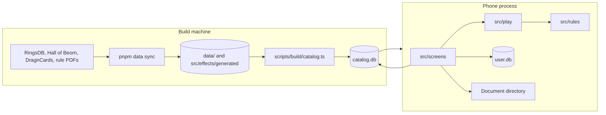
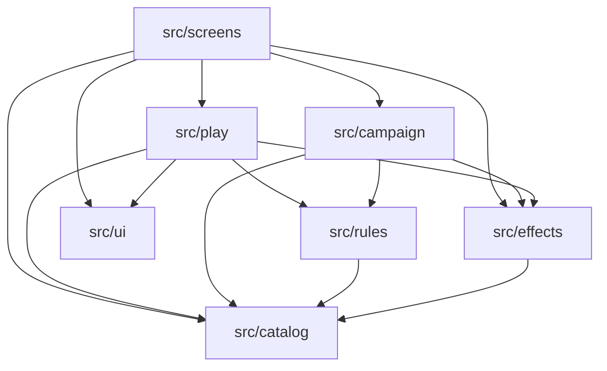
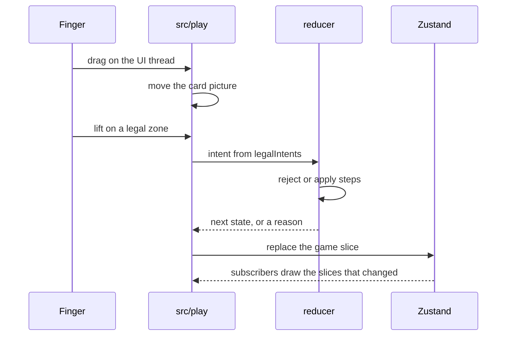

# Architecture

Structural design for the solo Lord of the Rings LCG app. Product rules and the round stay in [brief.md](brief.md). This file says how the process is split, who is allowed to write state, and which library owns which job. It does not restate a rule the brief owns.

The app is one Expo codebase: a binary on a phone, and on Windows, macOS and Linux an Electron shell around its web export (Desktop; user decision, 2026-11-16). The reducer runs in the app's own process either way. There is no accounts system, no room, and no server on the play loop.

## Stack

Pin Expo SDK 58. The new architecture stays on. One package, no monorepo. pnpm is the package manager. SDK 59 is out of these phases.

| Job | Library | Lives in |
| --- | --- | --- |
| Shell, routing, device builds | Expo SDK 58, Expo Router, EAS Build (development and e2e), Gradle and Xcode in GitHub Actions (release APK and IPA, optional TestFlight build) | `src/screens` |
| Desktop shell | Electron and electron-builder (exact pins in `package.json`), bundled with esbuild: unsigned installers for Windows, macOS and Linux from the web export (`expo export -p web`) | `desktop/` |
| Chrome layout | NativeWind 4.2.7, Tailwind 3 | screens other than the table |
| Table | `@shopify/react-native-skia`, the SDK 58 `pnpm expo install` version; on the web and the desktop it runs on CanvasKit, loaded from `public/canvaskit.wasm` (Screens) | `src/play`, `src/ui/skia` |
| Gestures and motion | `react-native-gesture-handler`, `react-native-reanimated`, `react-native-worklets` | `src/play` |
| Lists | `@shopify/flash-list`, the SDK 58 `pnpm expo install` version | pool, deck editor, any list past one screen |
| Catalog schema | one schema from `drizzle-orm/sqlite-core` | `src/catalog` |
| Catalog build | `better-sqlite3` opens that schema | `scripts/build/catalog.ts` only |
| Device database | `expo-sqlite` opens the same catalog tables, read-only | screens, opened at the root |
| User schema | `expo-sqlite`, migrations in `drizzle/` | screens |
| Catalog boundary | Zod | `src/catalog` |
| Files and list images | `expo-file-system`, `expo-image` | bundled pictures, lists, inspect, booklets |
| Screen state | Zustand | subscribers of reducer output |
| Haptics | `expo-haptics` (user request, 2026-10-25) | the table's dock: arm, send, undo, refusal; a card landing; a combat spotlight's strike |
| Sound effects and music | `expo-audio` (user request, 2026-11-18) | the table's and the screens' moments, and a looped piece of the film score for each scenario, on the phone only (`src/ui/sound/`; `docs/design-system-table.md`, Sound) |
| Clipboard | `expo-clipboard` | Copy game state on a phone (`src/screens/table/clipboard.native.ts`); it only writes |
| Keep awake | `expo-keep-awake` (user request, 2026-10-28) | the table, while Keep screen awake is on (`src/play/chrome/use-keep-awake.ts`) |
| Backup exclusion | local Expo module `modules/image-backup-exclusion` | the image directory (`src/screens/images/queue.native.ts`) |
| Other audio | local Expo module `modules/other-audio` (user decision, 2026-11-21) | whether another app's audio plays, so the music waits (`src/ui/sound/music.ts`) |
| Local PDF reader | `modules/booklet-pdf`, a local Expo module: PDFKit on iOS, `PdfRenderer` on Android; on the web `pdfjs-dist`, which `metro.config.js` serves for `booklet-pdf` (`src/screens/booklets/web`) | `src/screens/booklets` |
| Booklet import | `expo-document-picker`; bundled books through `expo-asset`; on the web an `<input type="file">` and OPFS | `src/screens/booklets` |
| Dev build | `expo-dev-client` (the local module is not in Expo Go) | device builds |
| Engine tests | Vitest | `src/rules`, `src/campaign` |

Install Reanimated, `react-native-worklets`, Gesture Handler, Skia, FlashList, `expo-sqlite`, `expo-image`, `expo-file-system`, `expo-haptics`, `expo-audio` and `expo-clipboard` with `pnpm expo install`. Worklets is the Reanimated 4 peer. NativeWind 5 is out. `package.json` pins Skia (2.14.0), FlashList (2.3.2), NativeWind (4.2.7), Reanimated (4.7.1), worklets (0.13.0) and Zustand (5.0.15) exactly; keep the versions `pnpm expo install` selected. The table decodes cached files. It does not call Skia's `makeImageFromView`. Only the deck import list uses FlashList sticky headers.

The catalog is one `drizzle-orm/sqlite-core` schema. The script opens it with `better-sqlite3`. The phone opens those tables with `expo-sqlite`, read-only. `user.db` is a separate schema. Its migrations stay in `drizzle/`.

Reanimated is the only animation library. Do not add TanStack Query, Redux, a Phoenix client, a server framework, MUI, Emotion, or styled-components.

Android ships an APK or AAB. iOS ships an IPA. A physical iPhone needs Apple signing. The desktop ships as unsigned installers for Windows, macOS and Linux (`desktop/electron-builder.yml` names the targets), with the web export, the pictures and the booklets in the installer's resources (Desktop). The binary contains the Expo shell, native modules, `catalog.db`, the booklet PDFs that `pnpm assets booklets` packs into `assets/booklets/` (not committed; `metro.config.js` bundles its map in place of the stub `src/screens/booklets/bundled-map.ts`) and every card's picture, which `scripts/build/pack-scans.ts` writes into `assets/scans` scaled to at most 1200 px on the long side (with the map `src/screens/images/scan-map.ts`, empty in git): each card's pinned `pictures` file, else its scan. `pnpm ios` and `pnpm android` pack too. It also carries the sound effects (user decision, 2026-11-21): `pnpm assets sounds` copies each file the `sounds` source of `data/sources.json` pins, from `.cache/audio/sfx` or else the asset mirror, into `assets/sounds/`, gitignored but for its `.gitkeep`, where the phone's `src/ui/sound/bundled.native.ts` finds them through Metro's `require.context` (the web and the desktop read them through `bundled.canvaskit.ts`, so the web export the desktop installers carry has them too; the tests read the empty `bundled.ts`). `--from` cuts them first from the player's own unpacked Darkest Dungeon II banks (and `--hearthstone` the card landing from the player's Hearthstone sounds) and writes their pins (`scripts/build/pack-sounds.ts`). With neither the cache nor the mirror the folder is empty and the app plays no sound. `pnpm assets music` does the same for the music loops, from the `music` source, `.cache/audio/music` and the mirror into `assets/music/` (`scripts/build/pack-music.ts`; both packs share `scripts/build/pack-audio.ts`). `eas-build-post-install` runs the catalog build and the packers, and so do the `android` and `ios` jobs of `.github/workflows/release.yml`, which build the signed release APK and the IPA (and, when set up, the TestFlight build; `docs/releasing.md`). The version is `0.0.0` in `app.json`; `app.config.js` stamps the release tag's version and build number from `APP_VERSION`, and the iOS signing team from `APPLE_TEAM_ID`. Image files stay in the document directory. A bundled booklet is copied into the document directory on first open, and the reader reads only that copy.

## Processes



Three groups of Node entry points exist, and none of them runs on the phone.

- `pnpm data sync` is the only command that reads the sources for new data. The packs and `pnpm data mirror` also read and write the asset mirror, a private R2 bucket of the pinned files (`docs/development.md`, Asset mirror). It refreshes `data/raw/` (the game icon sources under `data/raw/icons` included), `.cache/pdf/`, `.cache/scans/` and `.cache/pictures/` (every card's picture the app bundles, `scripts/data/sources/pictures.ts`) and records every pin in `data/sources.json`. Card text comes from the printed-text ledger `data/printed/`, read from the scans; rule text from the curated spans in `data/rules/index.json`. `pnpm data build` turns the raw snapshots into `data/cards`, `data/scenarios`, `data/campaigns`, `data/decks` (the pre-built player decks, read by the import screen), `data/rules`, `src/effects/generated`, and the game icons and printed card backs (`assets/icons`, `src/ui/icons`), offline and deterministically. `pnpm data check` rebuilds into a temporary directory and fails on any difference.
- `scripts/build/catalog.ts` (`pnpm assets catalog`) reads `data/` offline. It writes `assets/catalog.db` and the `CATALOG_VERSION` constant. `scripts/build/pack-booklets.ts` and `scripts/build/pack-scans.ts` bundle the booklets and card scans. EAS Build and the release workflow run all three after install.
- Developer tools read `data/` and the engine: `pnpm data query`, `pnpm effects draft`, `pnpm effects open`, `scripts/e2e/fixtures.ts`, `scripts/card-smoke/run.ts`, `test/harness/combat-policy.ts` (the policy the combat tests play whole starter games with, which attacks; the auto-player never does), and the auto-player and scene scripts the golden games use.
- The Expo app runs on the device. It reads the bundled catalog, reads and writes `user.db`, and calls the reducer in process. It plays with no network: the catalog, the booklets and every card's picture are in the binary, and a release build's only requests are the RingsDB deck import and the update check (Update check).

A second human who must not see hidden cards, or several clients sharing one live table, would need a host. This product has neither. A future copy of `user.db` rows onto another device would still not run the round.

## Modules



| Path | Owns | May import |
| --- | --- | --- |
| `src/catalog` | Zod schemas for cards, packs, `Effect`, `Instruction`, `Condition`, `Cost`, and `ScenarioDefinition`; the mechanic families' vocabulary (`families/`); scenario and campaign data types; the universal deck-legal check; the catalog Drizzle schema; `CATALOG_VERSION` | nothing in `src/` (tests and scripts may reach `src/effects`) |
| `src/effects` | `generated/` (written by `data build` from sentence templates) and `authored/` (per scenario, `pool/<pack>.ts` and `families/<family>.ts`); `EFFECTS` is both, an authored id replacing a generated one; `open-lines.ts` | `src/catalog` |
| `src/rules` | The engine: state, round machine, window and frame stack, keywords, modifier list, effect interpreter, the mechanic families' engine (`families/`), reducer, undo, replay | `src/catalog` |
| `src/campaign` | Save and log types, briefing and checklist, `buildStart`, resolution, scoring, replay of a save, standalone games, playable list | `src/catalog`, `src/rules`, `src/effects` |
| `src/play` | Skia table, phase rail, sheets, choice logic, readouts, gesture-to-intent mapping, undo history | `src/rules`, `src/catalog`, `src/effects`, `src/ui` |
| `src/ui` | The design system the table and the screens share: tokens and theme, text, UI scale and size class, surfaces, radius, buttons, game icons (`icons/`, written by `data build`), motion tokens and the motion clock, accessibility (`accessibility.ts`: the one store of the phone's Reduce motion, screen reader, Bold Text, Reduce Transparency and Increase Contrast; `display-prefs.ts`: the hooks for what the table draws from those and the settings, Strong outlines in effect, Reduce Transparency and the Title face, with the one settings subscription; `faces.ts`: the face a text is drawn in; `screen-reader.ts`: `useScreenReader` and `useReaderMode`, the gate for everything made only for a reader on a phone; `announce.ts`: the one announcement queue, which every `announceForAccessibility` call goes through; `focus-ring.ts`: the keyboard focus ring every table control draws; `key-shortcuts.ts`: the key-to-action map of the table), haptics, sound effects and music (`sound/`: the slots, the bundled files, `playSound`, the music's loops, map and two-copy player, and the audio session they share; `feedback.ts`: a haptic and its sound together), the volume slider, table settings, fog (`fog/`: textures, layers, masks and their Skia draw, shared by the backdrops and the combat spotlight) | nothing in `src/` |
| `modules/image-backup-exclusion` | Sets the platform's backup-exclusion flag on the image directory; `index.ts` is the JS side; autolinking links it through `ios/*.podspec` and `android/build.gradle` (`scripts/checks/local-modules.test.ts`) | `expo-modules-core` only |
| `modules/other-audio` | Answers whether another app's audio plays (iOS `secondaryAudioShouldBeSilencedHint`, Android `isMusicActive`); `index.ts` is the JS side and answers false without the native module | `expo-modules-core` only |
| `modules/booklet-pdf` | Native view and `pageCount` for one local PDF (Swift on iOS, Kotlin on Android; Android zooms in `ZoomList`, PDFKit zooms itself); `index.ts` is the JS side and reports `bookletPdfAvailable()`; autolinking links it through `ios/*.podspec` and `android/build.gradle` (`scripts/checks/local-modules.test.ts`) | `expo-modules-core` only |
| `src/screens` | Expo Router routes, SQLite, image cache, deck editor, booklet reader | `src/play`, `src/campaign`, `src/catalog`, `src/effects`, `src/ui` |
| `test/` | Test support only: the harness (`harness/`: test catalog, scenes, auto-player, cause check) and one folder per scenario (`scenarios/<scenario-id>/`: its scene and its seeded whole game). Tests and scripts import it; the app never does | anything |

The Expo Router root is `src/screens/routes`. Every file in that directory is a page. SQLite, the database provider, and tests stay in `src/screens`, outside that root.

`.oxlintrc.json` enforces these edges (`pnpm lint`, CI). `import-x-js/no-restricted-paths` zones (eslint-plugin-import-x, loaded as an Oxlint JS plugin) allow only the imports in the table, and `src/play` may not import `src/campaign` or `src/screens`; `src/ui` may import nothing else under `src/`; `src/screens` may not import `src/rules`, so it reads engine results through `src/play` and `src/campaign`. `src/rules` and `src/campaign` also may not import `react-native`, `expo` or `expo-*`, statically, dynamically or with `require`. Scripts, `test/` and test files get the same zones except that they may import `src/effects` into `src/rules` and `src/catalog`; `src/rules/boundaries.test.ts` additionally scans `src/rules` for `src/effects`, `fetch`, `Math.random` and `better-sqlite3`. `src/rules` receives the effect list as an argument (`ReduceContext`). Vitest imports the same reducer the screen calls and passes the effect list in.

The core round and the deck builder do not mention Fellowship by name. A scenario is `data/scenarios/<id>.json` and a `ScenarioDefinition` derived from it; `buildStart` turns a campaign and a scenario into the engine's start. A further scenario is more `data sync` and `data build` output, its campaign card's Setup and Resolution as records, and the records `pnpm effects draft` drafts for its open lines. `src/campaign/playable.ts` lists the scenarios whose printed lines all have records; `pnpm effects open` lists the lines still open.

`src/play` sends player intents. It does not assign threat, damage, resources, progress, or log fields.

### Repository map

Each folder answers one question; a test keeps it so (`scripts/checks/layout.test.ts`: no source folder over 40 files, one folder per mechanic family, scenario folders named by scenario id). Scenario folders everywhere use the id of `data/scenarios/<id>.json`. A file's test sits beside it; a `.native` file sits beside its base file. Move files with `pnpm move`, which rewrites every path that names them.

```
src/catalog/            schemas, types, the families' vocabulary (families/<family>.ts), CATALOG_VERSION
src/effects/            generated/ (data build), authored/ (<scenario-id>.ts, return-of-the-king/ (that box's files), fellowship-of-the-ring.ts (the Fellowship box), reprint.ts (reprinted cards), pool/<pack>.ts, nightmare/, families/)
src/rules/              the engine
  core/                 state, intents, zones, keywords, printed cards, seed, causes, test-fixture
  engine/               reduce, the round machine, legal intents, refresh, undo, ENGINE_VERSION
  windows/              windows, the frame stack, the queue, responses, triggers, events, delayed effects
  interpret/            the effect interpreter, verbs, conditions, amounts, constants, restrictions, picks
  combat/  quest/  setup/  player/      combat and shadows; quest, staging, travel; setup and resolution; actions and costs
  families/<family>/    one mechanic family's engine: index.ts (its run) and its parts; families/index.ts orders them
src/campaign/           saves, log, loadout, start, briefing, resolution, XP, runs, standalone games, playable list
  scenarios/<scenario-id>/   that scenario's tests and its golden game (golden.json)
  starter/              the starter-deck tests and goldens
  fixtures/             the save fixtures (scripts/e2e/fixtures.ts writes them); registry.ts names them by scenario
src/ui/                 the design system (see the table above)
src/play/               the table
  store/  canvas/  layout/  motion/  spotlight/  phases/      state and selectors; the Skia table; zone geometry; card motion; the combat spotlight; the phase rail and carousel
  choice/ (dock/)  readouts/  words/  cards/  chrome/         sheets, the tray and the dock; numbers and banners; choice wording (words/scenarios/ holds the modules named for a scenario or a mechanic family, words/scenarios/angmar/ the Angmar Awakened table words, words/asks/ the asks files); card text and preview; top bar, menu, panels
  dream-chaser/         the Dream-chaser table pieces (the Island Map, the Heading dial)
  scenarios/            table tests that play one scenario
src/screens/            the app around the table
  routes/               Expo Router pages only (each file is a URL)
  kit/  nav/  art/  data/      the chrome UI kit and palette; navigation and insets; backdrops and hero art; databases, schema and stores
  deck/  pool/  campaign/  briefing/  history/  session/  table/  settings/  rules/  images/  booklets/
test/                   test support: harness/, scenarios/<scenario-id>/ (scene.ts, game.ts)
scripts/                commands: data/ (sync, build, check, query, effects), build/ (catalog, scans, booklets), desktop/ (dev, build, pack), docs/, e2e/, card-smoke/, checks/ (a11y-web, desktop-smoke), browser/ (the web export in Chromium for pnpm browser and the a11y check), game/ (pnpm game: a fixture or golden as text), tools/ (pnpm move), log.ts
desktop/                the Electron shell, outside the app's bundle (main, preload, serve, policy, identity, bounds, menu); imports nothing from src/. Built into desktop/build and desktop/out (gitignored)
discord/                the Discord issue bot, a Cloudflare Worker outside the app (docs/discord-issues.md); imports nothing from src/
data/  assets/  drizzle/  modules/  plugins/   sources and builds; bundled files; user.db migrations; native modules; Expo and Babel plugins
.maestro/               showcase/, subflows/ (the README's screenshot flows)
docs/                   brief, architecture, design system; phases/ (STATUS.md, open phases, done/); plans/ (done/); handover/
```

## State

Three kinds of state, three owners.

| State | Owner | Persistence |
| --- | --- | --- |
| Game and the open scenario | `src/rules` reducer | `user.db` `saves.activeScenario`, written when an intent commits; its table as `saves.checkpoint`, written at a phase boundary and on a pause (Persistence) |
| Campaign log, pool, path | `src/campaign`, applied by the same commit | `user.db` `saves` |
| A standalone game and its result | `src/rules` reducer, ended by `src/campaign/standalone.ts` | `user.db` `standalone_games`, each intent written when it commits |
| Decks, image index, booklets, applied catalog version | screen writers | `user.db` |
| The app's settings (user request, 2026-10-28; `TableSettings` in `src/ui/table-settings.ts` lists them, `docs/design-system.md`, Settings, says what each does) | `src/ui/table-settings.ts`, a vanilla Zustand store the table and the screens read; `src/ui/ui-scale.ts` (the four factors, the 44 pt `touch` floor, `UiScaleContext`) and `src/ui/theme.ts` (`resolveTheme`, `ThemeContext`); `src/screens/settings/store.ts` hydrates the store and writes each change. `routes/_layout.tsx` resolves the theme and the scale once, sets NativeWind's rem (14 × the factor) and the theme's color variables, and provides both contexts, so a list row pays one context read and no store selector | `user.db` `settings`, key `table` |
| Card rows, effect rows, scenario definitions baked at build time | catalog build | `catalog.db`, replaced only by a version bump |
| Finger position, card lift, in-progress sheet motion | Reanimated shared values on the UI thread | nowhere |
| Which slice a screen draws | Zustand | memory, rehydrated from SQLite on launch |
| The seat the table is peeking at in two-handed play (`viewedSeat`) | the table store (`src/play/store/store.ts`), set by a tap on the other seat's dial (`src/play/store/peek.ts`); `shownSeat(game, viewed)` is what the canvas, the reader table and the pile list draw, `actingSeat(game)` is what picks, pays and sends | memory only: never engine state, never in the save; null when the table opens and after every new state |

Zustand stores the latest reducer result so a subscriber can select one slice. The reducer is the only writer of game numbers. A screen replaces the Zustand game slice with the value the reducer returned. Reducer updates keep the same object references for zones that did not change. A threat change updates the threat overlay and does not replace the hand slice. Do not use Drizzle `useLiveQuery` for scenario state.

The save keeps only the seed and the intent log (Persistence). The table's Undo is `src/play/store/undo-history.ts`: the store keeps the state before each intent that showed nothing hidden (`showedHidden` in `src/rules/engine/undo.ts` decides; a finished scenario keeps none), with the round's log as it then was, and goes back to the last one. The session then drops that intent from the save (`unrecord`), so a relaunch replays the same game. The restored state and the seed cursor match. Separately, the engine keeps `state.undo`, a snapshot at each phase boundary plus the intents and steps since (`noteHistory`, and `replay` in `src/rules/engine/undo.ts`). The snapshot is held by reference, not copied: a state is never changed once the reducer returns it, so `snapshotOf` keeps the state itself (with an empty card map and an empty `undo`) and `cards` points at the same card map.

`legalIntents(state)` runs when the window changes, not per pixel. It does not build the cross product of every card and every target up front. The table computes targets for the card the player selected. A gesture samples positions on the UI thread and asks the reducer only when the finger lifts or a button commits.

The interpreter and the reducer are pure. Shuffles advance the seed cursor stored on the scenario. No clock, no network, no `Math.random`. Vitest passes a fixed seed. An e2e build passes one too, through a launch argument that production builds ignore. A kill and relaunch continues the same sequence.

Willpower and damage read a modifier list on the scenario. The list may be empty. A `constant` effect appends a record. Combat math does not fork to apply one.

## Play loop



Which intents are legal, and which amounts the engine computes, are in the brief. Drop targets are zone ids from `legalIntents`.

The window stack is part of game state. A nested frame pops before the parent continues. The action windows between framework steps, and between the steps of an attack, are opened by `src/rules/engine/step-window.ts`; the attack in progress waits on them and goes on once they close. The phase rail names the step. An animation does not gate the rule. Keyword scope is in the brief.

## Engine

`src/rules` is one pure reducer. Its public edge is `src/rules/engine/reduce.ts`: `reduce(state, intent, ctx)` returns the next state and the `EngineStep`s that produced it, or a reason; `legalIntents` and `legalTargets` (`legal.ts`) say what the window allows; `startScenario` (`setup.ts`) turns a `StartScenario` into the opening state; `replay` re-runs intents. `ctx` is a `ReduceContext`: the effect list and the printed cards (`PrintedCard`, `printed.ts`), both passed in.

One call to `reduce` runs `rejectionReason` (legality), `applyIntent` (`machine.ts`), `settle`, `syncConstants`, and `noteHistory` (`undo.ts`). `ScenarioState` (`state.ts`) holds the zones (`ZoneName`: deck, hand, discard, heroes, play, engaged, staging, the active locations, the quest and encounter piles, `burdenDeck`, `victory`, `setAside`, `removed`, `shadow`, `attached`, and the zones campaign play adds: `under`, `campaign`, `captive`), the round (`phase`, and `mode`, the framework step the machine is in), the open question for a player (`window`), the `stack` of frames, the modifier list, delayed effects, limit uses, the seed and its cursor, and the queue of events not yet announced.

- **Frames and windows.** A frame (`frame-types.ts`, `windows.ts`, `frames.ts`, `effect-frames.ts`) is work that can wait for a player: a reveal, an effect with a choice, a Response offer, a Forced effect. `settle` (`machine.ts`) advances the top frame until it pops or opens a `Window` (mulligan, pass, defense, choose, response, look, resolution, and so on), announces queued events once no window is open (`queue.ts`, `events.ts`), and runs the framework steps in order. `step-window.ts` opens the action windows between steps.
- **Effects.** `runEffects` and `runEffect` (`interpret.ts`) run a card's records of one timing, each instruction through `runInstruction`. That function asks, in order: `runFamilyVerb` (`families/index.ts`), `runPlayerVerb` (`player-verbs.ts`), the core verbs in its own `switch`, and `runExtraVerb` (`verbs.ts`). A verb that needs a choice or a child frame is handled by the effect frame before it gets there.
- **Triggers.** Code that changes the game announces a `GameEvent` (a `trigger` name, a seat, a card). `fireForced` (`triggers.ts`) collects the records whose `trigger` the event matches (`hears` in `listen.ts`, with `triggerHears` for the two-way triggers), Triggered before Forced, oldest card first, and pushes a frame for each; Responses are offered by `responses.ts`. `crossBoundary` fires the end-of-phase and end-of-round records and the delayed effects (`delayed.ts`). Code that has no effect list queues the event and `settle` announces it.
- **Constants.** `syncConstants` (`constants.ts`) turns each `ModifyStat` of a `constant` record into entries of the modifier list, rebuilt as cards enter and leave play; `modifiedStat` is the only reader. A stat flag (`FLAGS`) is such an entry with a boolean meaning, read with `flagged` or `heldStat`.
- **Causes.** Every step that changes a number carries a `Cause` (`cause.ts`): a rule span id, or an effect record with its printed line. A test plays the goldens and refuses any step without one.
- **Hidden information and randomness.** Shuffles use `seed.ts` and advance `seedCursor`. `showedHidden` (`undo.ts`) is true when an intent revealed something the player had not seen or moved the cursor; the table's Undo cannot take such an intent back.
- **Version.** `ENGINE_VERSION` (`version.ts`) is bumped when a change can move a replayed game, and the bump adds an `ENGINE_CHANGES` entry beside it: the scenarios it reaches and one line for players. A save from another version is replayed checked and asks the player to continue or restart on a mismatch (Persistence); the sheet lists the lines after the save's version that reach its scenario (the list starts after `ENGINE_CHANGES_SINCE`; a save from before it gets the generic sentence).

### Mechanic families

The engine and the record vocabulary grow by mechanic family, so work on one family does not edit another's files. A family `<F>` has three parts, composed by an `index.ts` beside each:

| Part | File | Holds |
| --- | --- | --- |
| Vocabulary | `src/catalog/families/<F>.ts` | one `manifest` (`family-manifest.ts`): `verbs` (strict Zod objects), `triggers` (event names), `flags` (stat flags `ModifyStat` can set). `index.ts` lists the manifests in `CATALOG_FAMILIES` and joins them as `FAMILY_VERBS`, `FAMILY_TRIGGERS` and `FAMILY_FLAGS`; `effect-schema-verbs.ts`, `effect-schema.ts` and `effect-schema-stats.ts` spread them into the verb union, the trigger enum and the stat enum. |
| Engine | `src/rules/families/<F>/`: `index.ts` (its `run`) and the part files beside it | one `manifest` (`interpret/family-manifest.ts`): the `verbs` it answers and `run(state, instruction, focus, ctx, steps)`, which returns the next state for a verb the family owns and `null` for any other. `families/index.ts` lists the manifests in `rulesFamilies()`, in play order; the first non-null result wins. `interpret/family-manifest.test.ts` fails when a declared verb has no runner or a runner answers an undeclared one. Families also hold the small hooks the shared engine files call (for example `play/hooks.ts`, `attachments/hold.ts`, `defense/listen.ts`). The manifest can also carry optional hooks the core calls through `rulesFamilies()` (`interpret/family-hooks.ts`; a test passes its own list or scopes one with `withFamilies`): `settle` (`before`, `after` and `sweep` steps of the settle loop in `engine/machine.ts`, run in `SETTLE_ORDER` of `families/index.ts`, which lists every family with a hook for the phase; each returns a new state or the same one), `travel` (`may`, `reach`: `legal.ts`; `cost`, the charge for traveling to a location or for declining to travel, which `quest/travel.ts` resolves in a frame of its own for the card that charges it; `forced`, the staged locations the players must travel to, and `unpayable`, a Travel instruction they cannot pay now: `restrictions.ts`), `questResult` (the state a family leaves when it places a quest resolution's progress or threat itself: `fortress`), `play` (a card the family bars from being played or put into play, `putting` telling which: `sidequests/contract.ts` `playBlocked`), `revealed` (a note of an encounter card as it is revealed, before its When Revealed: `windows/frames.ts`), `pick` (a card filter, `pick.ts`), `pool` (the cards a pick starts from, for a filter that names a pool of the family's own: `captured`), `condition` (`conditions.ts`, `null` when the condition is not the family's) and `amount` (`amounts.ts`, `null` likewise) and `combat` (`defense` and `attack` give the reason a character may not defend or be declared against an enemy, the first family's reason winning; `undefended` names the characters an undefended attack's damage goes to instead of the heroes: `combat.ts`, `legal.ts`). Core code that still calls a family by name stays until that family is next changed; it then moves behind its hook with the goldens byte-identical. A verb's routes are flags on its own schema entry, set with `verbFlags(schema, flags)` (`src/catalog/verb-flags.ts`): `setupRole` (`"dealt"` or `"afterSetup"`: the start deals it or resolves it after the quest card's Setup), `setupRuns` (a quest card's Setup runs it), `runsInFrame` (a Shadow runs it in a frame) and `collection` (it takes a hero or a card from the collection). `src/catalog/verb-sets.ts` reads the sets off the schema for `src/campaign/start.ts`, `shadow.ts`, `quest/setup.ts` and `world.ts`. |
| Records | `src/effects/authored/families/<F>.ts` | `RECORDS` and `REPLACES` (ids of generated records the family's records replace). `authored/families/index.ts` composes them into `FAMILY_AUTHORED_EFFECTS`. |

The families are listed in `src/catalog/families/index.ts`. `wilderland` (the Ered Mithrin campaign's treasures, boon allies and encounter cards in the Campaign Pool, and the decks, keywords and Guarded (X) its scenarios share: `src/rules/families/wilderland/`) runs `AttachRandomTreasure` in a game (a seeded draw, asked of the first player, attached as a guarded objective), answers the conditions that read the Campaign Log's lines and treasures, and leaves its Resolution verbs to `src/rules/setup/resolution.ts` and its Setup removal to `src/campaign/checklist.ts`. The decks beside the encounter deck are zones whose lists `src/rules/core/piles.ts` reads and writes through one accessor: the Corsair deck and its discard pile (`corsairDeck`, `corsairDiscard`), the Uncharted deck (`uncharted.deck`) and Ered Mithrin's `cavesDeck`, `evilCreaturesDeck`, `evilCreaturesDiscard`, `spidersDeck`, `orcsDeck` and Journey to the Cross-roads' `haradDeck` (`ScenarioState.piles`); `moveCard` joins and leaves them there, `core/decks.ts` refills a deck from its discard pile and `encounter/named-decks.ts` reveals its top card (the Corsair deck and the Evil Creatures deck share both), and `settle` keeps the Evil Creatures deck refilled. A card dealt into the Evil Creatures deck carries `CardInstance.deck`, so it goes to that deck's discard pile, even with Victory, when it would be discarded. Deep is a constant marker on a location: `quest/travel.ts` pushes a frame under the Responses to the travel that discards the location and makes the top Caves card the active location (`wilderland/deep.ts`). `IgnoreKeyword` on a card in play (the campaign card, the quest stage) is the scenario-level switch for Deep and Discover (`wilderland/markers.ts`). Mount Gundabad's quest deck is a quest whose stage 2s print `FlipAtQuestPhase` (`stages[i].deck`): the quest advances to the top of the deck, the stage defeated goes to the victory display, a stage arrives side A up and `unflippedStage` (`quest/order.ts`, read by `effectsOfCard`) keeps its side B text silent until `FlipCurrentQuest` flips it at the beginning of the quest phase; `wilderland/gundabad.ts` bypasses the current stage, searches the quest deck and flips Wormsbane in place, `gundabad-cards.ts` searches the Caves deck, stages a random discarded enemy and gathers treasures on one character, and `rounds.ts` notes the first treachery revealed each round and limits a player's plays in a phase. The Fate of Wilderland's `wilderland/assault.ts` searches the encounter deck, its discard pile and the victory display for a card, stages the enemies an effect discarded, takes progress off a card and answers `attackedThisPhase` (whether an enemy has resolved an attack in the combat phase now under way). Discover X is a Forced effect when a location becomes the active location, Loot a constant marker `startReveal` reads, and Guarded (enemy or location) on an objective is `GuardObjective` with `types`, which shares its search with the player attachments' Guarded (X) (`encounter/discard-until.ts`). `island` (the Island Map and Exploration of Temple of the Deceived, the Gate Key and the secrets: `src/rules/families/island/`, records in `src/effects/authored/temple-of-the-deceived.ts` and `pool/DCCE.ts`) adds the zone `islandMap` (a map location outside the staging area, in play; `syncIsland`, run by `settle`, moves the map's cards between the staging area and the map as the active location says) and keeps the map in `uncharted.island`. `grapple` (Grapple X, the encounter set a quest stage swaps in, the Stormcaller Elite's flip and its flip to an attack, The Thing in the Depths' campaign card and The Drowned Ruins' Sahír's Betrayal: `src/rules/families/grapple/`, records in `src/effects/authored/the-thing-in-the-depths.ts` and `the-drowned-ruins.ts`) adds the zone `grappled` (an enemy facedown on a location in the staging area: in play, outside the staging area, hosted by the location; `zones.ts` detaches it when the location leaves the staging area) and reads the Threat it adds in `modifiedStat`. `dreamchaser` (the Dream-chaser campaign's XP: the Resolution verb `GainXp`, run by `src/rules/setup/resolution.ts`, with its counts in `src/rules/families/dreamchaser/index.ts`; what the log's marks mean to a game, a scalable card's level and an upgraded card's side, in `dreamchaser/facts.ts`; `GainXp` is allowed only in a Resolution record) has its records in `src/effects/authored/pool/DCCE.ts` for the Hard/Expert Mode card, and in each scenario's file for its campaign card. `sea` (the ships, the fleet, the heading, the Sailing test, the Corsair deck, Boarding and the Stormcaller Elite of the Dream-chaser box: `src/rules/families/sea/`) keeps one optional piece of state, `sea` (the heading, the Heading card, the routes of the cards that never go to the encounter discard pile, the Sailing test in progress), and the zones `corsairDeck` and `corsairDiscard`; a game with no ship and no Stormcaller Elite card has neither, so no other game's state changes. A ship is an enemy or an objective ally carrying `PrintedCard.ship`; `moveCard` asks `sea/routes.ts` where a card really goes, `machine.ts` runs the Sailing test before the quest commitment and refills the Corsair deck, `events.ts` resolves Boarding as an engagement from the staging area is announced, and `combat.ts` and `legal.ts` read the ship rules. Its records for the Dream-chaser's Sailing line are in `src/effects/authored/families/sea.ts`. `campaign` (the Mirkwood Paths campaign cards' Setup and Resolution verbs: an objective ally put into play, cards set aside and attached later, cards added to the Campaign Pool on their hero, a prisoner named, cards carried to the next campaign, tokens placed on the campaign card and recorded) has its records in `src/effects/authored/passage-through-mirkwood.ts`, `journey-along-the-anduin.ts`, `the-oath.ts`, `pool/RevCore.ts` and `pool/TDoM.ts`. The Oath adds the limit `oncePerCampaign` (`src/rules/player/usage.ts`, `families/campaign/used.ts`: the use is a fact in the Campaign Log's `usedOnce`), the encounter family's `SearchCollection` and table flag `encounterUncancelable`, and a Response window at the end of the round (`src/rules/windows/triggers.ts`). The first quest card's own Setup and When Revealed at the start of the game run in `src/rules/families/quest/setup.ts`. `burden` (the burden deck, the Ring-bearer's life, Flight to the Ford) and `south` (a second active location, the Ring-bearer captive under the Watcher, damage assigned among characters, The Ring Goes South) have no records file of their own: their records are in `src/effects/authored/flight-to-the-ford.ts` and `the-ring-goes-south.ts`. `objectives` (a Guarded objective with an encounter card attached, claimed by a player and attached to a hero), `prisoner` (a hero held facedown in the captive zone the south family also uses, Mendor captured with it, the rescue) and `dungeon` (Orc Guards made of deck cards, Iron Shackles on a deck, the group limit of allies, a staging threat raise) have no records file of their own: their records are in `src/effects/authored/escape-from-dol-guldur.ts`. `caves` (The Caves of Nibin-Dûm: progress limits on the quest card, engagement cost 0, a location the first player may attack from the staging area, the excess of combat damage taken off the quest, a card removed from the game) has its records in `src/effects/authored/the-caves-of-nibin-dum.ts` and `pool/TDoM.ts`; the stage number is an amount, and a stage that arrives with 0 quest points is not met on arrival (`src/rules/quest/quest.ts`). How to write records for a family is `docs/agents/effect-authoring.md`. `uncharted` (the Uncharted deck and its double-sided locations, the Grotto deck of The Drowned Ruins, Calphon, the bottom of a deck and the Campaign Setup of The Fate of Númenor: `src/rules/families/uncharted/`; the state `uncharted` and the zone `unchartedDeck`; its records are in `src/effects/authored/the-fate-of-numenor.ts`, `the-drowned-ruins.ts` and `pool/DCCE.ts`, `pool/DCCEDrownedRuins.ts`). A card whose two sides are two catalog cards (a Grotto location over its Underwater side, the Shrine to Morgoth) keeps the side it shows in `CardInstance.code` and the other in `CardInstance.other`; the Shrine, dealt apart from the deck, is paired in `uncharted.pairs`, and `uncharted.grotto` marks the deck as the Grotto deck, which the table names and draws as such (`zone.ts` routes a Grotto card, on either side, that would go to the encounter deck or discard pile into it, Grotto side up). `aflame` (Aflame X and The Havens Burn, Sahír's Advance, the Stormcaller Elite of Raid on the Grey Havens, Galdor's Counsel's level: `src/rules/families/aflame/`; the zone `under` hosted by the Burn; its records are in `src/effects/authored/raid-on-the-grey-havens.ts` and `pool/DCCE.ts`). `stormcaller` (Flight of the Stormcaller's area, a second quest deck of stages 2C to 4C beside the Stormcaller, the catch-up that wins, the progress that moves onto its stage and the commitments the ships and Corsairs hear: `src/rules/families/stormcaller/`) keeps its area in the sea state (`sea.stormcaller`: the Stormcaller, its current stage, the stages to come and the cards of the area) and the zone `stormcallerArea`, which is in play and is not the staging area; `settle` stands the area's cards in the staging area while the players are at the Stormcaller's stage and in the zone otherwise (`stormcaller/area.ts`), so no rule that reads the staging area reaches them and a player card effect cannot choose them; its records are in `src/effects/authored/flight-of-the-stormcaller.ts` and `pool/DCCE.ts`. `pursuit` (The Uruk-hai's pursuit tracker: `ScenarioState.pursuit`, the verbs that set, raise and lower it, the amount X the quest stages read, and the condition `soleAttacker`: `src/rules/families/pursuit/`) and `captives` (the Captives of The Uruk-hai: heroes faceup in the captive zone under To Isengard! or an enemy, flagged `CardInstance.captive`, kept out of their owner's heroes and not killed, `values.ts` read by the `captive` pick filter; `src/rules/families/captives/`) have their records in `src/effects/authored/the-uruk-hai.ts`. `fortress` (Helm's Deep's Defense keyword, `mec112.defense`: `src/rules/families/fortress/`) answers the hook `questResult` (`resolveQuest` in `src/rules/quest/quest.ts` asks `familyQuestResult` first): while the current quest stage holds the flag `defenseKeyword` questing places no progress for the players, and the Threat that beats the committed Willpower is placed on the current quest through the active location, no threat raised; it keeps `ScenarioState.defensePlaced` (whether the stage itself took progress) for the condition `encounterPlacedOnStage`, announces `defenseQuestResolved` to the stage, bars attackers while the table holds `cannotDeclareAttacks` (the `combat.attack` hook) and answers `RemoveResourceTokens`, `playerUnengaged` and the pick filter `isSource`; its records are in `src/effects/authored/helms-deep.ts`. `wizardry` (the Wizardry timing of The Road to Isengard, `mec112.wizardry`: `src/rules/families/wizardry/`) reads a Wizardry line as a `forced` record whose trigger is `wizardry`, so the line's printed timing in `data/` stays a constant: `play/hooks.ts` `triggerHears` lets it hear a location leaving play, the record's `subjectExplored` condition keeps it to an explored location (the staging area as well as the active location), and `TriggerWizardry` runs the same record for Machines of Isengard (the active location's) and for Saruman (a shadow card's, with `asOnlyPlayer`: each `ForEachPlayer` runs once for the acting player, `eachSeat` becomes the actor and the number of players is 1). `shadowWizardry` is announced about the attacking enemy for each face-up shadow card with a Wizardry line, as the shadow step ends (`combat/shadow.ts`, `wizardry/shadow.ts`), and the family keeps the progress placed on the current quest this phase while the table holds `trackQuestProgress` (`quest.ts` `putOnStage`) for `CancelPhaseProgress`. `harad` (Journey to the Cross-roads, `mec112.setup-journey-to-the-cross-roads`: `src/rules/families/harad/`) places an enemy facedown under The Black Gate (`PlaceFacedownUnder`: the zone `under` hosted by the card with that code, `placedUnder` announced), answers the condition `facedownUnder` and the Pick filters `lowestAttack` and `lowestThreat`; its records are in `src/effects/authored/journey-to-the-cross-roads.ts`. The Harad deck is the wilderland pile `harad`, and `AddFromPile` with `reveal` reveals its top card (Surge and When Revealed resolve); a lasting `ModifyStat` with `target: enemies` and a `trait` is held by the class `enemies:<Trait>` (`core/holder-classes.ts`), which `archeryTotal` reads too. `grey-company` (The Passing of the Grey Company, `mec113.phantom`: `src/rules/families/grey-company/`) cancels a Phantom enemy's combat damage in `combatDamage` (`defense/excess.ts`, the one place an attack deals its damage to a character) and raises the defending player's threat by as much, unless the enemy holds `losesPhantom`; it also answers the amounts `highestThreat` and `playersAtThreat`, the seat flag `cannotPlayCards` (the `play` hook), `DiscardHand` and the Travel cost `RemoveProgressFromQuest`. Phantom is a printed keyword (`keywords.phantom`, `src/catalog/keyword-line.ts`). A copy of Overcome by Fear on a player's threat dial is a card in that seat's play area under its control, attached to no card; the attachments family attaches and detaches it (`AttachToDial`, `DetachFromDial`, `RemoveSetAside`, the conditions `onDial` and `canAttachToDial`: `attachments/dial.ts`), the set-aside copies waiting in `ScenarioState.setAside`. The quest family's flag `threatFloor` stops a threat reduction at the starting threat level (`quest/threat.ts`). Hand pressure is the deck family's (`src/rules/families/deck/pressure.ts`): `cardsDrawn` is announced with the draw's source and a clock stamp (`GameEvent.at`, so a card that enters play after the draw does not hear it), `abilityTriggered` is announced when an Action, a Response or a Forced effect of a card triggers, and the settle `sweep` hook eliminates a player with 0 cards in hand while the table holds `eliminatedAtEmptyHand`. `mount-doom` (the Fortitude test of Mount Doom, `mec113.fortitude-tests`: `src/rules/families/mount-doom/`) is a frame beside the Hide test's (`fortitude`, step by step in `fortitude.ts`: the tester commits heroes with `CommitFortitude`, discards the top X cards of the encounter deck with the discard pile shuffled back in any phase, a Forced effect of a card discarded for the test (`discardedInFortitude`, Gollum) hears them, the Sauron's Eye icons (`keywords.eyeIcons`, read from the ledger) are counted, the players take actions, and the committed Willpower must be greater than the icons); its result is heard as `fortitudeFailed` or `fortitudePassed`, kept for the round in `ScenarioState.fortitudeFailures` and on the running effect for `lastFortitudeFailed` and `lastFortitudePassed`. The same family marks the first treachery of each quest phase (`FirstTreacheryImmuneSurge`, a `revealed` hook); the table flags `fortitudeEyes`, `noFortitudeCommit` and `noRefreshThreat` are read by the test and `src/rules/engine/refresh.ts`. A location a Setup makes active announces `becameActive` when its own Forced effect hears it (`announceSetupActive`), and the campaign family's `PlaceTokensOnCampaignCard` puts the recorded tokens on the campaign card kept in the game. A burden that functions like a player card (Poisoned Counsels, The Searching Eye) is the burden family's: `ShuffleCopyIntoEachDeck` (Setup, run by a Choose of the quest card's Setup: `setupRuns: "inChoose"`; `src/rules/families/burden/player-deck.ts`), the rest of the hand discarded by `DiscardEach`, the draw announced by `enteredHand`.

## Effects

The effect record shape, and which sentences may stay inactive, are in the brief. Zod schemas for `Effect`, `Instruction`, `Condition`, `Cost`, and `ScenarioDefinition` live in `src/catalog`. `src/effects/generated/` is written by `data build`: `scripts/data/effects/templates.ts` holds ordered sentence patterns, and a template writes a record only when its pattern matches a whole line of card text. `src/effects/authored/` holds the records for the lines no template reads, and an authored record replaces a generated one with the same id (`mergeEffects` in `src/effects/index.ts`; `data build` also writes `src/effects/generated/authored.ts`, the barrel of the authored files in campaign order, because Metro cannot glob); `AUTHORED_REPLACES` names those overlaps, and `scripts/checks/effect-coverage.test.ts` fails when the list and the overlaps differ. Authored records live in `authored/fellowship-of-the-ring.ts` (the Fellowship box), `authored/<scenario-id>.ts` (a scenario's own cards; a campaign in `AUTHORED_CAMPAIGN_FOLDERS`, `scripts/data/effects/authored-paths.ts`, keeps its box file and scenario files in one folder, `authored/return-of-the-king/`, to hold the directory under the size limit `scripts/checks/layout.test.ts` sets; and where `effects draft` sends a box card that no pool file takes), `authored/pool/<pack>.ts` (the player pool, by pack; `pool/RevCore.ts` and `pool/TDoM.ts` also take those boxes' boons and burdens) and `authored/families/<family>.ts`. `pnpm effects draft <scenario | starter deck id>` writes `.agent/drafts/<code>.md` for the lines that still lack a record.

The interpreter takes the effect list as an argument. It does not import `src/effects`. The screens, `src/campaign` and `src/play` import `EFFECTS` and pass it in. There is no effects table in `catalog.db`. New verbs are added by hand to the vocabulary and the engine: a family's `VERBS` and `run` (Engine, Mechanic families), or, for the older core verbs, `effect-schema-verbs.ts` (stat modifiers, picks, conditions and amounts in `effect-schema-stats.ts`, `effect-schema-pick.ts`, `effect-schema-conditions.ts` and `effect-schema-amount.ts`, all exported through `effect-schema.ts`) and `src/rules/interpret/interpret.ts` or `verbs.ts`. That is engine work, not data. Printed lines no record owns are listed by `pnpm effects open` (`src/effects/open-lines.ts`).

## Scenario definition

The reducer accepts a definition. It does not branch on a scenario's product name.

```ts
type ScenarioDefinition = {
  id: string;
  encounterSets: { code: string; count: number }[];
  stages: { code: string }[];
  widgets: {
    hide: boolean;
    lifeTracker: boolean;
    burdenDeck: boolean;
    secondActiveLocation: boolean;
    perSeatStaging: boolean;
  };
  setup: Instruction[];
  resolution: Instruction[]; // the campaign card's Resolution records, in line order
  burdenDeck?: string[]; // the burden deck's cards, in booklet order
  life?: number; // the Ring-bearer's starting life
  campaignCard?: string; // the campaign card whose Setup and Resolution belong to the scenario
  bookletPage?: number; // in the schema; `scenarioDefinition` does not set it
};
```

`widgets.lifeTracker` is `life != null` and `widgets.burdenDeck` is a non-empty burden deck; the other flags come from the scenario file. `bookletPages` is an optional map in the campaign file (`data/campaigns`), scenario id to the MEC109 page its setup is printed on; screens read it through `src/screens/data/campaign-data.ts`. It is an index, not prose. `pnpm data build` fills it from the page of the scenario's `mec109.setup-<id>` span in `data/rules/index.json`, which was read from the booklet PDF; a scenario with no such span has no entry. Do not copy headings or narrative into this type. The second active-location slot is the shared scenario slot the widget flag opens. It is not a field on the seat.

**The campaign registry.** `src/screens/data/campaign-data.ts` holds every built campaign and scenario by id (`campaignOf`, `scenarioOf`, `scenarioName`, `bookletParams`) and the boxes the Scenarios tab lists (`BOXES`, `boxOf`, `campaignOfScenario`). Metro needs static JSON imports, so the map is written by hand; `campaign-data.test.ts` checks it against `data/campaigns` and `data/scenarios`. A screen never names a campaign id: it asks the registry, and a campaign's `saga`, `xp` and `bookletId` come from its file. The XP, the sheet's scalable and upgradable cards and the Spend XP rules are pure in `src/campaign/xp.ts` and `xp-view.ts`; the Spend XP screen only draws them. `src/campaign` stays pure and takes the campaign through the `World` it is handed.

`data/scenarios/<id>.json` is generated: stages, booklet sets, and for every card its pile (encounter, quest, staging, active location, set aside, attached) with Normal and Easy counts. `data build` fails to write a scenario unless Hall of Beorn's per-scenario counts and the quest card's Setup text agree with the DragnCards load list; a mismatch is resolved with a row in `data/overrides.json`. `scenarioDefinition(data, campaign, effects)` (`src/catalog/scenario-data.ts`) derives the `ScenarioDefinition`, including `setup` from the piles in the quest card's order (set aside, staging, active location, attach) and `resolution` from the campaign card's records. Which widget a scenario turns on is in the brief.

The save, the log, the pool, the loadout, and win and loss are specified in the brief. `src/campaign` applies that specification. The reducer does not switch on Fellowship scenario ids.

## Persistence

Two files, two handles, both reachable from screens.

| File | Contents | Replacement |
| --- | --- | --- |
| `catalog.db` | `packs`, `cards`, `campaigns` (id, name, scenario count, playable, kind: `campaign` or a `cycle` of scenarios that is part of no campaign, `box`, the RCO product a locked campaign is printed in, `released`, and `position`, the order the hubs read the rows in; from `data/campaigns/index.json`), `meta` | New asset when `CATALOG_VERSION` differs from the applied one. Not migrated in place. |
| `user.db` | `decks`, `saves`, `standalone_games`, `image_files`, `booklets`, `settings`, `meta` | SQL migrations in `drizzle/`, run on open. Never replaced by a catalog update. |

`catalog.db` is a Metro asset. `CATALOG_VERSION` is a hash of the catalog rows, so any change moves it. `forceOverwrite` is true when the bundled version differs from `user.db` `meta.appliedCatalogVersion`. First launch has no applied version, so the copy runs. `cards.deck_legal` is set at build time. `cards.campaign_id` is set only for rows a campaign owns. Errata text is what the app stores and shows when RingsDB sets `has_errata`.

`useSQLiteContext` returns the nearest `SQLiteProvider`. Nesting the two providers and reading through that single hook leaves `catalog.db` unreachable, and the suspense helper keeps one module-level database and closes the previous file. Open each file with its own handle and pass both down.

On the web and the desktop, Settings backs up and restores `user.db` (`src/screens/settings/web/`; `view.canvaskit.tsx` hands the phone's `view.tsx` the Saves page, and `src/play/chrome/settings-platform.canvaskit.ts` says the web and the desktop show that category). The backup is `serializeAsync` of the open connection. A restore opens the file with `deserializeDatabaseAsync` as a copy in memory and checks it there (`quick_check`, the `__drizzle_migrations` rows against the journal in `drizzle/meta`, the migrations run on an older copy, `readSaveChecked` on every save); only then does one `BEGIN IMMEDIATE` transaction on the live connection replace the rows of every table but `meta`, `booklets` and `image_files`. A transaction cut short by closing the tab rolls back when the database next opens, so the old saves stay. The page reloads after it so every store reads the restored rows.

`image_files` stores code, path, width, height, byte size, media type, and sha256. The bytes live under the document directory. A catalog update deletes a file only when that code's hash changed.

`saves.activeScenario` is `{ engineVersion, dataHash, world, seed, intents, checks }` (and `continued`, `startedAt`, `activeMs` when set), not the table: loading rebuilds the start from the log and the decks and replays the intents through the reducer. How an open game is kept through an update is in Open games across an update, below; the rule is in `docs/brief.md`, Persistence and shipping. `saves.loadout` keeps what the briefing dealt (the heroes, cards and side deck of each deck, the Ring-bearer, the difficulty, the answers to the campaign card's choices), so a relaunch rebuilds the same start even if a deck is edited afterwards. A log gains its columns with Zod defaults (`campaignLogSchema`), so a save written before a column reads with its default. A new save of a saga box may take in a finished save of the box before it (`src/campaign/continue.ts`, `NewSaveOptions.continued`): the new row copies the log columns the next box reads and keeps the finished row's id in `log.carriedFrom`; the finished row is never written. `saves.archivedAt` marks a playthrough the player put away: the row is kept whole, and Restore clears the mark. Only the campaign list hides an archived save; it still opens by id (a deep link, the e2e fixture route, which also clears the mark). Each accepted intent and each Undo is written at once and writes only the open scenario (`writeActive`, `writeStandaloneActive`: `activeScenario` and, for a save, `updatedAt`; an Undo is `writeUndone` or `writeStandaloneUndone`, which also clears a checkpoint that is behind the game, in the same statement); the log and the loadout are not serialized again. The table's play clock (`play-clock.ts`) counts the foreground time and each of those writes folds what it took into `activeMs`; leaving the table or sending the app to the background writes once more for the time since the last write (a pause), and a scenario that is over, won or lost, writes nothing on a pause, so a pause never writes a finished scenario back or moves `updatedAt` with no play. A change to the log or the loadout (a deal, the Resolution, a lost game, the checklist, notes) writes the whole row (`writeSave`, `writeStandalone`). The lists read a row without the open scenario's intents: a save row says only whether one is open, a standalone row and a save row carry the open scenario's engine version, data hash and world stamp and the lengths of its intents and checks (what tells a game that will ask for a choice). The save lists do not parse the open scenario, so a save whose open scenario is malformed lists as open until the screen that reads it drops it with the usual message. `saves.updatedAt` is set by every write of the save, not by Archive or Restore, and orders the list's open saves, the one written last first. A standalone game (`standalone_games`) is stored the same way, with its own loadout (no campaign choices or penalty) and its result instead of a log; `src/campaign/standalone.ts` builds its start with `buildStart(..., mode: "standalone")`, which leaves the campaign card's Setup and Resolution out. Delete removes the row, which is the whole playthrough; decks are separate rows and stay. A write inserts a missing row, so no save screen stays open under the list: path, briefing, table, log and resolution are pushed above it. The catalog's `cards` rows also carry `encounter_set` and the campaign-card facts the engine reads (`campaign_kind`, `burden_set`, `back_type`), so the phone builds the engine's cards from `catalog.db` and never reads `data/cards`.

`decks.updatedAt` (0005) is set by each Save of a deck and orders the deck list, the one saved last first; the starters are inserted and reset with it null. `decks.side` (0011) is the side deck, `[]` for a deck saved before it. A deck is written whole by `src/screens/deck/store.ts`, ready to play or not. A stored loadout's seat carries `side` from 0011 on; one without it deals with no loot deck asked for (`src/catalog/deck-ready.ts`), so a game dealt before still opens. The deck being edited is a draft in memory (`src/screens/deck/draft.ts`) shared by the editor and the pool; it knows the saved deck it came from, so Back can ask before unsaved changes are lost.

`booklets` stores one row per book: id, path, original filename, byte size, sha256, page count, and last page. One file per book lives in the document directory under `booklets/`. Those bytes stay eligible for backup. A catalog update does not delete the row or the file. `expo-document-picker` copies into the cache. Copy that file into `booklets/` before inserting the row. A bundled book (`assets/booklets/bundled-map.ts`, written by `scripts/build/pack-booklets.ts`) is resolved through `expo-asset` and stored the same way. On the web (`store.ts`, the plain sibling of `store.native.ts`) a bundled book is read from its asset URL and only its row is written (`path` `bundled:<id>`, valid while its `sha256` is the build's pin), and a picked file is checked for the PDF header and a page count, written to OPFS under `booklets/` (`web/opfs.ts`, apart from the `expo-sqlite` directory) and read by an `opfs:` path, so no object URL is made. The book ids are in `src/screens/booklets/books.ts`. The engine does not read the PDF.

### Open games across an update

The rule (when a game resumes, what Continue and Restart do, what the checkpoint holds) is `docs/brief.md`, Persistence and shipping. This is how the code keeps it.

### Open game rows

- `checks` holds `tableDigest(state)` (`src/campaign/digest.ts`) after each intent, one for one with `intents`: a 32-bit hash of a curated view of the table (each card in id order with its code, zone, face, exhausted, damage, progress, resources, host, controller and committed, each seat's threat, the phase, the round, the quest stage, the open window's kind and seat), leaving out `undo`, caches and internal queues, so a new state field does not move it. `recordIntent` appends the digest of the table the reducer returned (the one digest of a tap, only while the save has a digest for every intent) and `dropLastIntent` drops it with the intent, so the per-intent write grows by one number. A list of another length, or none, reads as no checks.
- `world` is `worldHash(world, codes)` (`src/campaign/world.ts`): a hash (`contentVersion`, `src/catalog/content-hash.ts`, the one `CATALOG_VERSION` uses) of the printed rows of `gameCodes` (the scenario's codes, the codes given and what its records take from the collection by code), the scenario and campaign data, and the effect records of those codes. The codes given are `savedCodes(save, loadout)` or `dealtCodes(loadout)` (heroes, deck and side deck), the same list the table's open loads, so a deal made on the briefing's world, which loads every saved deck, stamps what the table's world hashes. The hash is kept for the last set of codes a world was asked for. A game saved before `world` existed has it null and is current while its `dataHash` is `CATALOG_VERSION` (`worldChanged`).
- `from` (`ActiveScenario.from`, `{ stateVersion, state }`) is the table every replay of a rebased game starts from in place of `startScenario` (`baseOf`, `openingOf`); its `intents` and `checks` hold only the moves after it. It lives in its own column (`saves.rebase`, `standalone_games.rebase`), never in `activeScenario`, so the per-intent write keeps its size: the stores attach it on read. `continued` is set by every Continue (`restamped` with it, `rebased`), and `isContinued` is what `runs.rebased` reads.
- `saves.checkpoint` and `standalone_games.checkpoint` hold `{ stateVersion, intentCount, seed, startedAt?, state }` (`src/campaign/checkpoint.ts`): the scenario state without `undo` (`storedState`, `src/rules/engine/state-version.ts`). `usableCheckpoint` ignores one that is another deal's (another seed or time dealt) or counted more intents than the game has. `STATE_VERSION`, the ordered pure migrations (`STATE_MIGRATIONS`) and `checkState(state, ctx, expected)`, which returns the problems that make the engine unable to play a state, are in `state-version.ts`.

### Opening a game

- `openTable` and `openStandalone` (`src/screens/session`) read the row, load the world and replay it through `resumeFrom` (`src/campaign/session.ts`). A game current on the engine version and world replays as it stands and computes no digest, except one with no checks, whose replay writes them once. Otherwise `replayAccepted` replays checked; the open hands back the game to write as `stamp` (restamped, or given its world or checks) or a stale result with `changes`, `takenBack` and `fromCheckpoint` (`staleFields`, `stale-game.ts`). `needsChoiceBeforeOpen` (`src/campaign/replay.ts`) is the same decision without a world, which the open and the lists use.
- An open writes nothing itself: `writeOpenedTable` and `writeOpenedStandalone` (`write-opened.ts`) make the one write, in an effect, once for each session object (`write-once.ts`), because React Activity runs the effect again when a hidden table is shown. A session the cache hands out later carries no stamp. A row that does not read is dropped there, with its message; one whose campaign or scenario is not in the build reads as not open and is left as it is.
- The lists select the open scenario's version, hash, world and the lengths of its intents and checks, never its intents, and mark `needsChoice` (`listSaves`, `listStandalone`, `ListedSave`, `ListedStandalone`); `nextStep` carries it to the hub, the path and History.

### Continue, Restart and the checkpoint

- `gameStore` (`game-store.ts`) is the table store both routes use. It writes the checkpoint (`checkpointOf`) as its own statement when an accepted intent leaves a phase boundary (`atPhaseBoundary`) and when the play clock pauses with moves since, never per intent.
- `continueFrom` migrates and checks the checkpoint (`checkedCheckpoint`) and, when it passes, replays the moves after `intentCount` checked and rebases the game onto it (`rebased`); otherwise it replays from the base (`openingOf`) as far as the moves are accepted and match (`restamped`). A rebased game whose engine version, world or state version moved has its base checked before it replays; a base that fails leaves Restart only.
- `continueTable`, `restartTable` and the standalone pair (`stale-game.ts`: `continueChoice`, `restartChoice`) read the game, load its world and write with `writeReplaced` or `writeStandaloneReplaced`, which write the active scenario, the rebase and a cleared checkpoint in one statement. A deal writes with `writeDealt` or `writeStandaloneDealt`, which clear the checkpoint of the game they replace.
- `useStaleChoice` (`use-stale-choice.ts`) holds what both table routes share: the count that opens the game again, the refusal sentence, and the choice itself, run after the next paint behind the table's loading frame and once at a time. `StaleSheet` (`src/screens/table/stale-sheet.tsx`) is drawn as the design system words it (`docs/design-system.md`, Table opens stale).

## Images

Every card's picture is bundled (brief, Card images): `scanAssets` in `src/screens/images/scan-map.ts` maps a code to its asset and size (and `<code>.B` to side B of a quest stage or campaign card, which the table and the preview show for a card turned to its B side, `src/play/canvas/picture-key.ts`; and `<code>.scene` to the scene of a scenario's first quest card, cut at the source's size, which `SceneArt` draws), and a bundled picture wins over a downloaded file (`resolveCardImage`). The catalog also carries `imagesrc`: RingsDB's path, or for a quest or encounter card the full URL of its scan (the front the printed ledger was read from, else the Hall of Beorn front from `imageUrls`). It also carries `back_imagesrc`, side B's scan (the ledgered back, else a Hall of Beorn or DragnCards back from `imageUrls`), which the table downloads under the key `<code>.B` for a card lying on its B side (`prefetchCodes` names picture keys); such a card is drawn from that side only, as text until the file lands, never from side A's picture (`picture` in `src/screens/table/view.tsx`). Every screen and the download queue reach those URLs through `remotePictureUrl` (`src/screens/images/remote.native.ts`): a release phone build gets none and draws a card it did not bundle as its text; a development build downloads a card it did not bundle (a build run without `pnpm assets scans`), and the browser dev build (`remote.ts`) shows that remote file directly, while the desktop build (`EXPO_PUBLIC_DESKTOP=1`, `src/screens/nav/desktop.ts`) gets none, like a phone's release build. The queue accepts a RingsDB path and the two scan hosts, and nothing else. It downloads with `File.createDownloadTask` from `expo-file-system` into the document directory, which `modules/image-backup-exclusion` excludes from backup, and sniffs magic bytes because a URL ending in `.png` often holds a JPEG. The sniff reads the first 64 KiB of the file, not all of it (a JPEG whose frame header lies past that, behind a large color profile, is read whole), and the stored byte size is the file's own `size`.

`expo-image` decodes list rows at the size on screen and the inspect screen at up to the bundled 1200 px. It caches a bundled picture in memory only (`src/ui/image-cache.ts`): on Android it keys its disk cache by the drawable's resource id, which a build assigns alphabetically, so a picture added to the bundle moved every later id and the cache kept from the last install showed another card. The table is one Skia canvas. How it sizes, keeps and releases each picture's copy is `docs/design-system-table.md`, Pictures on the table (`table-pictures.ts`, `table-images.native.ts`); the Card pictures setting sets the ratio (`pictureRatio`) for the table and the hand alike, and the combat spotlight's copies, the long-press preview and the Card screen do not follow it. Nothing decodes every picture, and startup does not wait on one. The decodes are queued and run one at a time, as many in a frame as fit about 6 ms (`performance.now()`; one at least), then the rest a frame later (a code with no copy yet before one that wants a new size, then the table's own order), and the canvas is handed the finished copies once a frame, so a draw of several cards neither stalls the frames after it nor records the canvas once for each picture; unmounting, or a screen hidden by `Activity`, cancels the pending frames and announces an empty map before it disposes the copies, so a committed state never holds a disposed image, and the screen decodes again when it is shown (`table-images.native.ts`). The web build keeps that queue, its order and its release (`table-images.canvaskit.ts`, a copy `scripts/checks/web-copies.test.ts` holds to the phone's) but lets the browser decode: `createImageBitmap` reads the file at its card's size, with the resize filter that matches the halving steps (the size from the file's header, `src/ui/skia/encoded-size.ts`), off the main thread, and up to four run at once; CanvasKit's own decode and halving in wasm held the main thread for 40 to 50 ms a picture. The combat spotlight's stage-size copies start when an enemy's attack is declared (and its defender chosen), not when the spotlight starts (`spotlight/warm.ts`). The table's fonts and icons are loaded once for the app and shared by the canvas, its token layer and the spotlight's layer (`table-assets.native.ts`).

## Screens

Expo Router. The app opens on the campaign list. Its dock (`(tabs)`) is Campaigns, Scenarios, Decks, Cards and Rules (user requests, 2026-10-25 and 2026-10-28); Settings is a pushed route, `routes/settings/index.tsx` with a page per category, `routes/settings/[category].tsx`, opened by the gear at the top right of each hub; in an expanded window (840 points and wider, by size class, not device) the dock is a rail down the left edge with the same tabs and Settings at its foot.

| Route | Reads | Writes |
| --- | --- | --- |
| Campaign list | `saves`, `campaigns` (kind `campaign`), the campaign file's scenario names, `cards` (through `deckFaces`: the heroes' names and faces only) | nothing. It reads saves through `campaign-store`. The first unfinished save's next step (`nextStep` in `src/campaign/path.ts`) opens the table, the briefing or the path. |
| Campaign setup | `campaigns`, the campaign file, open and archived `saves` (their logs, for the carry-over offers), `cards` (through `deckFaces`: names only) | a new save: id, campaign id, seat count, the carry-over taken |
| Scenarios | `standalone_games`, the scenario files (a cycle's scenarios have no campaign card), `PLAYABLE_SCENARIOS`, `campaigns` (the locked campaigns and cycles; a cycle with a playable scenario is a box fold, `BOXES`), `cards` (through `deckFaces`: the hero's and the other games' heroes' names and faces only) | an open game from another engine version or data hash marked "Needs a choice" when it will ask for one, never written (`listStandalone`). |
| History | `runs`, `saves` and `standalone_games` (open and archived), the campaign files, `cards` (through `deckFaces`: names and faces) | `saves.archivedAt` and `standalone_games.archivedAt` on Archive and Restore; a deleted save's or game's row (a deleted playthrough's open scenario is recorded as a run first, `recordUnclosedRun`) |
| Standalone briefing | decks, catalog, scenario definition; a finished game's loadout for Play again | a new `standalone_games` row with its loadout and open game |
| Standalone table | the same table view (`src/screens/table/view.tsx`) over a game replayed by `src/screens/session/standalone-session.ts` (the replay and the committing store are shared with the campaign table in `src/screens/session/open-game.ts`) | each accepted intent, appended to `standalone_games.activeScenario` |
| Standalone outcome | the replayed game, or the stored result of a game already finished | the result (score or loss reason) as the screen opens; the open game is cleared |
| Campaign path | save, pool | nothing until a scenario ends |
| Log | save | notes |
| Briefing | save, deck, catalog, scenario definition | the loadout, then the opening `ScenarioState` from the reducer |
| Table | game slice (a Zustand store of the reducer result, rebuilt by replaying the save once on open, in an effect after the first paint, under the table's own loading frame, or at once from the cache; a save already replayed as it stands is not replayed again, see below), card pictures, `EFFECTS` from `src/effects` | each accepted intent, appended to `saves.activeScenario` |
| Resolution | the campaign card's Resolution options the reducer lists, one group and one seat at a time | each chosen `ChooseResolution` intent, then the log on Confirm; a loss drops the open scenario and writes no log field |
| Card | its bundled picture, catalog text | nothing |
| Card pool | the deck-legal card rows, read and sorted once for the app run (`src/screens/pool/cache.ts`, shared with the deck import), then filtered in memory; the collection's store; `image_files`. One view (`src/screens/pool/card-pool.tsx`: `CardPoolBody`, and `CardPool` around it) is the Cards tab, the deck editor's `/pool?adding=1` and, in an expanded window, the pane beside the deck | the open deck draft, when adding |
| Card group | the catalog rows that are not deck-legal player cards, read once per database with only the columns a cell reads (`src/screens/groups/cache.ts`), and the trees built from them on first use (`scenario-tree.ts`: products of `data/collection.json` to packs to encounter sets to type groups; `campaign-tree.ts` and `motk.ts` for the later views), with what only the scenario files say (a card's Easy copies, the scenario that gives a boon: `scenarioFacts`); the cards themselves are the Card screen's | nothing; the groups the player showed are kept while the app is open (`reveal.ts`), and the Cards tab's view and pack folds in `settings.sections` |
| Deck list | catalog, `decks` | `decks` (duplicate, delete, reset a starter) |
| Collection | `data/collection.json` (the switches, `src/screens/collection/sets.ts`), the pool rows for the counts, the collection's store (`src/screens/collection/store.ts`: the packs switched off, `settings` key `collection`, loaded once by the root layout) | `settings` (`collection`), on each switch |
| Rules | `data/rules/entries.json`, parsed by `src/catalog/rule-entry.ts` (the one rule-span type the build, the table's causes and the glossary share), through `src/screens/rules/glossary.ts`: the Rules Reference, Learn to Play, FAQ, Easy Mode, MEC109 and the other booklets' and rulesheets' rule spans (`trg`, `bts`, `jtr`, `hoem`, `tdm`, `rtm`, ...), searched in memory (`src/screens/rules/view.tsx`, also the `/glossary` route the table opens); the two books open the booklet route | nothing |
| Deck | catalog, `decks`, the collection's store | `decks` |
| Booklet | one `booklets` row and the file under `booklets/`; the import, the file copy and the reader view are in `src/screens/booklets/` | last page |

The Rules tab, the path, the briefing, the log, and the table each open the booklet route and close back to that same screen. The reader is an in-app native view, full screen, with the close control in thumb reach. It is not a Skia surface and not a WebView. On the web it is pdf.js drawing one page at a time onto a canvas (`src/screens/booklets/web/reader.tsx`): the wheel, the keys and the buttons turn pages, Ctrl+wheel and the keys zoom (the keys are heard on the window while the reader is mounted, so they work before a click on the page, and not while a field is typed in); pdf.js is loaded when a book is first opened, and its worker and data come from `public/pdfjs` (`pnpm assets pdfjs`). `react-native-pdf` stays out: `@config-plugins/react-native-pdf` has no SDK 58 release, so the reader is the local `modules/booklet-pdf` (PDFKit on iOS, `PdfRenderer` on Android). It renders a local file and reports the page. It does not annotate, search the prose into the app, or become a second document system. A missing file does not block a scenario. Opening from a scenario starts on its `bookletPages` entry when one exists, and otherwise on the saved last page.

NativeWind 4.2.7 styles the chrome. Tokens and screen specs live in [design-system.md](design-system.md). The table does not use NativeWind for cards. Tap targets are at least 44 points. The phase rail, the choice buttons, and the booklet close control sit in thumb reach. Reduced motion snaps the same transitions. A new gesture cancels the animation in progress.

The table is played in landscape only; the other routes follow the screen. The root `Stack` sets `orientation` to `useIsTablet() ? "all" : "portrait"` (`src/screens/routes/_layout.tsx`; a tablet is a screen whose shorter side is 600 points or more) and to landscape for `table/[saveId]` and `standalone/table/[gameId]` (react-native-screens, no orientation package). A tablet rotates every route but the table. A phone stays portrait but for the table and the card, booklet, glossary and rule routes, which are `"all"` on phones and tablets alike, so a phone's landscape table is not turned back to read a card. `app.json` leaves `orientation` at `default`, so the stack option decides. On iPad, `app.json` sets `supportsTablet` and `requireFullScreen` (iPadOS honors an orientation lock only for a full-screen app). Three platform notes: Android 16 (targetSdk 36) ignores orientation locks on screens 600 dp and wider, iPadOS 26 deprecates `requireFullScreen`, and a folding iPhone opened can ignore the lock in its windowing mode (the release builds with the iOS 27.1 SDK or later, so the app fills that screen: `docs/releasing.md`). Any of them can hand the table a portrait window, so `table/view.tsx` shows a sentence asking to turn the screen, with Back, instead of the table; that guard covers both, and no Android `appCategory` plugin is added.

The words of a choice are a pure function of the record's instruction, the names and the table (`src/play/words`). A scenario can keep them as data: an asks file (`src/play/words/asks/<scenario-id>.ts`, listed in a barrel `pnpm data build` writes) holds, per Pick and Choose of its records, a note and row templates whose numbers are `Amount`s and whose warnings are `Condition`s, keyed by record id and instruction path. `askWords` and the Choose sheet read an entry first (`src/play/words/asks.ts`), found in the game's own scenario's file by the frame's effect id or the queued instruction's cause (a filled-in copy of an instruction is matched by the fields it repeats); with none, the chain of word families runs unchanged.

The phase rail, threat, life, the dock, the panels and the preview are React Native text and buttons with stable testIDs. Card pictures stay on the Skia canvas. A tap on a table card picks it for the open moment and sends an intent only when the moment has one answer; a long press shows it large with its attachments, the tokens on it now and the effects on it, and Details there opens the card route. The picture stays on the canvas. The inspect screen is the React Native view. A card drawn only on the canvas is not a view a test or a screen reader can address by id.

With a screen reader on (VoiceOver or TalkBack), or the Table as a list setting at Always, the table draws no canvas: `src/play/canvas/table-canvas.native.tsx` chooses the reader table (`src/play/canvas/reader-table.tsx`, rows from the pure `reader-table-rows.ts`), a native list of the board with the zones as headings and each card a button (`docs/design-system-table.md`, Screen reader). It takes the same props, so a double tap is the canvas tap, and the screen and the command column are laid out as over the canvas. The gate is `useReaderMode()`; with no reader on and Table as a list at Follow screen reader, the canvas is drawn.

The phone's files and bundle never change for the web or the desktop (user instruction, 2026-11-16). Every `*.native.*`, `*.ios.*` and `*.android.*` file (a new one too, since it lands in the phone bundle), `modules/**`, `plugins/**`, `app.json`, `app.config.js` and `eas.json` stay byte for byte as on `main`: `scripts/checks/phone-files.test.ts` fails and names the file when a branch with desktop work touches one. A shared file (no platform suffix) is not edited for them either, a comment aside, so the Android and iOS JS bundles stay identical to `main`'s apart from where the checkout lives: `pnpm test phone-bundle` (`scripts/checks/phone-bundle.ts`) exports each at the merge base with `origin/main` and here, with this tree's installed dependencies on both sides, and names the first modules that differ. It proves the phone's source identical, not its dependencies: a change to `pnpm-lock.yaml` that touches a phone dependency is reviewed by hand. Web code is therefore a `.canvaskit` variant or a web-only sibling with no platform suffix, which `metro.config.js` serves on the web platform only. The web draws the same canvas that way. Skia on the web needs CanvasKit (a wasm that `pnpm assets canvaskit` copies to `public/canvaskit.wasm`), loaded once by `src/ui/skia/skia-web.ts`, which the web's splash (`src/screens/kit/splash-glow.canvaskit.tsx`) starts after the first paint, so the web-only files `src/play/canvas/table-canvas.tsx` and `src/play/spotlight/layer.tsx` are gates: until CanvasKit is ready (and if it never loads) the table is the reader table (`canvas/row-feet-probe.tsx` answers the rows' feet), then each imports what it draws by its explicit path (`table-canvas.native.tsx`; `spotlight/held-layer.tsx`), so no Skia module is evaluated during the static render or before CanvasKit. The phone never imports `skia-web.ts`: the files that wait for CanvasKit are web-only, or variants (`play/choice/use-reader-choice.canvaskit.ts` seeds the list while it loads, `play/spotlight/use-spotlight.canvaskit.ts` is the web's copy with a canvas on every platform). What CanvasKit or react-native-web lack is supplied by shims that `src/ui/skia/web-shims.ts` installs once CanvasKit has loaded, so the unchanged `.native` files run: `Image.resolveAssetSource`, the system font manager (no text until the bundled faces load), the burn's runtime shader (no effect compiles, so `spotlight/burn.native.tsx` takes its fade, drop and darken fallback) and freeing an image (CanvasKit frees at once and the scene is replaced a few tasks later, so a disposed image is freed after half a second). The web also keeps the spotlight's canvas mounted and invisible while a spotlight can play (`spotlight/held-layer.tsx`, the web's copy of `layer.native.tsx`): a web canvas builds a graphics context and compiles each pipeline on first use, so a canvas per spotlight paid about 200 ms every time; `spotlight/warm-spotlight.tsx` draws a warm plan through it once the table has settled. The mouse and the keyboard are web-only too: `metro.config.js` serves `X.canvaskit.ts(x)` in place of `X.native.ts(x)` or `X.ts(x)` on the web platform, from beside it or from a `web` folder beside it, and the variant imports the phone's file by its own name. `play/canvas/hand-gestures.canvaskit.ts` returns the phone's gestures as they are and adds hover, wheel and right click from the page's pointer events, on the scrub's own shared values (`docs/design-system-table.md`, Pointer and keys); `src/ui/web/focus-ring.canvaskit.ts` draws the focus ring for a keyboard's focus; the gate mounts `play/canvas/table-keys.ts`, which sends Escape and Z to the table's root wherever the focus is; and `screens/session/flush-runs-on-leave.ts` writes the queued runs when the page is hidden or closed. The web build reports no screen reader (`src/ui/web/accessibility.canvaskit.ts` holds the flag off whatever `src/ui/accessibility.ts` reads, since react-native-web always says yes; `src/ui/web/screen-reader.canvaskit.ts` has no web exception), so the web table is the canvas unless Table as a list is Always. The Android and iOS bundles stay byte-identical to `main`'s (`scripts/checks/phone-bundle.ts`, `pnpm test phone-bundle`), which is why every web difference above is a variant or a web-only file.

How a tap answers the open moment is `src/play/choice/table-choice.ts`: the sheet `sheets.ts` builds for the window (or `windowSheet` for an ordinary action window) says what the rules allow; a tap picks a card or opens the question it leads to (a host, the attackers, a payment); the dock's buttons send the intent, and a button that sends one with nothing picked arms on the first tap and sends on the second, unless the moment has only one answer (`onlyAnswer`: the engine allows one intent and the sheet shows one answer for it), which is picked already and sends on one tap. Undo is the store's (State). The store and the reopened save fold each intent into the round's log and the Undo list with the same function (`keepIntent`). Haptic ticks are `src/ui/haptics.ts` (`expo-haptics`; Android's haptic constants, not the vibrator). The screen holds no choice logic of its own: `src/play/choice/use-table-choice.ts` keeps the open choice, the armed button, the folded or listed choice tray and the banner, and hands the route what to draw; `src/play/chrome/table-layers.tsx` draws the one reading panel and the phase carousel over the table (the choice's rows are drawn inside the dock, `src/play/choice/tray.tsx`), and `src/play/choice/tray-logic.ts` and `reading.ts` are their pure halves. The dock's numbers are `src/play/readouts/readout.ts` and the banner's lines `src/play/store/outcome.ts`; both read only what the engine computed (`modifiedStat`, `defenseAsDefender`, `attackStrength`, the `quest` and `strike` steps), so `src/screens` still imports nothing from `src/rules`. The motion of cards between states is worked out in `src/play/motion/motion.ts` once per state and interpolated on the UI thread. The attacks a new state resolved are `clashesOf` (`src/play/store/clash.ts`), read from the same `strike`, `damage` and `destroy` steps (a players' `attack` step names its `attackerIds`, so a strike resolved in the reduce that declared it still says who attacked); the store opens a gate for them (`spotlight`, `src/play/spotlight/gate.ts`), the table canvas keeps their plan and clock (`use-spotlight.ts`) and hands them through a small store (`spotlight/handoff.ts`) to a full-screen layer that plays them as the combat spotlight (`spotlight/layer.native.tsx`, `spotlight.native.tsx`; user request, 2026-10-29; `docs/design-system-table.md`, Spotlight), and the banner, the settle after a moment and the state's card motions wait for it. A tap on the canvas (which does nothing else), a press on the transparent skip catcher over the bar and the dock (`spotlight/scrim.tsx`), or Android Back ends the gate and lands the table on the new state. Reduced motion, a screen reader and the table setting Combat spotlight (off) play none.

The first screen paints from SQLite. It does not scan the image directory, query `cards`, or count the catalog before drawing.

Opening a screen does as little as it can before the first paint:

- **The table's replay** runs in an effect two frames after the screen mounts (`useTableSessionAfterPaint`, `useStandaloneSessionAfterPaint`, `src/screens/nav/after-paint.ts`; React Native 0.88 has no `InteractionManager`), and the route shows the table's own frame (`table/loading.tsx`: the table's scene and insets, Back at the menu button's place; testID `table-loading`, so a flow waiting for `table` waits for the real table) until it is done. A session already in the cache is held from the first render, with no loading frame, and a key already open is never opened again (a screen hidden by `Activity` and shown again keeps its store). The Resolution and the standalone outcome open their session during the render, from the cache.
- **The session cache** (`src/screens/session/cache.ts`, used by `table-open.ts` and `standalone-open.ts`) keeps the replayed sessions of the last three saves, each valid for one exact save: its key is the save's whole JSON (every intent, the seed, the loadout, the log) with the catalog version, so an Undo followed by a new intent, a new deal on the same id, or a log edit cannot be served a stale game. A session holds only immutable values (the reducer's state, the world, the facts), and each table builds its own store from it. The table's store registers itself as the followed game of its save (`follow`), so when the Resolution or the outcome asks for the save the table just wrote, the cache hands it the store's current game, history and round log instead of replaying; the fingerprint is computed at that ask, not on each intent. A relaunch has an empty cache and replays from the save.
- **`recordUnclosedRun`** reads the save in the tap (the caller is about to overwrite or delete it), and replays it after the next paint, queued once (`src/screens/data/pending-runs.ts`); `listRuns` flushes the queue first, and so does the app leaving the foreground (`flush-runs-on-leave.native.ts`), so History never lacks a run its player just closed and a kill after the home button cannot lose one. It usually finds the table's game in the session cache and replays nothing. The run's `endedAt` is the time of the tap.
- **Hidden screens** (`activityEnabled` on the root `Stack` and on the `Tabs`): expo-router 58 ignores `freezeOnBlur` (its types call it deprecated, no effect) and hides a screen with React `Activity` instead. A hidden screen renders at low priority and its effects are torn down (cleanups run, they run again when it shows); its state stays. The stack hides a screen only when two or more screens are above it, the tabs hide a tab that is not shown. The toast, the image cache and the deck draft are module stores read with `useSyncExternalStore`, which reads again when a hidden screen shows, so none of them misses a change made while hidden.
- **Parsed on first use, not at load:** the rule glossary (`glossary()`, with each entry's search fields folded once), the campaigns and scenarios (`campaignOf`, `scenarioOf`, each file on its own, and the starter decks reuse the Fellowship parse), the pre-built decks and the import list (`prebuiltDecks()`, `prebuiltList()`).
- **The deck editor** subscribes to the draft by part (`useDeckDraft(select)`): the pool and the grid read the heroes and the cards, not the name, and the refused-card set is worked out once per change of the deck. A cell of the grid (`DeckCardCell`) is drawn again only when its card, width, refusal, loss or lookup changed. The toast keeps its own room below the list (in the pool and in the deck editor), so it never covers a row or sits on a row's +.
- **The briefing's world** is rebuilt only when the scenario or the set of codes it is built from changes, not each time the deck list is read again.
- **The backdrop** draws each fog texture once into a tile and only slides the tiles after (`docs/design-system.md`, Backdrops).

## Desktop

The desktop app is Electron around the web export (`expo export -p web` with `EXPO_PUBLIC_DESKTOP=1`), on Windows, macOS and Linux; it plays offline. `desktop/` is the shell; esbuild bundles `desktop/main.ts` and `preload.ts` into `desktop/build/app`, with a generated `package.json`, and `pnpm desktop` (`dev`, `build`, `pack`, `smoke`; `docs/development.md`, Commands) runs it. The shell is not part of the app's Metro bundle (`metro.config.js` blocks the folder), `.oxlintrc.json` forbids it any import from `src/`, and the phone's files are untouched by it.

- **Origin.** The export is served from disk over the custom scheme `app://middle-earth-player/` (`desktop/app-protocol.ts`: standard, secure, `supportFetchAPI`, `stream`, `codeCache`; Range answered). `codeCache` lets V8 keep the bundle's compiled code between launches, which Chromium does only for http(s) unless a standard scheme asks. A secure origin is what gives the page `crypto.subtle` and OPFS, and the export's absolute `/assets/...` paths need the origin's root. Every response carries COOP `same-origin` and COEP `credentialless`, so the page is cross-origin isolated (expo-sqlite's synchronous calls need `SharedArrayBuffer`), and a CSP whose directives `desktop/serve.ts` explains one by one. `.mjs` is `text/javascript` (the pdf.js worker is a module worker), `.pdf` is `application/pdf`, `.wasm` is `application/wasm`. Which file a path names (`.html` and `[param].html` fallbacks, `+not-found.html`, the traversal guard) is `resolveFile` in `desktop/serve.ts`, which `scripts/browser/web-export.ts` uses as well.
- **Names that never change.** The origin, the profile folder (`userData`, set by `app.setPath`), the app name and the app id are in `desktop/identity.ts`, pinned by `desktop/identity.test.ts`. They are permanent after the first release (`.claude/rules/release-standards.md`, Tags and releases).
- **Policy** (`desktop/policy.ts`, pure and tested). `session.webRequest` cancels every request except `app://middle-earth-player`, `data:`/`blob:`, the RingsDB deck import's endpoints (`https://ringsdb.com/api/public/`, `/api/oauth2/deck/load/`) and the update check's one URL (`LATEST_RELEASE_URL`, equal to `src/ui/update/offer.ts`'s, which the test checks); in `pnpm desktop dev` the Metro server on `localhost:8081` too. Navigation away from the origin is refused (`will-navigate`, `will-redirect`), a new window is never opened and only links to the project's GitHub page go to the system browser (`setWindowOpenHandler`, the hosts `src/screens/settings/links.ts` opens), every permission request is denied but the clipboard write of Copy game state (`src/screens/table/clipboard.ts`), and `<webview>` is refused. The window has `contextIsolation`, `sandbox`, no `nodeIntegration`, no dev tools in a packaged app; the shipped Electron has the `runAsNode`, `NODE_OPTIONS` and load-outside-the-asar fuses off.
- **Preload** (`desktop/preload.ts`). It exposes `window.middleEarthDesktop` with two members: `accessibilitySupportEnabled()` and `onAccessibilitySupportChanged(listener)`, answered by Electron's `app.isAccessibilitySupportEnabled()` over two IPC channels the main process answers for the app's own page only. `src/ui/web/accessibility.canvaskit.ts` (the web's store, served in place of `accessibility.ts` by `metro.config.js`) reads it, so "Follow screen reader" turns the table into a list when the platform's assistive technology is on.
- **Window.** One window, 844 x 390 minimum (the table's smallest landscape size), bounds remembered in `window-state.json` in the profile folder and checked against the displays at start (`desktop/bounds.ts`), one instance at a time. The menu (`desktop/menu.ts`) has Undo (the keydown the table listens for, `desktop/undo.ts`), Cut, Copy, Paste, Full screen, Quit and About with the version and the licences; no item has an accelerator the page also handles. A Blob download (the Settings backup) opens a save dialog.
- **Packaging.** `desktop/electron-builder.yml`: the export is `extraResources` (`resources/web`, outside the asar), the version is `APP_VERSION` as `app.config.js` takes it (`package.json` stays `0.0.0`), the shell is a bundle with no dependencies, so `desktop/before-build.cjs` tells electron-builder not to collect `node_modules` (otherwise a pnpm workspace makes it pack the repository's own, a gigabyte of installer), Node's inspector flags are off in the packed app's fuses, there is no auto-update (no publish target; a new release is a new installer), the targets are an NSIS installer and a zip for Windows, a universal `.dmg` (ad-hoc signed) for macOS and an AppImage and a `.deb` for Linux. The shell ships unsigned unless the optional Windows certificate is set: Windows shows SmartScreen and macOS asks for a right click and Open (`docs/releasing.md`, Desktop signing).
- **Check.** `pnpm desktop smoke` (`scripts/checks/desktop-smoke.ts`) launches the shell through Playwright's `_electron` on a seeded export (and, with `--app`, a packed app as a plain process attached to over CDP once its window has committed: Playwright hangs on a page that is still loading, and cannot inject its loader into a packed app; the packed app's version is read from its `app.asar`) and asserts isolation, the preload's surface, the drawn table, a picture and a booklet page (when packed), that no request left `app://` (but the update check's, which a packed release build makes), that navigation and a request elsewhere are refused and that a relaunch finds the save; CI runs it as `desktop-smoke` (`.github/workflows/test.yml`).

## Update check

A release build asks GitHub once a day whether a later release is out (user decision, 2026-11-17). The rules and the store are `src/ui/update/offer.ts` (in `src/ui` so the table menu in `src/play` reads the same offer); the request, `user.db` and the timing are `src/screens/update/check.ts`, started by the root layout once the databases are open.

- **The request.** One GET of `https://api.github.com/repos/j-jmnz/middle-earth-player/releases/latest` (`LATEST_RELEASE_URL`), with no header, cookie or identifier of the app's own and a 10 s timeout. Only `tag_name` (plain semver, so a draft, a prerelease or another tag reads as no release) and `published_at` are read. A 404 means no release yet; any other status keeps what was known. Either way the answer counts as the day's check. No answer (offline, a timeout) records nothing.
- **When.** Only while Check for new versions is on (`checkUpdates` in `src/ui/table-settings.ts`, on by default) and the running version is semver above `0.0.0`, so a development build never asks. Then 3 s after the databases open, when the app returns to the foreground (`AppState`) and when the switch is turned on, each time only once a day has passed since the last answer (`checkDue`). Settings, About, Check now (`checkNow`) asks at once, past the daily wait and the switch, and leaves how it went in `updateStore.manual` (`manualLine` says it); a development build shows no Check now.
- **Stored.** `user.db` `settings`, key `update`: `{ checkedAt, latest: { version, publishedAt } | null, dismissed }`, read into `updateStore` at start and written back on each change. No migration: `settings` is a key-value table.
- **Shown.** `offerOf` names the later version while the switch is on. The ribbon (`src/screens/update/ribbon.tsx`, `docs/design-system.md`, Update ribbon) stands above the root `Stack` in `UpdateFrame`, which passes the stack a top safe-area inset of 0 while it shows, so every screen starts under it and keeps its own `TOP_ROOM`; the tree keeps its shape, so the stack never remounts. Its measured height is `RibbonRoom` (`src/ui/update/ribbon-room.ts`), which the card preview takes off the window's height, since it sizes itself from the window. It is left out on the table's routes and in a landscape window under 600 pt tall (`ribbon-place.ts`). The table menu heads its rows with the offer, and Settings, About keeps it after the ribbon is closed. Get it opens `releasePageUrl(version)`, built from the repository and the version, never from the answer.
- **Desktop.** `desktop/policy.ts` and the CSP's `connect-src` (`desktop/serve.ts`) allow that one URL, and the release page opens in the system browser like Settings' other GitHub links.

## Catalog build

`scripts/build/catalog.ts` reads `data/cards` and `data/raw/ringsdb/packs.json` and writes `catalog.db` and the `CATALOG_VERSION` constant (a hash of the rows). It does not fetch, and it does not write effects or scenarios: the app imports those from `src/effects` and `data/`. Identifiers are RingsDB codes. A card without a RingsDB row takes the code Hall of Beorn gives its Black Riders or Road Darkens printing, and `data/overrides.json` carries the two that have none. The Revised Core Set's encounter, quest and campaign cards (Hall of Beorn alone, `CardSet` "Revised Core Set") keep the 2011 codes 01074 to 01131 under the `RevCore` printing; The Dark of Mirkwood's take `410` and the collector number (Stalking Goblin 41041), because Hall of Beorn's `020NN` is The Hunt for Gollum's (`productCodes` in `data/overrides.json`). Which products the pipeline builds, their packs, home campaign and load source are one table, `PRODUCTS` in `scripts/data/campaign-defs.ts`.

`assets/catalog.db`, `.cache/`, card images and booklet PDFs are gitignored. The game icons in `assets/icons` are small app assets built from `data/raw/icons` and are committed (`docs/design-system.md`, Icons); `.gitignore` exempts their PNGs, the raw DragnCards token PNGs, and the two printed card backs (`assets/icons/playerBack.jpg` and `encounterBack.jpg`, and their raw copies under `data/raw/icons/dragncards/cardbacks`) from the card-image rule, so a fresh clone builds without `pnpm data sync icons`. `data/` is committed, raw snapshots included, so no session starts without card text, scenario piles or rules text.

## Tests

Two layers. They do not stand in for each other.

| Layer | Proves | Does not prove |
| --- | --- | --- |
| Vitest | The reducer, the campaign log, effect coverage | That a screen dispatched the intent, or that a save survived a relaunch |
| A physical phone | Pool fling, table drag, airplane mode after a kill, a catalog bump leaving `user.db` in place | The suite above |

Vitest runs in Node on every `.test.ts` under `src/`, `scripts/` and `test/`. No React renderer, no network, no prebuilt database: tests that need `catalog.db` build one into a temporary directory from `data/`. A worker keeps one module cache for every file it runs (`isolate: false` in `vitest.config.mts`), so a test that changes module state or the environment puts it back before it ends. The card smoke sweep is split into `scripts/card-smoke/suite-<n>.test.ts` shards (`card-smoke/suite.ts`) so it runs on every core. A scenario is not playable until a test reads its quest deck, encounter deck, burden deck when it has one, and the seeded starter decks from `data/`, and every printed ability on those cards has an effect record. A player card outside that set does not fail the test. `src/campaign/full-game.test.ts` plays a whole scenario on fixed seeds and pins its step log, and the golden games (`src/campaign/scenarios/<scenario-id>/golden.json`, one per scenario, and `src/campaign/starter/golden/`, one per starter deck; checked by the `golden.test.ts` beside each) pin the intents, the digest of the table after each intent (`checks`, so a scenario's checks move only when a change reaches its games, and the release notes name the scenarios whose checks moved), outcome and causes of played games. `scripts/data/*.test.ts` pin the card normalizer, the scenario cross-checks, the ledger, the prebuilt decks and the rules store, including that every rule id named in `src/rules` or the brief exists, and `scripts/checks/effect-coverage.test.ts` checks that every printed line of a playable scenario's cards is owned. CI runs `pnpm data check`, `pnpm lint` and `pnpm typecheck` in one job and `pnpm test` split by file over four runners (`--shard`, `.github/workflows/test.yml`), with one `test` job that passes only when all of them do. The sequencer in `vitest.config.mts` (`scripts/tools/test-sequencer.ts`) runs the `slowFiles` and the golden tests first when Vitest has no timings from an earlier run, and deals them in turn to each shard. `pnpm test fast` leaves out the files in `slowFiles` (`vitest.config.mts`), the whole-game sweeps and the compiler check.

A scenario's tests are built on one kit, not copied from the previous scenario. `pnpm scenario new <scenario-id>` (`scripts/tools/scenario-new.ts`) writes the skeletons and the registry lines; it refuses an id not in `data/scenarios` and a scenario that has any of its files. The kit is `test/harness/scene-kit.ts` (id lookups, answers, `resolveRecords`, stand-in cards, the fight), `game-kit.ts` (`campaignGame` and `dealtGame`: world, plan, start, the earlier parts' log, `playGolden`; `standaloneGame` for a scenario of a cycle: world, plan, start and `playGolden` with no checklist, log or earlier part), `golden-suite.ts` (`goldenSuite`: the snapshot, opening, cause, replay, won and lost tests; each golden is played once, there; `standalone: true` swaps the won and lost loops for a cycle scenario's: scored and recorded as a standalone run, nothing earned, no Resolution, no XP, no next part, plus one test of its place in the cycle), `core-spirit-game.ts` (`coreSpiritGame`: a cycle scenario dealt to the Spirit starter deck, for stage tests), `golden-state.ts` (`goldenState`: a golden's final state read from its `golden.json`, for a campaign test or a later part's log), `card-spec.ts` (`cardSpecs(scenarioId, rows)`: a row is a ledger `line`, a `layout` by zone, an `act` (`resolve`, `quest`, `attack`, `reveal`, `travel`, `endRound`, `answer`, `announce`) and an `expect` (`stat`, `flag`, `zone`, `progressOn`, `resourcesOn`, `lost`, `won`, `frame`, `offers`); it builds the table with `tableFromLayout` in `scene-kit.ts`, which reads the scenario's codes from `data/`, so a row needs no scene file, and runs every row a second time with the records of its line removed, failing a row that still passes) and `scripts/e2e/seed-kit.ts` (`playSeed`, `firstSeed`, `wonLog`; `playStandaloneSeed`, `firstStandaloneSeed` for a cycle scenario). A scenario of a cycle (Shadows of Mirkwood: no campaign card, `docs/brief.md`, Shadows of Mirkwood) gets the standalone game, golden test, `standalone.test.ts` in place of the campaign test, and a seed finder from the same command; its fixture entry has `kind: "standalone"`, and each of its fixtures is one open standalone game the e2e route writes to `standalone_games` and opens on its table (`fixtureStandalone`). A scenario keeps only its intent policy, expected XP, opening checks and card tests. No scenario's scene imports another scenario's. Three registries hold one line per scenario: `src/campaign/fixtures/registry.ts` (fixture names; `src/campaign/fixtures.ts`, the writers in `scripts/e2e/writers.ts` and `fixtures.test.ts` read it), `test/harness/golden-registry.ts` (every scenario's goldens; the reader check plays them, `pnpm scenario new` reads it, and its test fails on a `golden.json` it does not list) and the authored-effects barrel `src/effects/generated/authored.ts` (written by `pnpm data build`).

The reader parity test (`src/play/reader-play.test.ts`, its pure model in `src/play/reader-play/`) plays seeded games through what a screen reader can reach: A Shadow of the Past with a starter deck (the auto-player, with the dice sending some of the intents a reader can reach instead) and the golden games of a sea scenario, an Island Map scenario and a Wilderland scenario (`test/harness/golden-registry.ts`). At each state it builds the reader table's rows, the open sheet's tray rows and the dock's buttons from the same pure functions the table's choice hook uses (`reader-table-rows.ts`, `pickResult` and `listedOnPaper` in `choice/pick-route.ts`, `dockFor`, `readerDock`, `dockExtras`, `cannotPay`), checks that every intent `legalIntents` offers (and every target `legalTargets` lists) is sent by some labelled element, and sends the driver's intent only when a reader can build it. It fails on the first intent with no path, naming the scenario, round, phase, window and intent; the few intents it lets pass are listed with their reasons in `src/play/reader-play/allowed.ts`. `READER_PLAY_SCENARIO=<scenario-id>` plays one scenario, which is how `pnpm test scenario` runs it.

Save fixtures are parked moments the e2e route opens and the unit tests read. Fixtures are real games `scripts/e2e/fixtures.ts` writes, replayed by `src/campaign/fixtures.test.ts`. The first seat of every fixture seed finder plays The One Deck, RingsDB decklist 8682 (`data/decks/test-decks.json`, fetched by `pnpm data sync ringsdb` and built by `pnpm data build`; it is not a printed product, so the app does not offer it and `data/prebuilt-decks.json` does not list it). The second seat plays a printed decklist that shares no hero title with it (`FIXTURE_DECKS` in `scripts/e2e/seed-kit.ts`; the Fellowship's is Stealth and Steadfastness), and `scripts/data/test-decks.test.ts` checks both and the deck's legality under each campaign's rules. The goldens, the per-starter-deck goldens and the reader-play starter game keep their own decks: they test those decks or the engine, not a fixture's win. A fixture that is not committed is open in `docs/phases/STATUS.md`, is not served by the e2e route, and its tests are skipped.

## Performance

A drag does not cross into JavaScript to reposition a card. The reducer runs at the end of the gesture. `legalIntents` runs when the window changes (State). Lists virtualize. The pool loads card rows when that screen opens, then filters in memory. Painting every row is not. A hitch under a finger fails the phase that introduced it. Smoothness is not a later pass.

The React Compiler is on (`app.json`, `experiments.reactCompiler`) and memoizes `src/play` and `src/screens`, but it silently skips a component or hook it cannot compile. `src/play/compiler.test.ts` runs it over every file there and fails on any skipped one. What it needs: no `eslint-disable` of `react-hooks/exhaustive-deps` (an effect that must run only when X changes lists X and reads the rest through `useEffectEvent`), no `try/catch` in a component (a module-level helper), no default parameter that is not a plain literal, and no read of the store (`getState()`) or of a mutable object during a render (pass the value in, or subscribe to it with a selector), because the compiler caches the result by its arguments.

The engine's hot path leans on the same rule, that a state is never changed once the reducer returns it. `constantInstructions` and `restricted` (`src/rules/interpret/constant-records.ts`, `restrictions.ts`) keep their result in a `WeakMap` keyed by the state and the context, so `settle` and the legality checks ask the card list once for each state. `effectsOf` and `effectById` (`src/rules/windows/listen.ts`) index the effect list by card code and by id once for each list. `slotNumbers` and `cardEffects` (`src/play/cards/card-effects.ts`) keep their numbers for each state, context, seat and card, so a canvas that redraws on every game change asks the engine once for each card it shows. `updateCards` (`src/rules/core/state.ts`) patches several cards with one copy of the card map. A cache keyed by a state is correct only while nothing writes into a state, a card or a list in place; a new reducer step builds a new object.

The table's canvas records its whole scene on every React commit, so what renders it is kept small. A state that changes none of what a selector reads gives the previous result without reading the game again (the zone, pile, threat and engagement-cost selectors in `src/play/store/selectors.ts` compare the game object first, which is sound because a state is never changed once the reducer returns it); the hooks the table view runs read the store a value at a time (the peek, the quest advance screen, the phase sweep, the settings they use) and the panels that read the game subscribe themselves while they are open, so picking a card up, a banner beat (`beat-store.ts`, read by the canvas alone) or a picture landing (the canvas and the spotlight's layer read the image cache's revision themselves) draws the canvas and not the view above it. The phone's accessibility settings (Reduce motion, screen reader, Bold Text, Reduce Transparency, Increase Contrast) are one module store with one `AccessibilityInfo` listener for each however many components read them (`src/ui/accessibility.ts`). A dock button's Sent tick plays the moment the reducer accepts the intent (`dispatch`'s `accepted` argument), before the next state is built and the save written, and a refused intent still gets only the Refused tick; a card's landing tick plays when the card clock passes the landing (`useCardMotion`), not on a timer.

Each card on the table is a memoized `TablePiece` (`src/play/canvas/table-piece.native.tsx`). The canvas asks `pieceProps` (`src/play/canvas/table-piece.ts`) for everything one card draws from: its slot, motion, picture, name, highlight, marks and the engine's numbers on it, with the callbacks the screen passes (name, sphere, inactive, numbers) answered once for the slot. `samePiece` compares those fields (slots and numbers by contents, since layout and `slotNumbers` make new objects for every card on every state; the clock only for a card that moves), so a pick, a token or a game step rebuilds the cards it changed and the rest skip their body, marks and badge subtrees. A field added to `PieceProps` or `CardSlot` is a type error until the comparison lists it. The leaving ghosts and the lifted card are drawn by the canvas itself.

Screens do their heavy work after the first paint, or once: the table's replay is deferred and cached, the card pool is read and sorted once, the backdrop's noise is drawn once into tiles, startup parses nothing a screen has not asked for, and a screen under another is hidden (Screens). 

The save is written synchronously on every accepted intent, so a crash loses nothing, but an intent writes only the open scenario (Persistence): it does not serialize the log, the pool and the loadout again, and `stored()` does not copy the value before the json column serializes it.
